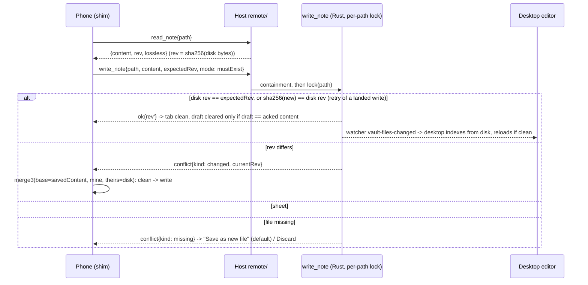

# Kokobrain iOS: architecture proposal

Status: proposal, owner questions answered (section 8), 2026-11-02, repo at `main` 2a937e57. Read-only study: nothing was compiled, run, or tested on a device.
Inputs: owner scope [`research/scout-00-owner-scope.md`](research/scout-00-owner-scope.md) (authoritative); scouts in [`research/`](research/); designs [A remote](research/design-A-remote.md), [B local](research/design-B-local.md), [C mobile UI](research/design-C-mobile-ui.md), [D core seams](research/design-D-core-seams.md); the draft [`research/synthesis-draft.md`](research/synthesis-draft.md); and three reviews of it: [facts](research/review-facts.md), [sequencing](research/review-sequencing.md), [data safety](research/review-data-safety.md). Section 9 records the disposition of every review finding.
Citations: `path:line` for code; URLs for external claims; UNVERIFIED = not checked against code, a primary source, or a device. Claims that the designs took from scouts 06, 09, 11, 13 and 15 are UNVERIFIED: those files are not in `research/` (facts F7).
Sizes: S <= 2 days, M 3-7 days, L 1-3 weeks of solo work. Every size is an estimate.

## Phase 1 minimum (owner decision, 2026-11-02; supersedes the order of section 5)

The owner wants to test in the browser as fast as possible and decide from real use what comes next; a browser version may be enough for now. Only these Issues are filed and in scope ([`issues/`](issues/)):

| # | Issue | Blocked by | Owner sees |
|---|---|---|---|
| 01 | Mac serves the app | none | Mac Safari loads the app (not connected) |
| 02 | Browser shows the vault tree | 01 | the real tree in Mac Safari; desktop unaffected |
| 03 | Paths stay inside the vault | 02 | nothing outside the vault is reachable (tests) |
| 04 | Reach it from iPad and iPhone over the tailnet | 03 | the app on the iPad/iPhone through `tailscale serve`, owner login only |
| 05 | Open and read a note | 02 | notes with live preview, links, rail shell, lenses |
| 06 | Images and embeds load | 03, 05 | images, PDF, audio, video in notes |
| 07 | Mac changes show up in the browser | 05 | Mac edits appear without reload |
| 08 | Edit and save from the browser | 03, 07 | edit on the iPad, saved on the Mac; stale saves refused, text kept |

**Branch:** this is a proof of concept. All phase 1 work lands on the long-lived branch `feature/ios-poc`, never on `main`. On that branch `.agent-relay-lite/config.json` sets `"base": "feature/ios-poc"`, so relay-lite squashes and pushes there; run `/relay-lite:run ios-app NN` from the `feature/ios-poc` worktree (`.claude/worktrees/ios-poc`), not from the main checkout. If the branch is ever merged into `main`, restore `"base": "main"` first. The Issue files live on `main` (plan and tickets) and reach the branch by merging `main` into it; the relay ledger and the Issue status lines that relay updates live on the branch only. Never run `/relay-lite:run ios-app` from the main checkout: its config still says `base: main`. Before the first run: push the branch (`git push -u origin feature/ios-poc`; `relay check run` fetches it), start from a clean worktree, and create the ledger with `/relay-lite:ledger ios-app` there. Pushes to the branch trigger no CI (the workflows cover `main`), so the relay gate (`cargo test` regenerates the ts-rs bindings) is the only check. Each Issue keeps its device and Safari checks under "Owner check", outside the acceptance criteria, because AFK agents cannot run them.

Simplifications against section 5, accepted for phase 1: no pairing token (Tailscale identity header is the auth); no seq/resume (reconnect = full refresh); no checked desktop write (do not edit the same note on both devices at once); no on-device drafts; the desktop shell as is (iPad usable, iPhone cramped). Everything else in section 5 (fix track, M0 spike, touch UI, M4, M5-M10) is deferred and not filed; it is picked from real use after 08 (list in [`research/next-phases.md`](research/next-phases.md)).

## 0. What changed from the draft

| Change | Driver |
|---|---|
| Prior iOS branches were found (facts F1), then deleted by the owner as too old; M10a is new work, their lessons kept as notes (section 2) | facts F1, F8; owner 2026-11-02 |
| The runtime ports milestone (old M1, ~40 file edits) is replaced by one hand-written `__TAURI_INTERNALS__` shim for the browser client | sequencing F1 |
| Containment lives in the remote dispatcher. Desktop write safety moves from "before the host" to "right before phone editing" | sequencing F2, data safety M9 |
| The write check is still atomic in Rust (not a TS read-then-write), but simpler: bytes revision, idempotent by content, no opId ring, single-flight per tab, plus a host read-set check that covers every remote blind writer | sequencing F3 (partly), data safety B1, M2, M3, M4 |
| Host security: event allowlist (no clipboard leak), full Virtual list, asset inline allowlist, directory and dot-dir denies, fail-closed Tailscale route, session lifecycle | data safety B3, M7, M8, M10, M14; sequencing F6 |
| The host builds its own small CSP; the M0 bundle spike runs on a release build | facts F3, F4 |
| A desktop fix track starts now (hybrid search, image gaps, queryjs, reload race, task toggle over a dirty tab, atomic create) | sequencing F11, data safety M1, B2, m1 |
| Offline (now M10) is split a/b/c, with explicit-delete journal, mass-delete breaker, case-folding and Trash on host DELETE | sequencing F12, data safety B4, M13 |
| iPad read moves from ~6 weeks to ~2.5-3.5 weeks; phone editing from ~9.5 to ~5.5-8.5 weeks (estimates) | sequencing §2, adjusted for the safety work added |

## 1. Executive summary and recommendation

**Recommendation: a sequenced hybrid. Phase 1 = model A (remote web app against the Mac). Phase 2 = model B (Tauri iOS app with a local replica synced through the same Mac host). One Mac host serves both.**

- **Phase 1 (M0-M9), model A:** the Mac app runs an opt-in, loopback-only HTTP+WebSocket server, published on the tailnet by `tailscale serve`. The iPhone/iPad opens the **desktop's own embedded SvelteKit bundle** in Safari as a home-screen web app. A browser-only shim stands in for `window.__TAURI_INTERNALS__` and forwards Tauri commands and plugin-fs calls over WebSocket. No Xcode, no Apple account, no iOS Rust build. Semantic search keeps working because BGE-M3 stays on the Mac.
- **Phase 2 (M10), model B:** a Tauri 2 iOS app (new bring-up in M10a) with the Rust core on device and a vault replica in the app container, synced file by file with the Mac host over the same route. Offline arrives here.
- **Built once, used by both phases:** the checked note write in Rust (bytes revision, per-path lock); host containment; pairing and sessions; the mobile UI (design C); the conflict sheet with 3-way merge.
- **Rust stays.** The host reuses `commands::*` in-process; a TS host would re-implement `VaultIndex`, FTS and semantic search for no gain in phase 1, and phase 2 runs the same Rust core on iOS (an older version compiled clean for the simulator in June 2026, section 2). Owner scope "Rust is not sacred": the gain is marginal here, so the default holds.
- **Storage stays.** Markdown files remain the source of truth. In phase 2 each device keeps its own local `.kokobrain/kokobrain.db`, so SQLite's single-host WAL rule holds (https://www.sqlite.org/wal.html). File-level sync with a 3-way merge is enough for a single-user, two-device vault; a CRDT store is not needed for v1 (owner scope "Storage engine is open (later, not v1)").

| Owner fact (`scout-00`) | Consequence |
|---|---|
| Reaches t3code from the phone over Tailscale | Model A copies a workflow already in use: one host, a one-time pairing token, Serve as the route ([scout-14](research/scout-14-ext-t3code-architecture.md) §1, §13). If the owner's t3code route is Serve on :443, HTTPS is already on and Kokobrain takes another port (Q4) |
| Priorities: view, edit, interact, rail shell; offline later | A delivers 1-4 without the sync engine, the riskiest part of B |
| Semantic search may be dropped | Not dropped in phase 1 (host runs `search_hybrid`); gated off in phase 2 |
| Solo developer, desktop must stay green | Each milestone is shippable on its own; the host is off by default; desktop behaviour changes are named per milestone |
| "An edit must never be silently dropped", even before offline | Checked writes (M4) land before any phone write (M5). Drafts persist synchronously on the device |
| Vault is on a MacBook | Phase 1 is unavailable when the lid is closed. This is the main daily limit, and the reason B follows A |

**Why not B first.** B0 (iOS compile and boot) was shown feasible in June 2026 on an older codebase (section 2), so the compile risk is moderate. The first useful B milestone is still the real vault on the phone, which needs the Mac sync server and the pull half of the sync engine (design B §12: L). The touch UI is identical in both models, and A ships it weeks earlier against the real vault with no sync risk.

**Why not A only.** Offline is required. Design A's offline step A6 caches the file tree, the entries snapshot and recently opened notes, so browsing and entries-derived lists work offline ([design A](research/design-A-remote.md):380). It cannot read note bodies that were never cached, and it has no FTS offline. It would also be a native app built and then replaced by B. B's replica runs the full index on device.

## 2. Prior art in this repo

**Deleted on 2026-11-02 at the owner's request** (the app changed too much since). Nothing is ported from them: M10a is new work, and the lessons below are kept only as notes to check again against today's code. Tip SHAs, recoverable only while the objects survive (local reflog, GitHub's unreferenced-commit retention): `ios-ipados-port` c2d12abd, `claude/ios-ipad-minimal-support-77g6tz` 55fef107, `claude/tauri-ios-ipad-compat-48qp3f` 6c9a6508.

| Branch (deleted) | Date, size | What it showed then | Use now |
|---|---|---|---|
| `ios-ipados-port` (local) | 2026-06-09, 15 commits, 1933 behind main | `cargo check --target aarch64-apple-ios-sim` clean; app compiled and launched on an iPad Pro 11" simulator (iOS 26.2) (`git show ios-ipados-port:tasks/todo/ios-ipados-port-ipad-first.md`, P0.9). Records: pre-gating build dies at `ort-sys` download (P0.1); `tauri ios init` writes a broken `node tauri` preBuildScript, fixed in `gen/apple/project.yml` (Notes); 610 MB debug `libapp.a`; `tauri-plugin-dialog` cannot pick a folder on iOS (P1.1); updater/process compile on iOS as no-op stubs (P0.8). Locked decision 2: "iCloud Drive folder via `UIDocumentPicker` + security-scoped bookmark (same vault the Mac opens)" | Note only: expect the `ort-sys` failure and the preBuildScript bug in M10a. The iCloud decision is void (Q3: local vault) |
| `origin/claude/ios-ipad-minimal-support-77g6tz` | 2026-09-13, 11 commits, 1334 behind main, 54 files | Cargo features `semantic` and `desktop-integration`, forced off for iOS/Android in `build.rs`, crates in a `cfg(not(any(ios, android)))` target table; `capabilities/desktop.json` platform-scoped; `scripts/check-mobile-profile.sh` in the CI Rust job (checks the iOS profile without an Apple SDK); `docs/IOS.md`; UA + `maxTouchPoints` detection (`src/lib/core/platform/platform.logic.ts`); a touch shell in `AppShell.svelte`; `e2e/specs/mobile-shell.spec.ts`; fixed vault at `Documents/kokobrain-vaults/Notes` | Note only: the same shape (feature flags forced off in `build.rs`, a CI profile check) is designed fresh in M10a |
| `origin/claude/tauri-ios-ipad-compat-48qp3f` | 2026-06-09, 1 commit | Plan only | None |

`src-tauri/gen/apple` on disk holds empty folders left by the June branch; M10a regenerates it with `tauri ios init`. It is not git-ignored (`src-tauri/.gitignore` ignores `/target/` and `/gen/schemas` only; facts F8).

## 3. Comparison

| Criterion | A only (remote web app, later A6) | B only (Tauri iOS + sync) | **Hybrid: A then B (recommended)** |
|---|---|---|---|
| Time to iPad read | ~2.5-3.5 wk | ~6-9 wk (M10a bring-up + sync pull + UI) | ~2.5-3.5 wk |
| Time to owner priorities 1-4 | ~8-12.5 wk | ~10-14 wk; sync on the critical path | ~8-12.5 wk |
| Time to offline | +L for A6 (partial) | included | +4.5-7.5 wk (M10a-c), reusing M4 and the M1 host |
| Mac asleep or lid closed | No new reads; edits stay as device drafts | Full use, sync later | Like A until M10, like B after |
| Two writers diverge | Low: one copy of each file, every write checked by the host | Medium: base hash, 3-way merge, conflict copies | Low until M10 |
| Data-loss exposure | Desktop blind writers until M4; device storage eviction and the Safari-tab vs home-screen split (section 4.4) | Same desktop writers, plus sync deletes and case collisions (M10 guards) | Desktop writers closed in M4 before phone writes; eviction bounded by M10 |
| Feature coverage | Everything the host runs, incl. semantic search and file history | No semantic search on device | Phase 1 has everything; phase 2 local has no semantic search, optional through the host |
| Apple account | None until A6 | Free (7-day reinstall) or paid for TestFlight | None until M10 |
| iOS Rust build | Never | Required (gating designed in M10a) | Deferred to M10a |
| Owner setup | Tailscale HTTPS (CT logs, https://tailscale.com/kb/1153/enabling-https), one pairing, Mac app running | The same plus an Xcode or TestFlight install | The same as A, plus an install at M10 |

## 4. Target architecture

### 4.1 Topology (end state after M10)

```
 iPhone / iPad                                          MacBook (host; owns the vault)
 +----------------------------------------+             +--------------------------------------------------+
 | Phase 1: Safari home-screen web app     |  https/wss  | tailscaled: tailscale serve --bg --https=<P>      |
 |   desktop's embedded bundle (same build)|<--tailnet-->|   -> http://127.0.0.1:<port>   (P not a Funnel port)|
 |   hooks.client: ipc-shim when !isTauri  |             | Kokobrain.app (Tauri, macOS)                      |
 |   shim: invoke/listen/convertFileSrc    |             |  webview: desktop UI, unchanged                   |
 |     -> WS JSON-RPC, /v1/asset/<rel>     |             |  remote/ (axum, 127.0.0.1, off by default)        |
 |   drafts in localStorage (sync write)   |             |   /.well-known  /v1/auth/*  /ws  /v1/asset/*       |
 +----------------------------------------+             |   /v1/sync/* (M10)  /* bundle via asset_resolver  |
 +----------------------------------------+             |   policy: Read | Write | Virtual | Denied         |
 | Phase 2 (M10): Tauri iOS app            |             |   containment + read-set check + event allowlist  |
 |   same bundle, real Tauri runtime       |             |  commands::* -> core (vault/db/search, Tauri-free) |
 |   Rust core on device, local .kokobrain |             |  write_note (bytes rev, per-path lock): desktop   |
 |   sync client (Rust, Keychain bearer) --|--tailnet--> |    editor save, phone save, sync PUT, task toggle |
 +----------------------------------------+             |  <vault>/ + .kokobrain/kokobrain.db (WAL, local)  |
                                                        +--------------------------------------------------+
```



### 4.2 Decisions

| # | Topic | Decision and reason |
|---|---|---|
| D1 | How the browser client replaces Tauri | **A hand-written `__TAURI_INTERNALS__` shim, installed only when `!isTauri()`.** Every `@tauri-apps/*` JS call goes through `window.__TAURI_INTERNALS__` (`node_modules/@tauri-apps/api/core.js:340-342` `invoke`; `isTauri()` reads `globalThis.isTauri`, `:491-494`). One file replaces ~40 call-site edits and keeps one bundle. It cannot reuse `mockIPC` from `@tauri-apps/api/mocks`: its `invoke(cmd, args, _options)` drops `options` (`mocks.js:127-132`), and `writeTextFile` sends the path in `options.headers` with a byte body (`plugin-fs/dist-js/index.js:777-788`). Cost: coupling to an internal object at pinned versions (api 2.12.4, plugin-fs 2.7.1); guarded by a vitest suite and one E2E spec, re-checked on every `@tauri-apps/*` bump. **Fallback** if M0 S2 fails or the owner rejects the coupling (Q6): design A's Vite alias build (`vite.config.js:48-58`, the E2E mechanism). Tauri iOS (M10) has the real runtime and needs neither |
| D2 | Where client code lives | `src/lib/app/remote/` (the composition root may import every layer, `scripts/import-graph.mjs:34-44`). A new top-level folder would escape every layer rule, since `ruleFor` has rules only for named layers (`:140-171`; facts F17) |
| D3 | Desktop vs web vs iOS | Phase 1: runtime `isTauri()`. Form factor by width and `pointer: coarse` (design C §3.3). iOS kind decided in M10a |
| D4 | When desktop gets the write check | **M4, before any phone write (M5), after read-only access ships.** Read-only needs no desktop change (sequencing F2). Phone editing without M4 lets a dirty desktop tab overwrite a phone edit (`editor.service.ts:375-380` skips dirty tabs; `:168` writes blindly) |
| D5 | Revision token | **SHA-256 of the disk bytes, computed only in Rust** (`sha2` is a dependency, `Cargo.toml:53`). plugin-fs decodes with `TextDecoder`, which strips a BOM and replaces invalid UTF-8 (`plugin-fs/dist-js/index.js:498`), so a client hash of the decoded string would not match disk (data safety M3) |
| D6 | Atomic check vs TS precheck | **Atomic in Rust.** Sequencing F3's TS "read, compare, write" leaves a window of about one RTT on the phone in which another client's write is overwritten silently. The owner rule forbids silent loss and the data is at risk, so the race is handled. Its simplifications are taken: content idempotency replaces the opId ring |
| D7 | Conflict resolution | **3-way merge first, then the sheet, from M4.** Base = the tab's `savedContent`, mine = buffer, theirs = disk. Drafts held while the Mac is unreachable make conflicts common (data safety M12), so merge cannot wait for M10. Rust `diffy` (https://github.com/bmwill/diffy, 3-way `merge`; new crate) is reused by M10 sync |
| D8 | Path identity | Absolute host paths in DTOs (CLAUDE.md "Absolute paths everywhere"); vault-relative NFC for durable identity (drafts, sync state); casefolded NFC for collision checks (M10, data safety M13) |
| D9 | Host dispatch | Call `commands::*` with `app.state()` in-process. `EventSink`, the `api/` move and a crate split wait for M10 or M11. Rust events reach the hub through `listen_any` (tauri-v2.12.5 `crates/tauri/src/lib.rs:938`) |
| D10 | Command policy | **One Rust table** `const POLICY: &[(&str, Class)]` with classes Read, Write, Virtual, Denied. `ipc-parity.test.ts` (which already parses `generate_handler!`, `src/tests/lib/contracts/ipc-parity.test.ts:86,93`) asserts the POLICY names equal the handler names. No TS mirror until a client reads it (sequencing F9) |
| D11 | Who indexes a remote write | **The desktop watcher, from disk.** Remote `update_note_in_index`, `remove_note_from_index`, `update_search_index_file`, `update_semantic_file` and `remove_*` are Virtual; remote `save_snapshot` snapshots disk, not the client's content. One indexer, so the index cannot drift from disk through out-of-order client calls (data safety M6) |
| D12 | Device drafts | **Synchronous `localStorage`, one entry per dirty path**, not IndexedDB, whose async commit may not finish before iOS kills a page (UNVERIFIED; sequencing F19) |
| D13 | Semantic gate on iOS | `semantic` and `desktop-integration` default features, forced off for iOS in `build.rs`, checked by `check-mobile-profile.sh` in the existing CI job. Replaces the draft's D10 |

### 4.3 Write safety model (M4, used by M5, M7, M10)

| Element | Rule |
|---|---|
| `read_note {path}` | Returns `{content, rev, lossless}`. `rev` = SHA-256 of the bytes. `lossless=false` when the bytes are not valid UTF-8; a BOM is remembered and re-added on write. A `lossless=false` tab opens read-only with a banner (today such a file is silently rewritten with U+FFFD on the first save; desktop change, Q1) |
| `write_note {path, content, expectedRev, mode}` | `mode` = `mustExist` (editor save) or `createOnly`. Under the per-path lock: write when disk rev = `expectedRev`, or return ok when `sha256(new bytes)` = disk rev (retry of a write whose ack was lost). Else `conflict{kind: changed|missing|exists, currentRev}`. `createOnly` uses an exclusive create, not `write_atomic` (which is temp + `rename`, `src-tauri/src/utils/fs.rs:16-32`, and replaces the target) |
| Callers moved to it | Editor save (`editor.service.ts:161-178`) and its reads (open `:124`, reload `:387`); frontmatter writer (`frontmatter-write.service.ts:117,149`); link rewrite (`link-updater.service.ts:35,39`); Rust `toggle_task_status` (gains `expectedLineText`), `propagate_type_rename`, `create_note` take the same lock |
| Remaining desktop blind writers | `type-definitions`, `deep-link`, `file-icons`, `templates` and META files (data safety B1 list). Named in `src/tests/lib/raw-write-ratchet.test.ts`, which only shrinks. When the phone runs them, the host read-set check below covers them |
| Host read-set check (remote only) | Per session, the host records the bytes hash of every note it served (`plugin:fs\|read_text_file`, `read_note`). A remote `plugin:fs\|write_text_file` to an existing note is accepted only if the disk hash equals the served hash (or the new hash); a write with no prior read must target a missing file. A successful write updates the recorded hash |
| Client side | Single-flight per tab: one write in flight, later saves coalesce behind it. A conflict is a distinct save result that pauses autosave and the 5 s retry (`editor.service.ts:181-194`) for that tab until resolved |
| Sheet | Shows a diff (`compute_diff`). Keep mine (snapshot theirs first), keep theirs (snapshot mine first, hard requirement), keep both (default; unique suffix, sanitized device name, `createOnly`). A merge3 result is snapshotted (base, ours, theirs) and refused if frontmatter no longer parses |

### 4.4 Host security model (M1, M2)

| Layer | Rule |
|---|---|
| Bind and route | `127.0.0.1` only. `tailscale serve --bg --https=<P>` on a port Funnel cannot use (Funnel listens only on 443, 8443, 10000: https://tailscale.com/kb/1223/funnel; whether Serve accepts other ports is UNVERIFIED, M0 S1). `--bg` persists until turned off (https://tailscale.com/kb/1242/tailscale-serve), so Settings shows the exact `off` command and `serve status` |
| Request checks | Exact Host allowlist; exact Origin (scheme, host, port) on `/ws`, POSTs and `/v1/asset`. On the tailnet Host, `Tailscale-User-Login` must equal the login stored at pairing; a missing header is denied, which also rejects Funnel traffic (https://tailscale.com/kb/1312/serve) |
| Pairing and sessions | Token hashed (SHA-256), 5 min TTL, single use, atomic consume (t3code `PairingGrantStore.ts:549-561`, minus its plaintext column); a grant closes after 5 failures (per-IP limits mean nothing behind Serve). Cookie `__Host-kb_session; HttpOnly; Secure; SameSite=Strict`, sliding 90-day expiry, server-side `expiresAt` and `lastSeen`. Revoke closes live sockets and asset streams. `remote.json` mode 0600 in the app config dir, never in the vault |
| One host per vault | Advisory `flock` on `.kokobrain/host.lock`; the server refuses to start if another process (a dev build) holds it |
| Containment | Every path-like argument is canonicalized and must sit inside the open vault root. Write, create, remove and rename are denied on the root itself and on `.kokobrain/` and `.git/` (directories, not only children); comparison is on NFC and case-folded paths (whether macOS `canonicalize` returns on-disk case is UNVERIFIED). Dot-dir reads are denied except an allowlist of `.kokobrain/*.json` the client needs. No vault open: every path command is denied. The remote server never runs with containment in log-only mode |
| Policy | Read / Write / Virtual / Denied per command (D10). Virtual (no shared-state effect, design A §3.4 plus sequencing F6): `open_vault_db`, `close_vault_db`, `shutdown_semantic`, watcher start/stop, `save_vault_cache`, `cleanup_history`, `scan_vault_v2_cached` (returns cache stats, index version unchanged), `build_search_index`, the index updaters of D11, and settings writes |
| Events | Explicit allowlist: `vault-index-updated`, `vault-files-changed`, `semantic-index-progress`, plus remote-only events. Never `qc:*` (it carries the Mac clipboard text, frontmost app and URL, `src-tauri/src/quick_capture/commands.rs:157-228`), `tauri-debug-log` or `menu:*` (`src/lib/contracts/events.ts:14-17`). A parity test fails on an unclassified `EventMap` name. Frames carry `seq` and the host `instanceId`; resume only when both match |
| Assets | `/v1/asset/<rel>` inline only for images (not SVG), audio, video and PDF. Everything else, `.html`/`.svg` included, gets `Content-Security-Policy: sandbox` and `Content-Disposition: attachment`; `nosniff`; never sniffed up to `text/html`. On desktop, assets come from the separate `asset:` origin, so this guards a new same-origin risk |
| Bundle CSP | Built by the host, not forwarded: Tauri's `csp_header` hashes every bundled JS file (273 files, ~15.1 KB, 93% of WebKit's 16 KiB header limit; tauri-v2.12.5 `crates/tauri/src/manager/mod.rs:53-103`; tauri#16442). Host CSP: `script-src 'self' 'unsafe-eval' 'sha256-<inline bootstrap>'`, `connect-src 'self' wss://<host>` |
| Secrets | Settings returned to a remote session redact `todoist.apiToken` (`settings.types.ts:220-221`); remote settings writes are Virtual in phase 1, so a redacted copy never overwrites the Mac's token |
| queryjs | `autoRunQueries` defaults to `manual` on the remote kind (vault JS can call every Write method) |

### 4.5 Module layout (new or changed)

```
src/hooks.client.ts                installs the shim when !isTauri() (entry order UNVERIFIED, M0 S2)
src/lib/app/remote/
  ipc-shim.ts                      __TAURI_INTERNALS__: invoke, transformCallback, convertFileSrc, metadata
  transport.ts connection.svelte.ts  WS JSON-RPC, supervisor (backoff, ping, resync)
  drafts.ts save-state.svelte.ts   localStorage drafts, save pill
src/lib/app/phone/                 PhoneShell, PhoneTabBar, phone-nav.logic.ts (+ store)
src/lib/core/conflict/             conflict store, ConflictSheet
src/lib/core/platform/capabilities.ts  lands with its first consumer (M3)
src/lib/features/rail-shell/       rail-shell-state.svelte.ts, rail-items.logic.ts
src/lib/core/markdown-editor/format/   markdown-format.logic.ts, KeyboardToolbar.svelte
src-tauri/src/commands/notes.rs    read_note, write_note, merge_text (Tauri glue)
src-tauri/src/vault/checked_write.rs   lock map, rev, exclusive create, BOM handling (Tauri-free)
src-tauri/src/remote/              server, config, auth, ws, dispatch, policy, scope, hub, assets, static, fs
src-tauri/src/sync/ (M10)          manifest, plan, journal, base store (Tauri-free, added to CORE_DIRS)
e2e/specs/mobile/*                 webkit-iphone / webkit-ipad projects
```

`api/` is not created: Tauri-dependent pieces (`TauriSink`, command wrappers) stay in `commands/` or `lib.rs`, so `core_tauri_free_test.rs` (`src-tauri/tests/core_tauri_free_test.rs:9,24`) keeps passing (facts F12).

## 5. Incremental plan

Rules for every milestone:
- Each task is one `.scratch/ios-app/issues/NN-*.md` Issue and one commit, test-first (CLAUDE.md rules 6, 10, 11).
- Gates: **F** = `pnpm check` + `pnpm vitest run` + `pnpm build`; **R** = `cargo test`; **B** = both (every IPC DTO or command change).
- "Desktop change" is stated per milestone. The chromium E2E suite stays green throughout.
- New crates (axum, tower-http, diffy) go through `cargo audit` and the cargo Dependabot cooldown (ADR-0014 covers npm; cargo cooldown per `docs/adr/0014-supply-chain-pnpm-quarantine.md:76`). A JS QR library would go through the pnpm quarantine, so QR is deferred.

### Fix track (desktop bugs, parallel, can start today)

Independent `fix:` Issues, failing test first. None is on the iOS critical path; each shortens a later milestone.

| # | Fix | Evidence | Gate |
|---|---|---|---|
| X1 | `search_hybrid` returns FTS hits when the embedder is absent | FTS at `src-tauri/src/commands/semantic.rs:946`, `ensure_embedder_loaded()?` at `:952` | R |
| X2 | Image gap G1: relative `` | `widgets.ts:143-150` ([scout-07](research/scout-07-frontend-assets-images.md) §3) | F |
| X3 | Image gap G3: binary `![[x.pdf]]` read as text | scout-07 §3 | F |
| X4 | Image gap G4: raw `<video>` src | scout-07 §3 | F |
| X5 | queryjs Prev/Next `mousedown` guard | `kb-ui.ts:499-533`; Run/Retry have it at `queryjs-block-widget.ts:159,250` | F |
| X6 | Reload race: after the await, re-check `isTabDirty` and that `content` is unchanged before `syncExternalContentToEditor` | `editor.service.ts:380` checks before the read, `:398-401` overwrite after it | F |
| X7 | Task toggle over a dirty tab: apply into the buffer, never `markSaved=true` over a dirty tab; audit the same pattern elsewhere | `tasks.service.ts:114`; `type-definitions.service.ts:220`, `deep-link.service.ts:262,281,298`, `deep-link-actions.ts:63` (data safety B2) | F |
| X8 | Atomic `create_note`: exclusive create instead of check-then-rename | `commands/vault.rs:896-899`, `utils/fs.rs:27-28` | R |
| X9 | fsync the temp file before rename in `write_atomic` (owner accepted, Q1) | `utils/fs.rs:16-32` (data safety m2) | R |

### M0: Owner facts and runtime spike (throwaway worktree, not merged)

| Check | How | Passes when | If it fails |
|---|---|---|---|
| S0 Owner facts | Ask: iPhone iOS version; which t3code route is in use; where the vault lives (Q3, Q4, Q5) | answers recorded | n/a |
| S1 Route | axum echo on `127.0.0.1`; `tailscale serve --bg --https=<P>` with P outside 443/8443/10000; cookie set by POST; WS upgrade without query string; check `Tailscale-User-Login` is present | 5 min round trips with the phone locked and unlocked; header present | Tailscale iOS bug on iOS 27 (tailscale#21387: tunnel unusable ~5-7 pings after connect; open; https://github.com/tailscale/tailscale/issues/21387) hits A and B's sync alike. Fallback: LAN direct with a `tailscale cert` or self-managed cert on the tailnet IP |
| S2 Bundle + shim | Release-type build (`pnpm tauri:build:fast`; under `tauri dev` the resolver reads `build/` from disk with no CSP, tauri-v2.12.5 `app.rs:343-370`). Serve `asset_resolver` bytes with the host CSP; minimal shim in `hooks.client.ts` answering a fake vault | the app reaches the vault tree in iPad Safari; CSP header length logged; the shim is installed before the first `invoke` | D1 fallback: alias build |
| S3 Images | `/v1/asset/<rel>` with the cookie, `` and `<video>` | both render | fetch + `URL.createObjectURL` |
| S4 Keyboard | plain CodeMirror page; `visualViewport` resize and `scrollMargins` | caret stays visible | reduced toolbar in M6; native keyboard plugin only in M10 |
| S5 Home-screen storage | add to home screen; cookie copied at creation (Safari 17.2+), `localStorage` survives app kill and a 3-day idle | both survive | re-pairing on expiry; warn while drafts exist |

Exit: findings appended to this file; owner go/no-go on the route and on D1. Size S (2-3 d). Needs the owner's devices.

### M1: Mac host on loopback (desktop change: new opt-in server, off by default)

Goal: the real vault browses and renders read-only in Safari on the Mac, through the same code path the phone will use.

| # | Task | Test | Gate |
|---|---|---|---|
| 1.1 | `remote/` skeleton: axum + tower-http in the desktop target table; bind `127.0.0.1`; Host and Origin allowlist; `/.well-known/kokobrain` (no vault path); `remote.json` 0600 in the app config dir; `host.lock` flock | bad Host -> 403; second process cannot start the server | R |
| 1.2 | Pairing, Rust half: hashed token, TTL, single use, grant closes after 5 failures; hashed sessions with `expiresAt`/`lastSeen`; `__Host-kb_session`; revoke closes sockets. Settings section shows the pairing URL as text (token in the fragment) | single use, expiry, failure cap, revoke closes a live socket, expired session rejected at upgrade | B |
| 1.3 | Static bundle through `asset_resolver` with the host-built CSP (4.4) | unknown path -> `index.html`; CSP header present and under 4 KiB | R |
| 1.4 | POLICY table (D10) and parity: extend `ipc-parity.test.ts` to compare POLICY names with `generate_handler!`; strip `#[...]` attributes before its lazy block regex (`:86`), which ends at the first `]` (facts F13) | parity fails on an unclassified command | B |
| 1.5 | `/ws` JSON-RPC 2.0: hello/welcome `{proto, serverVersion, instanceId, vaultRoot, indexVersion, seq, caps}`, ping/pong; Read class dispatched to `commands::*`; containment (4.4) in `remote/scope.rs` | outside path, `..`, symlink escape, symlinked root, root/`.kokobrain`/`.git` directory ops, dot-dir reads, no-vault-open denial, case variants | R |
| 1.6 | Virtual class (4.4 full list) | a recorded phone cold start (`initializeVault` + `teardownVault` sequence) leaves `db::is_open()` true, the desktop watcher in place and the index version unchanged | R |
| 1.7 | Event hub with the allowlist, `seq` + `instanceId`, ring ~2,000 for resume | `qc:capture-detected` is never forwarded; parity test classifies every `EventMap` name; replay inside the ring; epoch mismatch -> `resumed:false` | B |
| 1.8 | plugin-fs read subset (`read_text_file` returns bytes, `exists`, `read_dir`, `stat`) and `GET /v1/asset/*rel` with the inline allowlist (no Range yet), all through containment; the host records served hashes (4.3 read-set) | `.html` asset gets `CSP: sandbox` + attachment; `.kokobrain/**` denied | R |
| 1.9 | `app/remote/ipc-shim.ts` + transport, installed from `src/hooks.client.ts` when `!isTauri()`: device-local answers (dialog -> in-app AlertDialog, opener -> `window.open`, `plugin:window\|*` no-ops, clipboard -> `navigator.clipboard`), `convertFileSrc` -> `/v1/asset/<rel>`, `plugin:event\|listen` bound to the hub stream; id map, per-call timeout, reject pending calls on loss, never replay; `exists` rejects on transport errors, never resolves `false` | vitest with an in-process fake WS host: `readTextFile` round trip, `listen` receives an event, `writeTextFile` headers parsed; with `isTauri` true the shim is not installed | F |
| 1.10 | Remote lifecycle: auto-open `welcome.vaultRoot` (one vault); on resync `invalidateVaultEntries()` + refresh; `initializeVault` unchanged; settings read-only with the token redacted; queryjs `manual` default | integration test with a recording transport: boot, open, read | F |

Exit: Mac Safari, paired through the pairing URL, browses the real vault and reads notes with live preview and images, while the desktop session keeps working (1.6, 1.7 tests). If Safari will not keep a `Secure` cookie on `http://127.0.0.1` (UNVERIFIED), run the exit check through the Serve URL from the Mac. Size M-L (7-10 d).

Deviation from 1.1 and 4.5 (Issue 02, 2026-11-02): the host is not on axum + tower-http. `/ws` runs on the `std::net` loopback server from Issue 01 (`src-tauri/src/remote/server.rs`) with a hand-written RFC 6455 codec and SHA-1 (`src-tauri/src/remote/ws.rs`). Reason: no new crates (no `cargo audit` or cooldown round) while the host listens only on `127.0.0.1`. Limits: no WebSocket extensions or compression, one thread per connection and per call, Host and Origin checked by hand in `upgrade_response`. Issues 03 and 04 must not assume axum is in the tree. Decide at Issue 04 (first traffic from another device, pairing cookies): keep the std server, or move to axum and replace `ws.rs`.

### M2: iPad read over the tailnet (owner priority 1 on iPad; desktop change: Settings section)

| # | Task | Test | Gate |
|---|---|---|---|
| 2.1 | Tailscale route: require `Tailscale-User-Login` = paired login on the tailnet Host; Settings shows the `serve` and `serve off` commands and status | missing header -> 403; mismatched login -> 403 | B |
| 2.2 | Connection supervisor: equal-jitter backoff 1 s -> 5 min (t3code `supervisor.ts:42-43,141-144`); probe on `visibilitychange`/`pageshow`; ping every 15 s; per-event-name promise chain; resync on seq gap or epoch change | fake host: reconnect fires one resync; a dropped frame triggers resync | F |
| 2.3 | Web app manifest + `apple-touch-icon`; no service worker; reload once when `serverVersion` differs (flushes drafts first once M5 exists) | `pnpm build`; manual install check | F |
| 2.4 | `docs/REMOTE-ACCESS.md` (setup, CT-log note, revoke, `serve off`) + ADR-0035 "in-app remote host" | none (docs) | none |

Exit: on the owner's iPad home-screen app, browse the real vault and read notes with live preview and images, in the desktop shell. Size S-M (3-5 d). Cumulative ~2.5-3.5 weeks.

### M3: Touch shells, read-only (priorities 1 and 4 read, on iPhone; desktop change: none)

| # | Task | Test | Gate |
|---|---|---|---|
| 3.1 | Playwright `webkit-iphone` + `webkit-ipad` projects for `e2e/specs/mobile/*`; `playwright install webkit` in `e2e.yml` (today chromium only, `e2e/playwright.config.ts:19`, `.github/workflows/e2e.yml:39,43`) | projects run in CI | F |
| 3.2 | Capability table + form factor (first consumer); desktop whenever not touch (the desktop window can be 800 px, `tauri.conf.json:22`) | pure tests | F |
| 3.3 | Device-local layout in `localStorage` on the remote kind (the persistence-seam half of draft 3.10; remote settings writes are Virtual) | logic tests; desktop still writes layout to the vault | F |
| 3.4 | Getter tests first, then extract `createRailShellState` + `railItems` from `AppShell.svelte:101-156` and `Rail.svelte:40-53` | getter tests; chromium `rail-shell.spec.ts` unchanged | F |
| 3.5 | shadcn `Sheet` through the CLI (bits-ui Dialog, no new dependency) | `pnpm check` | F |
| 3.6 | `phone-nav.logic.ts` + store; `registerFileOpenListener` port in `editor.service.ts` (fires on the cached branch too, `:114-120`) | stack tests; listener test with the real editor store | F |
| 3.7 | `PhoneShell.svelte` (navigator -> list -> editor; back) + shell switch | `webkit-iphone`: open a note from a list, assert rendered text | F |
| 3.8 | `PhoneTabBar` minimal (Today, Files) | same spec | F |
| 3.9 | `viewport-fit=cover`, safe-area padding; no editor autofocus on the phone | spec: editor not focused after open | F |
| 3.10 | iPad: `pointer-coarse:` hit areas, drag regions hidden, right sidebar as a sheet below 1100 px, read-only `NoteInfoSheet` | `webkit-ipad` spec; chromium unchanged | F |

Exit: iPhone: Today/Files -> list -> read a note; iPad uses the touch-tuned desktop shell (design C §9.3 items 5, 6, 8). Size M-L (6-10 d). M4-M5 do not depend on M3; they can go first if the owner wants iPad editing before iPhone reading.

### M4: Checked note writes (desktop change: yes; needs Q1)

Goal: no note write overwrites a disk state its writer has not seen, on desktop and from the phone (4.3).

| # | Task | Test | Gate |
|---|---|---|---|
| 4.1 | `vault/checked_write.rs` + `read_note`: bytes rev, BOM kept, `lossless` flag | BOM and Latin-1 fixtures | B |
| 4.2 | `write_note` with `mustExist`/`createOnly`, per-path lock, content idempotency, exclusive create (shares X8's helper); E2E `HANDLERS` gains both commands over the virtual FS (`e2e/mocks/tauri-core.ts:9,412`) | stale rev -> conflict, no write; missing -> `missing`; retry after a landed write -> ok; two threads serialize | B |
| 4.3 | `toggle_task_status` takes `expectedLineText` and the lock; `propagate_type_rename` and `create_note` take the lock | mismatched line -> conflict; no write | B |
| 4.4 | Editor save, open and reload through `read_note`/`write_note`; tab stores `baseRev`; single-flight per tab; `lossless=false` tabs read-only | service tests with the real editor store and a fake `call` returning each conflict kind | F |
| 4.5 | Frontmatter writer and link rewrite through the same commands | service tests | F |
| 4.6 | Conflict is a distinct save result that pauses autosave and retry for the tab | the 5 s retry does not re-fire while a conflict is open | F |
| 4.7 | `merge_text` (diffy) before the sheet; snapshot base/ours/theirs; frontmatter-parse guard | table-driven merges; broken frontmatter -> conflict | B |
| 4.8 | Conflict sheet (diff, mine/theirs/both, missing-file "Save as new file") | component test; E2E: dirty tab + external write + save -> merged or sheet; keep both -> two files | F |
| 4.9 | Host read-set check for remote `plugin:fs\|write_text_file` (4.3) | write after a stale read -> conflict; write with no read to an existing note -> denied | R |
| 4.10 | `raw-write-ratchet.test.ts` lists the remaining desktop blind note writers | ratchet fails on a new one | F |
| 4.11 | Rewrite the "editor always wins" comment (`editor.service.ts:368-374`); ADR-0036 "checked note writes" | none (docs) | none |

Exit: E2E proves an external change to a dirty tab is merged or shown, never overwritten; a lost ack does not conflict; a BOM file round-trips byte-identical. The milestone exit lists the covered writers by name. Size M (6-9 d).

### M5: Edit from the phone (owner priority 2; desktop change: none)

| # | Task | Test | Gate |
|---|---|---|---|
| 5.1 | Write class: `read_note`, `write_note`, `plugin:fs\|write_text_file` (read-set checked), `mkdir`; remote `save_snapshot` snapshots disk | Rust policy tests | R |
| 5.2 | Drafts (D12): key `(instanceId, vaultRoot, rel)`, throttled ~300 ms and on `visibilitychange: hidden`/`pagehide`, cleared only when the draft equals the acked content, never auto-discarded; a vault change lists drafts instead of applying them. Editing only in `display-mode: standalone`; a Safari tab is read-only with an "Add to Home Screen" banner (home-screen apps have separate storage, https://developer.apple.com/videos/play/wwdc2023/10120/) | vitest: kill between draft and save restores a dirty tab; ack of an older save keeps a newer draft | F |
| 5.3 | Save pill: saved / saving / not saved (Mac unreachable) / conflict, driven by acks | store tests | F |
| 5.4 | Flush on `visibilitychange: hidden` and `pagehide`: drafts, `saveAllDirtyTabs`, `flushSettingsPersistence` (the desktop close path, `tauri-listeners.service.ts:50-82`) | fake visibility event | F |

Exit: type on the iPhone, kill the app, reopen: the text is there (saved or as a draft) and reaches the Mac once reachable; an edit made on both sides merges or shows the sheet. Size M (4-6 d). Cumulative ~5.5-8.5 weeks.

### M6: Editing comfort (desktop change: none)

| # | Task | Test | Gate |
|---|---|---|---|
| 6.1 | `markdown-format.logic.ts` (inline marks, heading cycle, line prefixes, wikilink insert). No desktop Mod-B: Cmd+B is Toggle Right Sidebar (`src/lib/app/global-keybindings.ts:142-147`); desktop keymaps are a separate Issue only if the owner asks | logic tests with a real `EditorState` | F |
| 6.2 | `KeyboardToolbar.svelte`, keyboard inset from `visualViewport`, `scrollMargins` compartment (shape from M0 S4) | `webkit-iphone`: caret line above the toolbar | F |
| 6.3 | Touch drag guard: arm `mouseSelecting` on `touchstart`, release on `touchend`/`touchcancel` (`mouse-selecting.ts:40-56` arms on `mousedown` only) | `checkUpdateAction` skips while armed | F |
| 6.4 | 16 px inputs under `pointer-coarse` (iOS zooms smaller inputs, [scout-10](research/scout-10-editor-touch.md) T4) | CSS only: `Test-Exempt` | F |

Size S-M (3-5 d).

### M7: Interact with notes (owner priority 3; desktop change: long-press fix)

| # | Task | Test | Gate |
|---|---|---|---|
| 7.1 | Write class: `toggle_task_status` (with `expectedLineText`), `create_note`, `create_folder`, `rename_note`, `propagate_type_rename` | policy test | R |
| 7.2 | Long press acts on the pressed row: bits-ui opens on a 700 ms non-mouse `pointerdown` (`node_modules/bits-ui/dist/bits/menu/menu.svelte.js:1552-1557`) while the target is set only in `oncontextmenu` (`NoteRow.svelte:64`); shared `longPressTarget` + `-webkit-touch-callout: none` | failing `mobile/row-actions.spec.ts` first | F |
| 7.3 | Tap opens links on touch: pure `isOpenLinkGesture` (`click-handler.ts:16-17` needs Cmd/Ctrl) | logic test + `mobile/touch-links.spec.ts` | F |
| 7.4 | `@media (hover: none)` + 44 px hit areas: task checkbox (`styles.ts:169`), code copy (`:277`), table `+` (`:341`), callout chevron (line to be located; facts F25) | CSS only: `Test-Exempt` | F |
| 7.5 | Copy-block-link and block embed in the note-info sheet on touch | spec | F |
| 7.6 | Editable `NoteInfoSheet`: properties, backlinks, outgoing, TOC | spec edits a property, asserts frontmatter in the fake | F |
| 7.7 | Asset Range 206/416 and ETag for video seeking | Range, 304 tests | R |

Exit: on the iPhone, follow a wikilink, toggle a task, edit a property, view callouts, tables, embeds, images and video. Size M (4-6 d).

### M8: Rail shell on touch (owner priority 4; "success" checkpoint)

| # | Task | Test | Gate |
|---|---|---|---|
| 8.1 | `PhoneTabBar` full: Today, Inbox, Types, Files, More + inbox badge (`Rail.svelte:27-32`) | `mobile/phone-shell.spec.ts` | F |
| 8.2 | Navigator screens and neighbourhood lenses (backlinks, outgoing, belongs-to, has-many, related-to) through `openNeighbourhood` | spec per lens: list contents rendered | F |
| 8.3 | Palette and quick switcher as top-anchored sheets (16 px `command-input.svelte:19`) | `mobile/sheets.spec.ts` | F |
| 8.4 | Row actions without META writes: rename, favorite, "Move to..." sheet replacing drag and drop | `mobile/row-actions.spec.ts` | F |
| 8.5 | Text search panel (`search_fts`); semantic and hybrid when the host reports them | spec with fake results | F |

Exit: owner priorities 1-4 on iPhone and iPad. Size M (5-8 d). Cumulative ~8-12.5 weeks.

### M9: Remaining features over remote (each its own Issue, by value)

1. **META gate first:** desktop writes of `.kokobrain/*.json` go through the checked write with re-read and retry; `emptyTrash` removes only the item dirs listed in a freshly read manifest (today `remove(itemsDir, {recursive:true})`, `trash.service.ts:205-210`); the host emits `vault-meta-changed` and the desktop reloads on it (the watcher drops dot-dirs, CLAUDE.md Indexing §5). Then trash, folder order, icons, auto-move config on the phone.
2. Tags, tasks view, templates, periodic notes, calendar navigator: mostly proxied commands plus a touch pass.
3. File history (`get_file_history`, `compute_diff`).
4. Settings on the phone: device-local keys vs shared keys (design C §12.3); shared writes un-virtualized only with a host-side merge that never writes the redacted token.
5. iPad-first: kanban, canvas (asset URL), event calendar, graph.
6. QR pairing and a device list UI.

Dropped from the draft: the idle-sleep power assertion (speculative, API name unverified).

### M10: Offline through a local replica (model B; Q2, Q3, Q7 answered)

**M10a: iOS bring-up** (new work, the old branches are deleted; Size M-L, 6-10 d)

| # | Task | Test | Gate |
|---|---|---|---|
| a.1 | Add `semantic` + `desktop-integration` Cargo features forced off for iOS in `build.rs`, mobile target tables, and a `scripts/check-mobile-profile.sh` in the CI Rust job; decide stubs vs frontend guards for semantic calls at port time (`note-change.service.ts:209-219,247-254` call them on every save) | `check-mobile-profile.sh` passes on ubuntu; desktop `cargo test` | R |
| a.2 | `lib.rs` `cfg(desktop)` split for menu, composer, shortcuts, updater/process (the latter compile on iOS but are dead there) | parity test (with the 1.4 regex fix) | B |
| a.3 | Platform-scoped `capabilities/desktop.json`; `TAURI_ENV_PLATFORM` in the before-build fingerprint (`scripts/tauri-before-build.sh:52-59` hashes files only) | an iOS build after a desktop build rebuilds the bundle | B |
| a.4 | `tauri ios init`, fix the generated `node tauri` preBuildScript in `gen/apple/project.yml` if it reappears, and commit `gen/apple/**`; `PrivacyInfo.xcprivacy` with `C617.1` at minimum, then audit the linked binary for other required-reason APIs (https://developer.apple.com/documentation/bundleresources/describing-use-of-required-reason-api) | simulator build | none (config) |
| a.5 | No `notify` on iOS (kqueue, one fd per watched file, [scout-04](research/scout-04-rust-crate-ios-compat.md)): foreground reconcile on `visibilitychange` | Rust test of the reconcile | R |
| a.6 | iOS kind in the capability table; vault fixed at `Documents/kokobrain-vaults/Notes` (Q3: local vault, no iCloud); install through TestFlight (Q7: paid account) | platform table test; device smoke | F |

Exit: the Tauri iOS app boots on the owner's device with a local sample vault: read, edit, FTS.

**M10b: sync core + pull-only** (Size L)

- `sync/` (Tauri-free, added to `CORE_DIRS`): manifest, `plan()`, base store, `Remote` trait. Local deletes come only from an explicit op journal (the app is the only writer on iOS, design B §6); an unexpected local absence means re-pull, never DELETE.
- Host `/v1/sync/{manifest,file,events}` on the M1 server: same pairing, containment, and `write_note` for PUT (`If-Match` = base rev). A manifest scan with any error or a missing root fails with 5xx, never an empty manifest.
- Mass-delete breaker on both sides: more than 10 files or 5% in one cycle halts sync and asks the user.
- Keys and collisions on `casefold(NFC(rel))` (iOS APFS is case-sensitive, macOS is not by default: https://developer.apple.com/library/archive/documentation/FileManagement/Conceptual/APFS_Guide/FAQ/FAQ.html); `*.tmp-*` files excluded from manifest and scan.
- Bearer token in the Keychain, this-device-only, kept in Rust and never returned to JS (attribute names UNVERIFIED). `EventSink` lands here for the sync change feed.
- Pull-only release (read-only replica) to watch the planner.
- Tests: empty local scan, missing host root, unreadable file on each side, each yielding zero deletes; roundtrip with real axum on `127.0.0.1` and two temp vaults.

**M10c: push + merge** (Size L)

- Push reusing `merge_text` (M4.7) and conflict copies; PUTs before DELETEs; a DELETE whose path casefolds to a path just PUT is aborted; case-only rename as its own op (host rename through a temp name); creates that collide case-insensitively are rejected on the phone.
- Host executes a sync DELETE as a move to Kokobrain Trash (needs the M9 META gate), not `remove`.
- Optional: semantic search through the host when reachable.

Exit: in airplane mode the iPhone browses, reads, searches (FTS) and edits; on reconnect edits reach the Mac; concurrent edits merge or produce a conflict copy; no sync cycle can delete more than the breaker allows. Size +4.5-7.5 weeks for M10a-c. After M10, decide whether phase 1 stays as a zero-install fallback (Q2).

### M11 (optional): headless `kokobrain serve`

Only if the owner wants the host on an always-on machine (the vault then lives there). Requires design D R3 (`api/` for all commands) and R5 (crate split with `default-members` so ts-rs exports still run). Size M-L.

### Effort roll-up (estimates)

| Milestone | Size | Cumulative |
|---|---|---|
| Fix track | S each, parallel | off the critical path |
| M0 spike | S (2-3 d) | ~0.5 wk |
| M1 host on loopback | M-L (7-10 d) | ~2-2.5 wk |
| M2 iPad read | S-M (3-5 d) | ~2.5-3.5 wk (**iPad read**) |
| M3 touch shells read | M-L (6-10 d) | ~3.5-5.5 wk |
| M4 checked writes | M (6-9 d) | ~5-7.5 wk |
| M5 phone edit | M (4-6 d) | ~5.5-8.5 wk (**phone edit**) |
| M6 comfort | S-M (3-5 d) | ~6-9.5 wk |
| M7 interact | M (4-6 d) | ~7-11 wk |
| M8 rail shell | M (5-8 d) | ~8-12.5 wk (**success**) |
| M9 features | S-M each | open |
| M10a-c offline | M-L + L + L | +4.5-7.5 wk |

Day ranges for M0-M8 sum to 40-62 days. Compared with the sequencing review's estimate (iPad read ~2-2.5 wk, phone editing ~6-7 wk), this plan adds about a week of host security (1.2, 1.5-1.8) and of write safety (4.3, 4.7, 4.9) that the data-safety review showed are needed.

## 6. Dropped or deferred on iOS

| Feature | Phase 1 (web app) | Phase 2 (Tauri iOS) | Why |
|---|---|---|---|
| Semantic / hybrid search, model download, index build | search works (host); maintenance UI hidden | dropped locally (FTS stays); optional through the host | models of 542 MB (`docs/adr/0019-kokobrain-in-vault-data-dir.md:11,36`) and 571 MB (`src-tauri/src/semantic/model.rs:40`), ~1.6 GB CPU peak (`semantic/mod.rs:27-31`); the owner allows the drop |
| Quick capture (global hotkey, composer, clipboard capture) | hidden; `qc:*` events never forwarded | `desktop-integration` off | global-shortcut excluded on iOS (`global-shortcut src/lib.rs:15`); arboard falls into its Linux backend on iOS (https://github.com/1Password/arboard/blob/v3.7.0/src/platform/mod.rs). Later: a share extension (not designed) |
| Updater, relaunch | hidden | off | they compile on iOS as no-op stubs (June P0.8) but have no use there; App Store hygiene |
| Native menu, `menu:settings` | n/a | `cfg(desktop)` | `tauri::menu` is `cfg(desktop)` (tauri-v2.12.5 `lib.rs:111-113`) |
| Reveal in Finder, open log folder | hidden ("Copy path" stays) | hidden | opener on mobile opens URLs only (https://v2.tauri.app/plugin/opener/) |
| Vault picker, recent vaults, switching | hidden; host vault auto-opened | fixed container vault (Q3: no iCloud) | one vault (owner); no folder picker in `tauri-plugin-dialog` on iOS (`dialog-v2.8.4 src/commands.rs:185-186`, June P1.1) |
| Zoom shortcuts | browser zoom | iPad with a keyboard | keyboard only |
| System font list | hidden | returns `[]` (`commands/fonts.rs:71-74`) | Mac fonts are not on the phone |
| Debug log to file | off | device-local | host logs stay on the Mac |
| Deep links `kokobrain://` | hidden | optional | no custom scheme for a web app |
| Todoist push | hidden; token redacted for remote | later, Keychain token | token is plaintext in `settings.json` (`settings.types.ts:220-221`) |
| Trash, folder reorder, icons, auto-move config | hidden until the M9 META gate | local, then synced | whole-file read-modify-write of shared `.kokobrain/*.json` ([scout-12](research/scout-12-settings-storage-vault.md) §2) |
| Drag and drop on iPhone | "Move to..." sheet | same | no DnD on phone |
| Canvas, graph, kanban, event calendar on iPhone | iPad first (M9); iPhone hidden or read-only (design C Q6) | same | DnD and small screens not reviewed |
| Editing in a Safari tab | read-only, "Add to Home Screen" banner | n/a | separate storage from the home-screen app; Safari tab storage limits (third-party summary, UNVERIFIED) |
| Offline shell after reload | none: a reload while the Mac is unreachable shows Safari's error page; drafts survive but are not visible until reconnect | full offline | no service worker in phase 1 (avoids stale-bundle skew); owner decides under Q2 |

## 7. Risks

| # | Risk | Milestone | Plan change if it fires |
|---|---|---|---|
| 1 | Tailscale on the owner's iOS version is unusable (tailscale#21387 on iOS 27, open) or `wss://` through Serve fails; this hits phase 1 and M10 sync alike. Downgraded by Q5: the owner runs iOS 27 and reaches t3code through Serve without the bug | M0 | LAN direct with a certificate on the tailnet IP or LAN; B does not help, because it syncs over the same route |
| 2 | A note writer not covered by the checked write overwrites an edit (desktop blind writers, reload race, dirty-tab toggle) | X6, X7, M4 | M5 does not ship before M4; the ratchet names every remaining writer; the host read-set check covers all phone writers |
| 3 | The shim does not boot the bundle in Safari (entry order, an internals field the shim does not provide) or the owner rejects the coupling | M0 S2 | D1 fallback: alias build (+1-2 d packaging) |
| 4 | Remote attack surface: same-origin HTML assets, clipboard leak, Funnel exposure, persistent `serve --bg` | M1, M2 | none (4.4 controls, each with a test); revisit if a control proves impossible (Serve port choice UNVERIFIED) |
| 5 | Cross-client lifecycle side effects: cold-start `teardownVault`, watcher replacement, settings rewrite, full rescans (`(app)/+layout.svelte:65-79`, `settings.service.ts:162-163`, `app-lifecycle.service.ts:313`) | M1 | none (Virtual class + parity test) |
| 6 | WebKit keyboard has no usable inset | M0, M6 | smaller toolbar; native plugin only in M10 |
| 7 | Device storage: eviction (https://webkit.org/blog/14403/updates-to-storage-policy/), Safari tab vs home-screen split | M5 | standalone-only editing; warn while drafts exist; M10 removes the risk |
| 8 | ~~Vault in iCloud Drive~~ Resolved by Q3: the vault is a local folder. Host reads must still surface I/O errors, never empty content | M1 | none |
| 9 | Sync bug deletes or clobbers notes | M10 | explicit-delete journal, breaker, case-folding, Trash on DELETE, pull-only phase first |
| 10 | iOS build breaks on current dependencies (the June 2026 result was on an older codebase) | M10a | `check-mobile-profile.sh` in CI from a.1 catches them on every Rust change |

## 8. Questions for the owner (only those that change the plan)

1. **Desktop write rule (M4).** May the desktop stop "editor always wins" (`editor.service.ts:368-374`)? A dirty tab then never overwrites a change made elsewhere: a clean 3-way merge applies silently, otherwise a sheet with "keep both" as default. Side effects: files that are not valid UTF-8 open read-only (today they are rewritten with U+FFFD), and a conflict pauses autosave for that tab. Also: fsync note writes (X9), at a small cost per save? Without the write rule, phone editing (M5) cannot ship safely.
2. **Availability until M10.** Is "MacBook awake, lid open, Kokobrain running" acceptable for M2-M9? A reload while the Mac is unreachable shows Safari's error page (drafts survive, hidden). If not, M10 moves ahead of M9.
3. **Where does the vault live today?** The June branch recorded "iCloud Drive folder ... same vault the Mac opens". If it is in iCloud: phase 1 must handle dataless files, and the offline route may be S2 (iCloud, custom Swift folder picker, security-scoped bookmark, `.kokobrain/kokobrain.db` moved out of the vault on both platforms, an ADR-0019 reversal; design B §4, §7) instead of S1.
4. **Which t3code route do you use?** If it is Tailscale Serve on :443, HTTPS is already on and the machine name is already in the CT logs; Kokobrain takes a port outside 443/8443/10000.
5. **Which iOS version is on the iPhone?** tailscale#21387 breaks the tunnel on iOS 27.
6. **Shim coupling.** Accept a browser-only shim that imitates Tauri's internal `__TAURI_INTERNALS__` object (re-checked on every `@tauri-apps/*` bump), or pay ~1-2 days more for a second build with module aliases?
7. **Apple account for M10.** Free account with a weekly reinstall from Xcode, or the paid program for TestFlight (price per scout 13, $99/yr, UNVERIFIED)?

### Owner answers (2026-11-02)

| Q | Answer | Effect on the plan |
|---|---|---|
| 1 | Accepted: drop "editor always wins"; checked writes on desktop and phone. fsync accepted | M4 proceeds as written (4.4, 4.11 ADR-0036). X9 is no longer "ask": fsync the temp file before rename in `write_atomic` |
| 2 | Acceptable: MacBook awake with Kokobrain running until M10 | Order M2-M9, then M10, unchanged |
| 3 | Vault is in a **local folder**, not iCloud Drive or any other sync service | The June branch's iCloud decision does not apply. Phase 1 needs no dataless-file handling (risk 8 drops for phase 1). M10 offline uses route S1: replica in the app container synced through the Mac host; no iCloud picker, no security-scoped bookmark, ADR-0019 stays as is |
| 4 | t3code is reached through **`tailscale serve` (HTTPS)** | Tailnet HTTPS and certificates are already enabled (the CT-log exposure already happened). Kokobrain takes a Serve port outside 443/8443/10000 so it never collides with t3code; M0 S1 confirms Serve accepts that port (still UNVERIFIED) and reads the current config with `tailscale serve status` before adding a handler |
| 5 | iPhone on **iOS 27, Tailscale works** today (t3code through Serve) | Risk 1 (tailscale#21387) downgraded: the owner's device does not reproduce it. M0 S1 still runs the 5-minute locked/unlocked round trip; the LAN-certificate fallback stays documented but is not planned work |
| 6 | **Internal shim** (`__TAURI_INTERNALS__`) | D1 as written; alias build only as the M0 S2 fallback |
| 7 | **Paid Apple Developer account** (already has / will use) | M10a installs through TestFlight; no 7-day reinstall |

## 9. Review disposition

Facts review ([`research/review-facts.md`](research/review-facts.md)):

| Finding | Disposition | Why / where applied |
|---|---|---|
| F1 prior iOS branches ignored | Accepted, then superseded | Section 2; the owner deleted the branches on 2026-11-02, so M10a is new work |
| F2 tailscale#21387 misdescribed | Accepted | Risk 1, M0 S1, Q5; fallback is non-Tailscale |
| F3 Tauri CSP near 16 KiB | Accepted | 4.4 "Bundle CSP"; 1.3 test |
| F4 S2 under `tauri dev` tests nothing | Accepted | M0 S2 runs on a release-type build |
| F5 free Apple account works | Accepted | Section 1, Q7 |
| F6 A6 misstated | Accepted | Section 1 "Why not A only" restated |
| F7 scouts 06/09/11/13/15 missing | Accepted | Header marks their facts UNVERIFIED; $99 UNVERIFIED |
| F8 `gen/apple` not ignored | Accepted | Section 2; a.4 recovers and commits it |
| F9 tailscale#18651 is Funnel, unreproduced | Accepted | Dropped as evidence; cookie auth kept on its own merits |
| F10 1.3 file count | Accepted (moot) | The import swaps are gone (D1) |
| F11 plugin-fs 27 vs 26 | Accepted (moot) | Same |
| F12 `api/` would break the Tauri-free ratchet | Accepted | 4.5: no `api/`; glue in `commands/` |
| F13 parity regex stops at first `]` | Accepted | 1.4 strips attributes first |
| F14 `semantic/vector.rs` missing | Accepted | Stub sites decided in a.1 |
| F15 `create_note` check-then-rename | Accepted | X8; `createOnly` uses exclusive create |
| F16 watcher serialization half true | Accepted | 2.2 keeps the per-event chain as a default, no claim about all handlers |
| F17 import-graph does not reject new folders | Accepted | D2 reworded |
| F18 model-size citations | Accepted | Section 6 citations fixed |
| F19 arboard on iOS | Accepted | Section 6 wording |
| F20 updater/process compile on iOS | Accepted | Section 6, a.2 |
| F21 wry#1889 is for WKWebView | Accepted | Removed from phase 1 assets; relevant only if M10 serves assets |
| F22 effort sums | Accepted | Roll-up recomputed from day ranges (40-62 d) |
| F23 t3code route may make Q4 moot | Accepted | Q4 asks the route first |
| F24 PrivacyInfo list | Accepted | a.4 "C617.1 at minimum, then audit" |
| F25 callout chevron citation | Accepted | 7.4 marks the line as to be located |
| F26 ADR number collision | Accepted | Section 2 notes the renumbering |

Sequencing review ([`research/review-sequencing.md`](research/review-sequencing.md)):

| Finding | Disposition | Why / where applied |
|---|---|---|
| F1 ports not needed; shim | Accepted | D1, 1.9. Correction: `mockIPC` cannot be used as is (drops `options.headers`, `mocks.js:127`), so the shim is hand-written. Coupling put to the owner (Q6) |
| F2 M2 too early; containment in dispatcher | Accepted | D4, 1.5; desktop VaultScope is not a prerequisite |
| F3 TS precheck instead of Rust CAS | Partly accepted | Rejected the TS read-then-write (one-RTT silent-loss window, owner rule, data safety M2/M3). Accepted: no opId ring (content idempotency), checked write placed right before phone editing |
| F4 Mod-B collides with Cmd+B | Accepted | 6.1 drops desktop keymaps |
| F5 split M5 | Accepted | M5 (edit) and M6 (comfort) |
| F6 Virtual list misses scans | Accepted | 4.4 Virtual list, 1.6 test |
| F7 lifecycle protection built twice | Accepted | Host virtualizes; `initializeVault` unchanged (1.10) |
| F8 split M3 | Accepted | M1 loopback, M2 tailnet; layout half to M3; images fixes to the fix track; Range to M7 |
| F9 two policy sources; no-`_` match impossible | Accepted | D10 single Rust table + parity test |
| F10 EventSink early | Accepted | Moved to M10b |
| F11 desktop fix track | Accepted | Fix track X1-X5 |
| F12 split M9 | Accepted | M10a/b/c |
| F13 webkit projects after their users | Accepted | 3.1 first |
| F14 E2E fake fix hidden in a no-change milestone | Accepted | Dropped with the ports |
| F15 caps table without consumer | Accepted | Lands in 3.2 |
| F16 pairing too big; QR needs a dependency | Accepted | 1.2 text URL; QR and device list in M9 |
| F17 concurrent daily-note create | Accepted | The UX task is dropped; the data part (silent replace) is fixed by X8 |
| F18 power assertion | Accepted | Dropped |
| F19 IndexedDB async commit | Accepted | D12 `localStorage` |
| F20 summary numbers contradict | Accepted | Section 0 and roll-up agree |
| F21 Cargo feature machinery | Accepted | Designed fresh in M10a a.1 (the September branch that built it was deleted) |

Data-safety review ([`research/review-data-safety.md`](research/review-data-safety.md)):

| Finding | Disposition | Why / where applied |
|---|---|---|
| B1 CAS covers 2 writers | Accepted, scoped | 4.3: editor, frontmatter, link rewrite and the Rust writers move to the checked write; host read-set check covers every phone writer; remaining desktop writers named in the ratchet. Not every desktop writer is migrated before M5: their window is milliseconds and they predate this work |
| B2 `toggle_task_status` unsafe | Accepted | X7 (dirty buffer), 4.3 (`expectedLineText`, lock) |
| B3 hub leaks clipboard | Accepted | 4.4 event allowlist, 1.7 test |
| B4 sync deletes by absence | Accepted | M10b journal, 5xx on scan error, breaker; M10c Trash on DELETE |
| M1 reload race | Accepted | X6 |
| M2 self-conflicts, no single-flight | Accepted | 4.3 content idempotency, single-flight; opId ring dropped |
| M3 rev over decoded string | Accepted | D5, `read_note` with `lossless` and BOM handling |
| M4 save mode on deleted file | Accepted | `mustExist`, "Save as new file" |
| M5 draft journal holes | Accepted | 5.2 (compare-and-delete, throttle, standalone only, key) |
| M6 index trusts client content | Accepted, simpler fix | D11: remote index updaters Virtual, desktop watcher indexes from disk |
| M7 deny-list gaps | Accepted | 4.4 containment and secrets |
| M8 same-origin HTML assets | Accepted | 4.4 assets, 1.8 test |
| M9 log-only scope | Accepted | Containment is remote-only and always enforcing; no-vault denial |
| M10 route does not fail closed | Accepted | 4.4 port, identity header, `off`; Funnel status check left as UNVERIFIED |
| M11 META writes and Trash | Accepted | M9 META gate |
| M12 conflicts common; sheet loop | Accepted | D7 merge3 in M4; 4.6 pause |
| M13 case sensitivity | Accepted | M10b/c casefold rules |
| M14 session lifecycle | Accepted | 4.4 sessions, 1.2 tests |
| m1 atomic create, name collisions | Accepted | X8, 4.3 sheet naming |
| m2 fsync and temp files | Partly accepted | Temp-file exclusion in M10b; fsync put to the owner (X9, Q1) because it is a desktop behaviour and cost change |
| m3 seq epoch | Accepted | `instanceId` in 1.5, 1.7 |
| m4 remote `exists` semantics | Accepted | 1.9 |
| m5 Keychain | Accepted | M10b (attributes UNVERIFIED) |
| m6 cookie scope | Accepted | `__Host-` cookie, exact Origin incl. assets |
| m7 two host processes | Accepted | `host.lock` in 1.1 |
| m8 no service worker | Accepted as a stated limit | Section 6, Q2; no SW in phase 1 |
| m9 merge3 safety | Accepted | 4.3 sheet row, 4.7 |
| m10 ask Q3 early | Accepted | M0 S0, risk 8 |
| m11 queryjs on remote | Accepted | 4.4 queryjs, 1.10 |

## 10. Not verified

- No build, test, cargo or device run. Every iOS, Safari and Tailscale runtime behaviour is UNVERIFIED; M0 exists for that.
- Verified in this pass: the three iOS branches and their contents (`git log`, `git diff --stat`, `git show` of the June task file and the September `docs/IOS.md`); `@tauri-apps/api` `core.js:340-342, 491-494`; `mocks.js:87-132` (drops `options`); plugin-fs `index.js:489-499, 777-788`; `src/routes/+layout.ts` (no `hooks.client.ts` exists yet); `events.ts:14-17`; `tasks.service.ts:110-116`; `global-keybindings.ts:142-147`; `editor.service.ts:122-126, 378-402`; `link-updater.service.ts:35,39`; `frontmatter-write.service.ts:117,149`; `app-lifecycle.service.ts:313`; ADR-0014 scope (npm only; cargo cooldown at `:76`); ADR numbers 0035/0036 free.
- Everything else is taken from the designs and the three reviews, which re-read their cited lines.
- SvelteKit `hooks.client.ts` running before the first `invoke` is from memory, UNVERIFIED.
- All effort figures are estimates.
