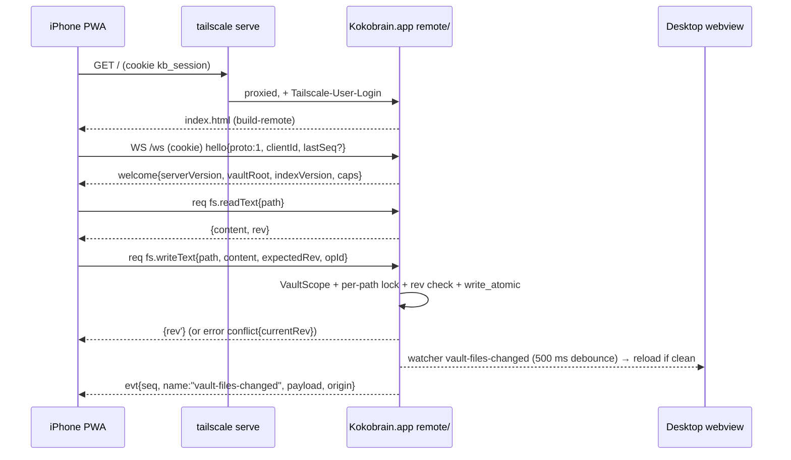

# Design A: REMOTE (t3code-style). The Mac hosts the vault; iOS is a thin client

Status: design input for the iOS plan. Read-only study of the repo at `main` (2a937e57) on 2026-11-02. Nothing was compiled or run. Owner scope (`scout-00-owner-scope.md`) overrides any tiering here.

Legend: **[V]** checked in this pass (code read or primary source fetched). **[S]** taken from a scout file and not re-checked. **[U]** UNVERIFIED (needs a spike or device test).

## 0. Summary

1. **Shortest safe path: a PWA served by the Mac app through `tailscale serve`, client option (a).** The Mac app gains a loopback-only axum server (HTTP + one WebSocket). It serves the same SvelteKit bundle, built with a `KB_TARGET=remote` Vite alias map that swaps the `@tauri-apps/*` modules for network shims, the same way E2E swaps them for mocks today (`vite.config.js:48-58`, `:122-127`) [V]. In milestone A1 no shared call site changes and the desktop build is untouched.
2. **The host side is mostly dispatch.** The Tauri commands are plain `pub fn`s that take `tauri::AppHandle` and `tauri::State<VaultIndexState>` (`src-tauri/src/commands/vault.rs:302-307`, `:430-433`) [V]. An in-app server holding an `AppHandle` can call them directly with `app.state()`. Events reach WS clients through `Listener::listen_any` (tauri-v2.12.5 `crates/tauri/src/lib.rs:938`) [V], so none of the 9 `app.emit` sites change. The `kokobrain-core` extraction is not needed until a headless host (A7).
3. **Three new hard requirements come from multi-client use, not from iOS:**
   - (i) **Writes need a revision check.** Today the save path overwrites blindly (`editor.service.ts:161-177`), and a dirty tab ignores disk changes ("the editor always wins", `editor.service.ts:368-404`) [V]. Phone plus desktop would lose edits silently.
   - (ii) **Host lifecycle commands must be virtualized.** A remote cold start runs `teardownVault()` (`(app)/+layout.svelte:76`), which calls `close_vault_db` and `shutdown_semantic` on the host (`app-lifecycle.service.ts:597`, `:601`) [V]. Without virtualization that closes the desktop's DB.
   - (iii) **Shared `.kokobrain/*.json` files are read-modify-write from every client.** Settings are rewritten on every load (`settings.service.ts:162-163`) [V], so remote writes to them stay denied until a merge path exists.
4. **Security is the largest new surface.** Only `read_files_batch` is vault-bounded today. `create_note` and `create_folder` accept any absolute path without `..` (`vault.rs:862-874`) [V], and `toggle_task_status` has no path check (`vault.rs:664-683`) [V]. Remote access needs:
   - a deny-by-default method policy;
   - one `VaultScope` containment check;
   - a loopback bind with Host and Origin checks;
   - a hashed one-time pairing token that leads to an HttpOnly session cookie.

   The `Tailscale-User-Login` header is defense in depth only.
5. **Semantic search keeps working on iOS for free.** BGE-M3 runs on the Mac. A phone save already drives `update_semantic_file` through `applyNoteChange` (`note-change.service.ts:235-252`) [V].
6. **Offline (later milestone A6) moves the client to option (c).** That is a bundled Tauri iOS app with native storage for a draft journal and an op queue keyed by `opId` plus `baseRev`. It has no client-side Rust vault core, so the iOS compile blockers in scouts 03 and 04 stay out of scope. From A2 on, a local draft journal makes sure an edit is never silently dropped.

## 1. Topology

```
 iPhone / iPad                                     MacBook (host, owns all state)
 ┌──────────────────────────────┐                  ┌───────────────────────────────────────────────┐
 │ Safari home-screen PWA       │  https/wss       │ tailscaled  (tailscale serve --bg --https=8443 │
 │ origin https://mac.<tn>.ts.net│◀───tailnet──────▶│              → http://127.0.0.1:<port>)         │
 │                              │                  │        │ adds Tailscale-User-Login (Serve only)│
 │ SvelteKit bundle (same code) │                  │        ▼                                       │
 │  ├ src/lib/platform/remote/* │                  │ Kokobrain.app (Tauri, macOS)                   │
 │  │   connection supervisor   │                  │  ├ webview (desktop UI, unchanged)             │
 │  │   rpc + event seq         │                  │  │    invoke/listen ──┐                        │
 │  │   shims for @tauri-apps/* │                  │  ├ remote/ (axum, 127.0.0.1 only)              │
 │  │   draft journal (IDB)     │                  │  │   /.well-known/kokobrain  (public)          │
 │  └ cookie kb_session         │                  │  │   /v1/auth/pair  /v1/auth/logout            │
 └──────────────────────────────┘                  │  │   /v1/asset/*rel (Range, ETag)              │
                                                   │  │   /ws  JSON-RPC 2.0 + event notifications   │
   later (A6): Tauri iOS app, bundled frontend     │  │   /    static bundle (build-remote/)        │
   + native drafts/op queue, same /ws protocol     │  │   policy.rs → calls commands::* with        │
                                                   │  │   app.state(); hub.rs ← listen_any(events)  │
                                                   │  ├ commands/* (unchanged Tauri commands)       │
                                                   │  ├ vault/ db/ search/ semantic/ (Tauri-free)   │
                                                   │  └ <vault>/  + .kokobrain/kokobrain.db (WAL)   │
                                                   └───────────────────────────────────────────────┘
```



## 2. Client options compared

| Criterion | (a) Safari PWA served by host over `tailscale serve` | (b) thin Tauri iOS shell / WKWebView loading the host URL | (c) bundled frontend in a Tauri iOS app, WS to host |
|---|---|---|---|
| iOS build infra | none | Xcode, signing, a minimal Tauri or Swift app | full Tauri iOS app, but it can be a **separate small crate** with no vault core (no ort, notify, arboard, global-shortcut), which sidesteps the compile blockers in scouts 03 and 04 [S] |
| Apple account | not needed | needed for device install beyond 7-day free provisioning [U] | needed (TestFlight or App Store; $99/yr per scout 13) [S] |
| Version skew | **none**: the host serves the bundle, so client = host version (except a stale SW cache) | none (remote page) | **real**: the client ships separately; needs a protocol integer and capability flags (section 9) |
| Auth | same-origin cookie works for ``, WS upgrade, fetch | same-origin cookie (remote page in WKWebView) | cross-origin (`tauri://localhost` to `https://mac.ts.net`): WebKit third-party cookie blocking makes cookies unreliable [U], so bearer in Keychain, WS first-frame auth, asset token in the URL |
| Secure context (`crypto.randomUUID` in `trash.logic.ts`, clipboard in 8 files) | yes, over HTTPS Serve. A plain `http://100.x` origin loses SW and secure-context APIs (MDN, scout 16) [S] | yes (https) | `tauri://localhost` treated as secure on iOS: [U] |
| Offline launch | SW + IndexedDB. Storage-pressure eviction still applies (webkit.org/blog/14403) [S]; home-screen apps exempt from the ITP 7-day cap (search excerpt) [S] | only if the remote page's SW works in WKWebView [U] | **always launches**; drafts and queue in the app container through plugin-fs or SQLite, outside WebKit eviction |
| Native extras (share sheet target, Keychain, haptics, background fetch) | none | possible through Swift, but IPC from a remote origin needs Tauri `remote` capability URLs [U] | full Tauri plugin set |
| Path to hybrid / local core (design B) | none | weak | direct: the same app can later embed the Rust core |
| Effort | **S-M** | M | M-L |

Recommendation: ship **(a)** for milestones A0-A5 (owner priorities 1-4 and most features). Switch to **(c)** at the offline milestone A6, reusing the same `src/lib/platform/remote/*` runtime and wire protocol. **Skip (b).** It pays the Xcode and signing cost and gets none of (c)'s offline gains; its only gains over (a) (Keychain, no Safari install step) are small for a single-owner app.

## 3. Host server (Rust, inside the Mac app)

### 3.1 Module layout

```
src-tauri/src/remote/
  mod.rs        start(app: AppHandle, cfg) / stop(); spawned on tauri::async_runtime; toggled from Settings
  config.rs     RemoteConfig { enabled, port, allowed_login: Option<String> } in app config dir (NOT the vault)
  server.rs     axum Router; Host + Origin allowlist middleware; tower-http ServeDir(build-remote) with index.html fallback
  auth.rs       pairing grants (SHA-256 hashed, 5 min TTL, single use), sessions (hashed 256-bit cookie), device list, revoke
  ws.rs         /ws upgrade, hello/welcome, JSON-RPC 2.0 framing, ping/pong, per-connection send queue
  policy.rs     enum Access { Read, Write, Virtual(VirtualOp), HostOnly, Deny } over every CommandMap name + every fs.* method
  dispatch.rs   method → args struct (serde camelCase) → commands::*::<fn>(…, app.state(), app.clone()); sync fns in spawn_blocking
  hub.rs        app.listen_any(name) for each EventMap name → tokio::broadcast<Envelope{seq, name, payload, origin}>; ring buffer of the last N for resume
  vault_fs.rs   VaultScope + fs.* methods (rev, per-path lock, opId dedupe ring)
  assets.rs     GET /v1/asset/*rel: Range/206/416, ETag (mtime+size), MIME sniff, nosniff, SVG sandbox CSP
src-tauri/Cargo.toml   + axum (ws), tower-http (fs, compression-br), tokio "net" "sync" "time"
```

Why in-process and not a sidecar: the commands, `VaultIndexState` and the process-global `DB`/`FTS_DB` (`db/mod.rs:17`, `:27`) [V] live in this process. A second process would need the core extraction (scout 01, 2-4 days) [S] and would fight over the same SQLite WAL file.

Dependencies: `tokio` today has `rt-multi-thread, fs, io-util` (`Cargo.toml:65`) [V]. axum `serve` needs `net` (scout 16, axum `Cargo.toml:102`) [S].

### 3.2 HTTP surface

| Route | Auth | Purpose |
|---|---|---|
| `GET /.well-known/kokobrain` | none | `{instanceId, serverVersion, proto, minProto, caps}`. No vault path, no device list. Used for route probes and skew checks (t3code `/.well-known/t3/environment`, scout 14) |
| `GET /pair` and `POST /v1/auth/pair {token, deviceName}` | one-time token | consumes the grant atomically, sets `kb_session` (`HttpOnly; Secure; SameSite=Strict; Path=/`), returns `{deviceId}` |
| `POST /v1/auth/logout`, `GET /v1/auth/devices`, `POST /v1/auth/revoke {deviceId}` | session (revoke: desktop UI only, via Tauri command) | session management |
| `GET /ws` | session cookie (option a) or first-frame `{"auth": bearer}` (option c) | all RPC + events |
| `GET /v1/asset/*rel` | session cookie, or `?at=<assetToken>` for option (c) | binary read for ``, `<video>`, canvas |
| `GET /*` | none for the static shell (no data in it); `index.html` fallback | the remote bundle |

Do not put the session in the WS URL query: Tailscale issue #18651 (open, 2026-02-08) reports that Serve/Funnel strips query parameters from WebSocket upgrade requests [V] (https://github.com/tailscale/tailscale/issues/18651). Cookie or first frame avoids it.

### 3.3 WebSocket protocol (JSON-RPC 2.0 framing)

```jsonc
// client → server, first frame
{"jsonrpc":"2.0","method":"hello","id":0,"params":{"proto":1,"clientId":"<uuid per install>","clientKind":"ios-pwa","build":"<git sha>","lastSeq":1234}}
// server → client
{"jsonrpc":"2.0","id":0,"result":{"proto":1,"serverVersion":"x.y.z","vaultRoot":"/Users/…/vault","vaultName":"vault","indexVersion":5821,"seq":1301,"resumed":false,"caps":{"semantic":true,"fileHistory":true,"metaWrites":false}}}
// request / response
{"jsonrpc":"2.0","id":17,"method":"get_backlinks_v2","params":{"path":"/Users/…/vault/a.md"}}
{"jsonrpc":"2.0","id":17,"result":[ /* NoteEntry[] exactly as Tauri returns */ ]}
{"jsonrpc":"2.0","id":18,"error":{"code":-32010,"message":"conflict","data":{"currentRev":"9f2c…","path":"…"}}}
// server push (notification: no id)
{"jsonrpc":"2.0","method":"event","params":{"seq":1302,"name":"vault-index-updated","payload":{…UpdateResult…},"origin":"<clientId|host|watcher>"}}
// liveness
{"jsonrpc":"2.0","method":"ping"}  ⇄  {"jsonrpc":"2.0","method":"pong"}
```

- Method names are the existing `CommandMap` keys (58 entries, `src/lib/contracts/commands.ts`) [V], plus a new `fs.*` namespace. Params and results are the existing ts-rs DTOs verbatim, so no DTO work.
- Error codes: the JSON-RPC standard range (https://www.jsonrpc.org/specification) [S], plus app codes: `-32010 conflict`, `-32011 not_found`, `-32012 exists`, `-32013 forbidden_path`, `-32014 method_denied`, `-32015 host_vault_not_open`, `-32016 proto_mismatch`.
- `seq` is per host process, monotonic across all events. The hub keeps a ring of the last ~2,000 events. On `hello.lastSeq` inside the ring the host replays; outside it, `resumed:false`, and the client runs the whole refresh (section 7.3).
- `origin` lets a writer skip its own echo. The current self-skip is a client-local 15 s map (`editor.hooks.ts:24-48`) [V], which keeps working for each client's own writes. `origin` is an extra signal.

### 3.4 Method policy (deny by default, exhaustive)

`policy.rs` holds a `match` over a `CommandName` enum with no `_` arm, plus a Rust test that parses `generate_handler!` in `lib.rs` (`:293-351`) [V] and fails when a registered command has no policy row. A TS mirror test, alongside `ipc-parity.test.ts`, checks every `CommandMap` key against an exported policy list.

| Class | Commands | Remote behaviour |
|---|---|---|
| Read | `get_backlinks_v2`, `get_relationship_backlinks_v2`, `get_outgoing_links_v2`, `get_outgoing_unlinked_mentions_v2`, `get_all_vault_entries_v2`, `get_unlinked_mentions_v2`, `get_all_tags_v2`, `get_all_tasks_v2`, `get_tasks_in_section_v2`, `get_all_property_records`, `get_index_delta`, `scan_vault` (path must pass `VaultScope`), `read_files_batch` (`vaultPath` must equal the host root), `search_fts`, `search_semantic`, `search_hybrid`, `get_semantic_stats`, `get_semantic_file_status`, `is_semantic_model_available`, `is_reranker_model_available`, `get_file_history`, `get_snapshot_content`, `compute_diff` | pass through |
| Write (path-checked) | `update_note_in_index`, `remove_note_from_index`, `rename_note`, `create_note`, `create_folder`, `toggle_task_status`, `propagate_type_rename`, `update_search_index_file`, `remove_from_search_index`, `update_semantic_file`, `remove_semantic_file`, `save_snapshot` | `VaultScope::check` on every path arg before the call. This closes the gaps in scout 01 §6 for remote callers |
| Virtual (host owns lifecycle) | `open_vault_db` (ok if it is the host's open vault, else `-32015`), `close_vault_db`, `shutdown_semantic`, `save_vault_cache`, `start_vault_watcher`, `stop_vault_watcher` (all no-ops), `scan_vault_v2_cached` (returns `{source:"cache", entryCount, loadMs:0, filesReread:0}` from the live index, no rescan, no `fullRescan` emit), `build_search_index` (no-op returning current stats), `cleanup_history` (no-op), `set_tauri_debug_mode`, `configure_sentry` (client-local, no host effect) | answered by the host without touching shared state |
| HostOnly / Deny | `build_semantic_index`, `download_semantic_model`, `download_reranker_model`, `init_semantic_search`, `check_for_update_on_channel`, `capture_clipboard_now`, `open_composer`, `dismiss_composer`, `submit_composer_capture`, `list_system_fonts` (Mac fonts are wrong for the phone), `get_process_memory`, `scan_vault_v2` | `-32014` |

Reason for the Virtual class: `start_vault_watcher` replaces the host's single watcher (`vault/watcher.rs:302-318`) [S], `close_vault_db` drops the process-global connections (`db/mod.rs:91-99`) [S], and `scan_vault_v2_cached` rebuilds the shared index and pushes `fullRescan` to every client (`vault.rs:1179-1190`) [V]. Each of these is a cross-client side effect.

### 3.5 `VaultScope` (one containment rule)

```rust
pub struct VaultScope { root: PathBuf /* canonical */ }
impl VaultScope {
    /// Absolute host path from a client (DTO paths stay absolute, see 5.3).
    pub fn check_abs(&self, p: &str, intent: Intent) -> Result<PathBuf, ScopeError>;
    /// Vault-relative (assets, offline queue).
    pub fn resolve_rel(&self, rel: &str, intent: Intent) -> Result<PathBuf, ScopeError>;
}
pub enum Intent { Read, Write, Create }
```

Rules:
- Reject NUL and `..`.
- An existing target is canonicalized and must `starts_with(root)`, so a symlink escape fails. This is the `read_files_batch` pattern (`files.rs:31-49`) [S].
- For `Create`, canonicalize the parent instead.
- Deny `Write` on `.kokobrain/kokobrain.db*`, `.kokobrain/models/**`, `.kokobrain/vault-index.msgpack` and `.git/**`.
- `.kokobrain/*.json` writes are gated by `caps.metaWrites` (section 6.3).

Make it the only path check: later, desktop Tauri commands can call the same function and replace `ensure_safe_write_path` (`vault.rs:862-874`) [V].

### 3.6 `fs.*` methods (replace the 27 plugin-fs importers on the wire)

Scout 05 maps every call site to these. The set matches its proposed `VaultFs` (`scout-05` §4) [S], with revisions added.

| Method | Params → Result | Notes |
|---|---|---|
| `fs.readText` | `{path}` → `{content, rev}` | `rev` = first 16 hex of SHA-256 of the bytes (`sha2` is already a dependency per scout 02) [S] |
| `fs.writeText` | `{path, content, mode:"overwrite"\|"mustExist"\|"createOnly"\|"append", expectedRev?, opId}` → `{rev}` | under a per-path `tokio::Mutex`. If `expectedRev` is set and the current rev differs, return `-32010 conflict{currentRev}`. `write_atomic` (`utils/fs.rs:16-32`) [S]. A ring of the last 512 `opId`s returns the stored result for a retried write whose ack was lost |
| `fs.exists` | `{path}` → `bool` | |
| `fs.readDir` | `{path}` → `[{name, isDirectory, isFile, isSymlink}]` | plugin-fs `DirEntry` shape |
| `fs.mkdir` | `{path, recursive}` → `null` | |
| `fs.remove` | `{path, recursive}` → `null` | |
| `fs.rename` | `{from, to, expectedRev?}` → `null` | disk only. The index half stays in `rename_note` (ADR-0025, per scout 05) [S] |
| `fs.copy` | `{from, to}` → `null` | byte-exact |
| `fs.stat` | `{path}` → `{size, mtimeMs, rev?}` | for ETag and conflict UI |

Binary reads go through `GET /v1/asset/*`, not RPC. That also covers canvas images (`canvas-image.service.ts:35`).

## 4. Client runtime (TypeScript)

### 4.1 Module layout

```
src/lib/platform/
  target.ts                 export const TARGET = import.meta.env.VITE_KB_TARGET ?? 'tauri'   ('tauri' | 'remote')
  caps.svelte.ts            capability store: static per target + server caps from `welcome`; UI reads caps.x
  remote/
    connection.svelte.ts    supervisor: phases disconnected|connecting|syncing|ready|blocked; equal-jitter backoff 1 s→5 min cap;
                            probe on visibilitychange/pageshow/online; 15 s ping, 5 s pong timeout (t3code numbers, scout 14)
    rpc.ts                  JSON-RPC client: id map, per-call timeout, rejects all pending on socket loss (never replays)
    events.ts               seq tracking, listener registry keyed by EventMap name, gap → resync()
    session.ts              hello/welcome, vaultRoot, auto-open of the host vault (skips the welcome screen)
    paths.ts                toRel(abs) / toAbs(rel) against vaultRoot; assetUrl(abs) → /v1/asset/<rel>
    drafts.ts               IndexedDB journal {path, rel, baseRev, content, updatedAt}; navigator.storage.persist()
    save-state.svelte.ts    per-tab: saved | saving | unsaved-offline | conflict (feeds a status pill)
    shims/                  aliased in place of @tauri-apps/* when KB_TARGET=remote
      api-core.ts           invoke(cmd,args) → rpc.call(cmd,args); convertFileSrc(p) → paths.assetUrl(p); Channel → throws
      api-event.ts          listen(name, h) → events.on(name, e => h({payload:e}))
      plugin-fs.ts          readTextFile/writeTextFile/exists/mkdir/readDir/remove/rename/copyFile/readFile → fs.* (readFile → fetch asset)
      plugin-dialog.ts      ask/message → in-app AlertDialog (shadcn); open → rejects Unsupported
      plugin-opener.ts      openUrl → window.open(url,'_blank','noopener'); openPath/revealItemInDir → reject Unsupported
      api-window.ts         getCurrentWindow() stub, SYNC: onCloseRequested → pagehide, onFocusChanged → visibilitychange, setBadgeCount → navigator.setAppBadge?
      api-webview-window.ts setZoom → no-op
      api-path.ts           appLogDir → reject (logging stays device-local, off)
      plugin-http.ts        fetch → window.fetch (Todoist CORS [U]; feature hidden until checked)
      plugin-deep-link.ts   onOpenUrl/getCurrent → no-op
      plugin-clipboard.ts   readText → navigator.clipboard.readText
      plugin-process.ts     relaunch → location.reload
```

`vite.config.js` gains `remoteShims` next to `playwrightMocks` (`:48-58`) [V], selected by `process.env.KB_TARGET === 'remote'`, with `outDir: build-remote`. The shim list must cover all 13 imported `@tauri-apps/*` modules. E2E aliases only 9, and `api/path`, `plugin-clipboard-manager`, `plugin-process` and the updater are missing (scout 08 §5) [S]. `getCurrentWindow()` must return its stub synchronously, because `tauri-listeners.service.ts:53` and `:309` call it inside mount effects (scout 08 §3) [S].

Why build-time aliasing before a real `VaultFs` port:
- It reaches all 27 plugin-fs importers and the dialog, opener and window importers with zero call-site edits.
- E2E has proved the alias mechanism over the whole app.
- The desktop bundle is byte-identical.

Two exceptions get explicit seams in A2, because the shim cannot infer intent there: the **editor save** (needs `expectedRev`) and **lifecycle guards** (section 6). Later, migrating the shims into a proper `VaultFs` port (scout 05 §4) is a refactor, not a prerequisite.

### 4.2 The editor save path (explicit, A2)

```ts
// core/editor/editor.service.ts (shared). Tabs gain `baseRev?: string`.
// On desktop TARGET==='tauri', vaultWrite falls back to plugin-fs writeTextFile (A2) and later (A4) to a Rust write_text with the same check.
export interface VaultWrite {
  writeNote(path: string, content: string, opts: { expectedRev?: string; opId: string }): Promise<{ rev: string }>;
}
```

Flow on remote:
1. Every keystroke debounce writes the dirty content to `drafts.ts` (IndexedDB) before the network save is tried.
2. `saveFileByPath` calls `writeNote`.
3. On success: `markSavedByPath`, `tab.baseRev = rev`, clear the draft, `notifyAfterSave`. The note-change owner then drives the Rust index, FTS and semantic legs over RPC unchanged (`editor.hooks.ts:66-81`, `note-change.service.ts:235-252`) [V].
4. On a network error: the tab stays dirty (existing behaviour, `editor.service.ts:170-176`, 5 s retry at `:180-193`) [V], the pill shows "Not saved: Mac unreachable", and the draft survives a reload or kill.
5. On conflict: go to section 7.2.

Boot: after `welcome`, `drafts.ts` lists drafts. For each one, open the tab with the draft content as dirty and `baseRev` from the draft, and show a banner. A draft is never auto-discarded.

## 5. Paths, identity and assets

### 5.1 Note identity

- **Wire identity for existing DTOs: absolute host paths, unchanged.** The frontend uses absolute paths everywhere (CLAUDE.md "Absolute paths everywhere"), and DTOs embed them (NoteEntry, FileNode, UpdateResult). Translating every nested field is error-prone, and translating none costs nothing, because the client learns `vaultRoot` from `welcome` and never joins a local path. The host checks every inbound path with `VaultScope`.
- **Durable identity for offline (A6): `(vaultRelPath, baseRev)`.** The draft journal and op queue store `rel = toRel(abs)` and the `rev` they were based on. A later host root move, or a second host, does not break queued ops. A rename while offline shows up as `not_found` on replay and goes to a conflict copy (section 7.2). No note UUID is introduced; the markdown file and its path stay the source of truth (owner scope).

### 5.2 Assets

- `EditorHost.assetUrl(path): string` is synchronous (`core/markdown-editor/editor-host.ts:41`) [V], implemented with `convertFileSrc` (`app/editor-host.ts:72-74`) [V]. The remote shim returns `/v1/asset/<encodeURI(rel)>`. It is same-origin, so the session cookie rides along and nothing is minted asynchronously.
- The endpoint follows scout 07 §4 [S]: Range (206/416), `Accept-Ranges`, `ETag` from mtime and size plus `If-None-Match` → 304, `Cache-Control: private, no-cache`, MIME sniff then extension, `X-Content-Type-Options: nosniff`, SVG with `Content-Security-Policy: sandbox`, `Content-Disposition: inline` (`attachment` renders blank on WebKit, wry#1889) [S]. `.kokobrain/**` is denied.
- Canvas (`canvas-image.service.ts:28-40`) gets the shimmed `readFile` → `fetch(assetUrl)` → `Uint8Array`, with no call-site change. Pre-existing gaps G1 (relative ``), G3 (binary wikilink embeds) and G4 (`<video>` src raw) from scout 07 break on every platform. Fix them in A1 because image embeds are owner priority 3.
- Option (c): cross-origin, so `welcome` returns an `assetToken` (scope `asset:read`, 1 h, rotated on reconnect), and the shim appends `?at=` synchronously. Query strings on plain GETs are not affected by #18651, which covers WS upgrades [V].

### 5.3 CSP for the remote bundle

The host sends the CSP as a header. It is the Tauri policy (`tauri.conf.json:29`) [V] minus `ipc:`/`asset:`, plus `connect-src 'self' wss://<host>`, `img-src 'self' data: https:`, `media-src 'self'`. Keep `'unsafe-eval'` only while queryjs needs `new Function` (scout 11) [S]. Keep the header small: tauri#16442 notes WebKit truncating CSP headers over 16 KiB [S].

## 6. Shared host state: lifecycle, settings, `.kokobrain/` metadata

### 6.1 Lifecycle guard (client side, plus Virtual policy on the host)

`TARGET==='remote'` changes three things in `(app)/+layout.svelte:65-79`:
- (1) no `teardownVault()` on a cold start without a vault;
- (2) `vaultStore.open(welcome.vaultRoot)` once the session is ready;
- (3) `initializeVault` skips `open_vault_db`, the watcher start and `cleanup_history`. Its steps 4-5b still run, because they build client-side stores.

This is 3 `if (TARGET==='remote')` branches in `app-lifecycle.service.ts` (`:233`, `:275`, and the watcher start) [V for lines 233, 275]. The host's Virtual class (3.4) is the backstop if a branch is missed.

### 6.2 Settings

`loadSettings` saves after every load (`settings.service.ts:162-163`) and overwrites the file with defaults on a parse error (`:166-178`) [V]. The desktop never reloads `settings.json` on an external change, because the watcher drops dot-directories (CLAUDE.md, Indexing §5). So a phone writing settings would be lost or would clobber the desktop. Design:
- Remote reads `settings.json` through the shim.
- Writes to `.kokobrain/settings.json` are dropped client-side when `TARGET==='remote'` (`writeSettingsFile`, `:185-198`) and denied by `VaultScope`.
- Device-specific values (pane sizes, editor font size, theme override) go to `localStorage['kokobrain:device-settings']`, merged over the vault settings at load.
- A later "edit shared settings from the phone" feature uses `fs.writeText` with `expectedRev` and needs a host `vault-meta-changed {file}` event that the desktop reloads on. Out of v1.

### 6.3 Other `.kokobrain/*.json` (trash manifest, folder order, recent icons, auto-move rules, Todoist sent)

All of these are whole-file read-modify-write from in-memory copies loaded at init (scout 12 §2) [S]. For A1-A4, `caps.metaWrites=false`: the UI hides trash, folder reorder, icon picking and auto-move config on remote. A5 enables them per file with `expectedRev` writes, retry-on-conflict re-reads, and the `vault-meta-changed` event so the desktop reloads. The trash manifest comes first, because delete is the most-wanted of these.

## 7. Multiple clients on the same note

### 7.1 Cases

| Case | Today (single client) | A2 behaviour |
|---|---|---|
| Phone saves, desktop tab clean | n/a | The host watcher fires `vault-files-changed` → desktop `reloadExternallyChangedTabs` reloads (`editor.service.ts:375-404`) [V]. Works without code change |
| Desktop saves, phone tab clean | n/a | The phone gets the same event through the hub → its own `fs.watcher.ts` handler → reload. The phone's self-skip map ignores echoes of its own writes (`editor.hooks.ts:37-48`) [V] |
| Both dirty, phone saves first | n/a | Phone write passes (rev matches). Desktop is dirty, so it ignores the disk change, and its next save **overwrites the phone's edit silently** (desktop plugin-fs write has no rev check) → fixed in A4 |
| Both dirty, desktop saves first | n/a | Desktop write lands. The phone save sends the old `expectedRev` → `-32010 conflict` → 7.2 |
| Both create today's daily note | — | `create_note` is create-only and errors when the file exists (`vault.rs:888-907`) [S]. The loser should open the existing note: check that `openOrCreateNote` handles `exists` on error [U] |
| Task toggle on phone (`toggle_task_status`) | host read-modify-write | Correct against disk. If the same note is dirty in a desktop tab, the desktop overwrites it later → also fixed by A4 |
| Index consistency | Rust `UpdateResult.changed` dedupes | The phone calls `update_note_in_index` and so does the desktop watcher handler (`watcher-handler.service.ts:96-129`) [V]. The duplicate is a no-op by content compare. Wasteful but correct |

### 7.2 Conflict flow (no CRDT in v1)

On `conflict{currentRev}`:
1. Fetch `fs.readText` (theirs).
2. `save_snapshot` both versions, so history keeps them (`commands/history.rs:56-78`) [S].
3. Show a sheet: **Keep mine** (re-write with `expectedRev=currentRev`), **Keep theirs** (load theirs, drop the draft), **Keep both** (write mine to `<name> (conflict <device> <yyyy-mm-dd HHmm>).md` with `createOnly`, then load theirs). Offer a diff through the existing `compute_diff` and `FileHistoryDialog`.

Default if the sheet is dismissed: Keep both. Nothing is ever discarded without an explicit tap.

### 7.3 Event loss and resync

The vault-index consumer sets `latestVersion = payload.version` without a gap check (`tauri-listeners.service.ts:271`, scout 17 §1.4) [S]. Remote adds:
- (1) a hub `seq` gap or `resumed:false` → `invalidateVaultEntries()` + `fullRefresh()` (both exist, scout 17) + `refreshTree()` + reload of clean open tabs;
- (2) the same on every reconnect after `ready`;
- (3) an `UpdateResult.version` gap → the same path.

`semantic-index-progress` and `tauri-debug-log` are not replayed. `vault-files-changed` handlers are not serialized (`fs.watcher.ts:121-172`) [V], so the remote event dispatcher delivers each event name through a per-name promise chain to keep the Tauri ordering assumptions.

## 8. Auth, pairing, listener

### 8.1 Pairing (t3code pattern, minus its plaintext-token weak spot)

1. Desktop Settings → Remote access → Enable. The host binds `127.0.0.1:<port>` (random, persisted). It checks `tailscale status --json` and runs `tailscale serve --bg --https=8443 http://127.0.0.1:<port>` with consent, as t3code's `ensureTailscaleServe` does (scout 16 §4) [S]. "Only `http://127.0.0.1` is supported for proxies" (tailscale CLI serve doc, scout 16) [S].
2. "Pair a device" mints a 12-char token (60 bits, as t3code, scout 14). The host stores `SHA-256(token)`, TTL 5 min, single use, consumed in one locked step. It shows a QR of `https://<mac>.<tailnet>.ts.net:8443/pair#t=<token>`; the fragment keeps the token out of logs and proxies.
3. The phone opens the link in Safari. JS reads the fragment, sends `POST /v1/auth/pair`, gets `Set-Cookie: kb_session=<256-bit random>` (stored hashed with `{deviceId, name, createdAt, lastSeen, tailscaleLogin}`), runs `history.replaceState` to drop the fragment, then prompts "Add to Home Screen".
4. Revocation: a desktop device list with Revoke. Optional "require the same `Tailscale-User-Login` as at pairing" (defense in depth).

Persist in the Tauri app config dir (`remote.json`, mode 0600), never in the vault: the vault may be synced (ADR-0019).

### 8.2 Token vs Tailscale identity headers

| | Pairing token → session cookie | `Tailscale-User-Login` header |
|---|---|---|
| Proves | this device was paired by the owner | the tailnet user behind a Serve request |
| Forgeable by | cookie theft from the device | **any local process or browser page on the Mac** that reaches `127.0.0.1:<port>` directly. Serve strips client copies (tailscale.com/docs/features/tailscale-serve, scout 16) [S], but the loopback port itself has no such stripping |
| Per-device revoke | yes | no (one login covers all your devices) |
| Works on non-Serve routes, option (c) | yes (bearer) | no |

Use the token as the credential and the header only as an extra match. A header-only design is unsafe because loopback is reachable from local software.

### 8.3 Listener and request filtering

- **Bind `127.0.0.1` only.** Serve is the only supported route in v1. Do not bind `0.0.0.0` or the `100.x` address: plain HTTP loses the secure context (randomUUID, clipboard, SW) and needs ATS exceptions for option (c) (t3code ships `NSAllowsArbitraryLoads: true`, scout 14 §11) [S].
- Even on loopback:
  - **Host allowlist**: `<mac>.<tailnet>.ts.net[:8443]`, plus `127.0.0.1:<port>` for desktop debugging.
  - **Origin check on `/ws` and on state-changing POSTs**: must equal the Serve origin.
  - Both block DNS-rebinding attacks from a web page open on the Mac.
- If a LAN or tailnet-IP bind is ever added: per-connection peer filter as t3code does (`apps/server/src/server.ts:351-355`, accept only private or tailnet peers) [V], accepting only `100.64.0.0/10` and `fd7a:115c:a1e0::/48` plus loopback. The t3code docs call it "not a firewall" (scout 14 §5), so the token stays mandatory.
- Rate-limit `/v1/auth/pair` (5/min) and close the grant after 5 failed attempts.
- Privacy: Tailscale HTTPS certs are logged in the public CT ledger with the machine FQDN (tailscale.com/kb/1153/enabling-https, scout 16) [S]. Use a non-identifying machine name.

## 9. Version skew

| Mechanism | Detail |
|---|---|
| Protocol integer | `PROTO = 1` in `src/lib/platform/remote/proto.ts` and `remote/ws.rs`. `hello.proto` below `minProto` or above `proto` → `-32016` with both versions. The client shows "Update the Mac app" or "Reload" (t3code returns HTTP 426, scout 14 §9) |
| Bundle = host | Options (a) and (b) load the bundle from the host, so code and protocol match. SvelteKit `version.pollInterval: 0` (`vite.config.js:74-78`) [V]: on `welcome.serverVersion != __BUILD_SHA__`, call `location.reload()` once (SW: `skipWaiting` on new SW) |
| Capabilities | `welcome.caps` booleans (absent = false = hide UI). New methods are additive. A removed or renamed method or DTO field bumps `PROTO` |
| DTO drift | The ts-rs bindings are shared (`src/lib/contracts/generated/`), so (a) and (b) cannot drift. For (c), a contract test pins the `CommandMap` hash per `PROTO` |
| Desktop auto-update mid-session | The host restarts. Clients see the socket drop, reconnect, get a new `serverVersion`, and reload (drafts survive in IndexedDB) |

## 10. Offline behaviour by milestone

| Milestone | Mac unreachable (asleep, offline, Tailscale down) |
|---|---|
| A1 (read-only) | Full-screen "Mac unreachable" state with retry. Last-opened notes stay visible from memory only |
| A2-A5 | Editing continues in open tabs. Every change goes to the IndexedDB draft journal. The save pill shows "Not saved, will retry". Reconnect retries the saves with `expectedRev`, and conflicts go to 7.2. Opening an unopened note fails visibly. No silent drop: drafts outlive app kills, unless WebKit evicts the origin (risk R7) |
| A6 (offline) | Option (c) app. Reads: cache of the last N opened notes, the entries snapshot (`getVaultEntries` memo) and the file tree, all in native storage. Writes: op queue `{opId, rel, baseRev, op, content, ts}`, replayed in order on reconnect. `opId` dedupes on the host ring (3.6), and conflicts go to 7.2. Create, rename and delete while offline are queued too, and a replay failure becomes a conflict copy |
| Beyond (hybrid) | A full replica on iOS (pull `fs.changes{sinceSeq}`) with a TS or on-device index is design B territory. A6 leaves room for it, because the queue is vault-relative and rev-based and the protocol already has `seq`. A CRDT or event-log store is optional on top (owner scope: storage engine is open). Recommendation: decide after A6 data on real conflict rates |

Mac asleep is the main availability limit of this model. Options:
- (1) While remote access is on and the Mac is on power, hold a "prevent idle sleep" power assertion (IOKit `IOPMAssertionCreateWithName`, from memory [U]). A closed lid on battery still sleeps.
- (2) A7 headless `kokobrain serve` on an always-on Mac mini needs the vault to live there, which is a different setup.

Tailscale on iOS drops tunnels after backgrounding in user reports (#21387, #21163, scout 16) [S]. The supervisor's probe on `visibilitychange` and `pageshow` covers it.

## 11. What is hidden or dropped on iOS (remote)

| Feature | Where | Remote behaviour | Why |
|---|---|---|---|
| Vault picker, recent vaults, vault switching | `vault.service.ts:25-32`, `(app)/+page.svelte:12-14` | hidden; host vault auto-opened | one vault (owner scope); folder picker unsupported on iOS anyway (scouts 06, 12) |
| Updater, restart | `UpdateSection.svelte:135-210` | hidden | the host updates itself; the client follows (section 9) |
| Quick capture (global hotkey, composer, clipboard watcher) | `lib.rs:15-17`, `:245-271`; `routes/composer` | hidden (`qc:*` events never subscribed) | macOS-only. iOS capture is a later share-sheet feature in option (c) |
| Reveal in Finder, open log folder | `fs.service.ts:291`, `note-action-bar.service.ts:41`, `log.service.ts:180-186` | hidden; "Copy path" stays | no host filesystem UI on the phone |
| Zoom shortcuts | `zoom.service.ts:29` | no-op | browser zoom; keyboard only |
| System font list | `list_system_fonts` | hidden (fonts on the Mac are not on the phone) | wrong machine |
| Semantic model download and index build | `SearchSection.svelte` | hidden; **search itself works** (host runs BGE-M3) | host-only maintenance |
| Debug log to file, Tauri debug log | `log.service.ts`, `debug.ts:123` | off | device has no log dir; host logs on the Mac |
| Dock badge | `dock-badge.service.ts:17` | `navigator.setAppBadge` if present, else hidden [U] | |
| Deep links `kokobrain://` | `deep-link.service.ts:87,99` | hidden in A1-A5 | no custom scheme for a PWA |
| Todoist push | `tauri-fetch-adapter.ts` | hidden until CORS is checked [U] | browser fetch is subject to CORS |
| Trash, folder reorder, icons, auto-move config | section 6.3 | hidden until A5 | shared META writes |

All gating reads `caps.svelte.ts`, not `TARGET` directly, so option (c) reuses the same flags.

## 12. Risks, ranked

| # | Risk | Impact | Mitigation |
|---|---|---|---|
| R1 | Silent overwrite between desktop and phone (desktop dirty tab wins, `editor.service.ts:368-373`) | note data loss | A2: remote `expectedRev`. **A4: desktop save gets the same check through a Rust `write_text_checked` command** plus a "changed on another device" banner. Snapshots of both sides, conflict copies |
| R2 | Remote arbitrary file read/write (`create_note`, `create_folder`, `toggle_task_status`, `scan_vault`, `save_vault_cache` unbounded, scout 01 §6) | Mac compromise from a stolen cookie or a bug | deny-by-default `policy.rs`, `VaultScope` on every path arg, write deny-list, loopback bind, Host and Origin checks, hashed tokens, revocation |
| R3 | Cross-client lifecycle side effects (`teardownVault` on cold start, watcher replace, `scan_vault_v2_cached` rescans, settings rewrite on load) | desktop DB closed, watcher lost, settings clobbered | Virtual policy class (host) + lifecycle guard (client) + settings read-only on remote; parity tests make a new command fail CI until classified |
| R4 | iOS kills sockets silently; stale UI shows "connected" | edits appear saved but are not; stale index | app-level ping/pong watchdog, probe on visibility and pageshow, `seq` gap → resync, save pill driven by acks only |
| R5 | Mac asleep or Tailscale down | phone unusable for new reads | clear unreachable state, draft journal (A2), power assertion option, A6 offline cache |
| R6 | Tailscale Serve quirks: WS query strip (#18651), cert CT exposure, first-cert latency (t3code retries 5 probes, scout 16) | auth failure, privacy | cookie or first-frame auth only, machine rename, retry on first setup. **Spike A0 must confirm `wss://` through Serve on iPhone Safari** [U]. t3code's Tailscale HTTPS route uses Serve with its `/ws` RPC (docs/user/remote-access.md:170-196) [V], which is strong practical evidence |
| R7 | PWA storage eviction loses drafts | lost offline edits | `navigator.storage.persist()`, home-screen install, tell the user while unsaved drafts exist; option (c) at A6 |
| R8 | Large payloads over cellular (`get_all_vault_entries_v2` clones the whole index, `vault.rs:508-517`) [S] | slow first load | permessage-deflate or tower-http compression, the existing delta path (`get_index_delta`) after the first load, cache the entries snapshot in IndexedDB keyed by `indexVersion` |
| R9 | Shim fidelity (options like `create:false`, `append`, `recursive`) | subtle write bugs | the shim forwards options to `fs.writeText.mode`. Run the scout-05 call-site matrix as vitest cases against a fake WS host built on the `calendar-vault.fixture.ts` disk model; avoid the E2E fake's ignored options (scout 05 §6) |
| R10 | WebKit editor issues (touch selection drag guard, hover-only controls, keyboard), scouts 09 and 10 | priority 2-3 UX | shared with design B; not a transport risk; WebKit Playwright project (scout 17) |
| R11 | Version skew in option (c) | broken client after a Mac update | PROTO integer + caps; (a) has none |

## 13. Effort (estimates, not measured)

S ≤ 2 days, M 3-7 days, L 1-3 weeks.

| Piece | Size | Milestone |
|---|---|---|
| A0 spike: axum on loopback in the Mac app, `tailscale serve`, serve `build-remote/`, WS echo, cookie, one image with Range, on a real iPhone | S | A0 |
| Remote shims for 13 modules + `KB_TARGET` build + sync `getCurrentWindow` stub | M | A1 |
| `remote/` server: router, ws, hub (`listen_any`), dispatch for 58 commands, `policy.rs` + parity tests (Rust + TS) | M | A1 |
| `VaultScope` + `fs.*` + assets endpoint | M | A1 (read), A2 (write) |
| Pairing, sessions, device list UI on desktop, Host and Origin middleware | M | A1 |
| Connection supervisor, seq/resync, unreachable UI | M | A1 |
| Lifecycle guard + settings device-local overrides | S | A1 |
| Fix image gaps G1, G3, G4 (scout 07) | S | A1 |
| Rev-checked editor save, draft journal, save pill, conflict sheet | M | A2 |
| Desktop save conflict check (Rust `write_text_checked`, banner instead of "editor wins") | S-M | A4 |
| META writes with `vault-meta-changed` (trash first) | M | A5 |
| Mobile shell UX (single-pane iPhone, iPad panes, long-press, touch targets), scouts 09 and 10 | L | A3 (shared with design B) |
| Option (c) app: small Tauri iOS crate, Keychain bearer, first-frame auth, asset tokens, native drafts, op queue, cache | L | A6 |
| Headless `kokobrain serve`: `kokobrain-core` crate, `EventSink`, host-side watcher→index driver, instance DB handles | M-L (scout 01: core 2-4 d + the rest) | A7 (optional) |

Milestones in owner priority order:
- **A0** spike.
- **A1** view notes and the rail shell, read-only (priorities 1 and 4, read).
- **A2** edit and interact (priorities 2 and 3).
- **A3** iPhone and iPad layout.
- **A4** desktop conflict parity.
- **A5** remaining features: FTS and semantic search, tags, tasks, templates, periodic notes, calendar and file history come mostly free through the proxied commands; then META writes.
- **A6** offline in the option (c) app.
- **A7** headless host.

Rough total to "owner calls it a success" (A0-A4): about 5-8 weeks, of which A3 UX is the largest single item.

## 14. Rust vs TS on the host

Keep Rust. In model A the host is the existing Rust process. A TS (Node) host like t3code would mean rewriting `vault/`, `search/` and `db/` (about 21k lines of Rust, brief) [S], losing the ONNX path, and running a second process against the WAL DB. The gain (one language for protocol types) is already covered by ts-rs bindings shared by both sides. Revisit only for design B or hybrid (an index in the iOS webview), not here.

## 15. Open questions for the owner

1. Is "Mac awake, Kokobrain running with the vault open" acceptable for A1-A5? Should A1 add the keep-awake-on-power option?
2. A4 changes desktop behaviour: a dirty desktop tab no longer silently overwrites a change made on the phone; you get a banner or conflict sheet instead. OK?
3. Conflict default when the sheet is dismissed: "keep both" (a conflict copy file next to the note). OK, or prefer "keep mine" plus a history snapshot?
4. Phone settings: device-local overrides only, with shared `settings.json` read-only from the phone, until a later milestone. OK?
5. PWA first, so no TestFlight before A6. Do you have, or want, an Apple Developer account for option (c) later?
6. Enabling Tailscale HTTPS publishes the Mac's tailnet FQDN in the CT logs. Is the current machine name fine?
7. Is semantic and hybrid search on the phone (served by the Mac) wanted in A5, or should it stay hidden to keep the phone surface small?
8. Which META writes do you need first from the phone: trash/delete, rename/move (folder order), icons?
9. Should the Mac app start the remote server (and `tailscale serve`) automatically on launch when enabled, or only on demand?

## 16. Not verified

- WebSocket upgrades through `tailscale serve` to iPhone Safari (only indirect evidence from t3code's shipped route); Serve's handling of `Origin` and `Host` headers.
- WebKit behaviour: third-party cookies from `tauri://localhost` to the tailnet origin (option c); SW in WKWebView for a remote page (option b); `navigator.setAppBadge` in a home-screen PWA; eviction of home-screen PWA IndexedDB under pressure.
- `openOrCreateNote` handling a `create_note` "exists" error under a concurrent create.
- IOKit sleep-assertion API names (from memory).
- Todoist API CORS for a browser origin.
- No build, cargo, vitest or device run. Scout claims marked [S] were not re-read, apart from the spot-checks marked [V].

## Sources

- Repo (verified this pass): `src/lib/contracts/ipc.ts:1-38`; `src/lib/contracts/commands.ts` (58 entries); `src/lib/contracts/events.ts:10-42`; `src/lib/core/editor/editor.service.ts:98-193`, `:368-404`; `src/lib/core/editor/editor.hooks.ts:24-100`; `src/lib/app/lifecycle/watcher-handler.service.ts:60-130`; `src/lib/app/lifecycle/app-lifecycle.service.ts:233,275,587,597,601`; `src/lib/core/settings/settings.service.ts:158-198`; `src/lib/core/filesystem/note-change.service.ts:202-252`; `src/lib/core/filesystem/fs.watcher.ts:121-172`; `src/lib/core/markdown-editor/editor-host.ts:33-55`; `src/lib/app/editor-host.ts:58-115`; `vite.config.js:28-80,118-140`; `src-tauri/src/lib.rs:222-300`; `src-tauri/src/db/mod.rs:10-50`; `src-tauri/src/commands/vault.rs:300-320,428-440,660-725,860-880,1140-1200`; `src-tauri/Cargo.toml:60-75`; `src-tauri/tauri.conf.json:29`; `src/routes/(app)/+layout.svelte:76`.
- Tauri `Listener::listen_any`: https://github.com/tauri-apps/tauri/blob/tauri-v2.12.5/crates/tauri/src/lib.rs (line 938, via `gh api`).
- Tailscale Serve strips WS query params (open): https://github.com/tailscale/tailscale/issues/18651
- t3code listener filter: https://github.com/pingdotgg/t3code/blob/main/apps/server/src/server.ts (lines ~351-355); Tailscale HTTPS route: https://github.com/pingdotgg/t3code/blob/main/docs/user/remote-access.md (lines 170-196).
- Scout files `scout-01` through `scout-17` in this directory (claims marked [S]), including Tailscale KB 1312 and 1153, MDN Service Worker, WebKit storage policy, JSON-RPC 2.0 spec, axum and tower-http docs as cited there.
- Search leads (not primary): https://github.com/openclaw/openclaw/issues/54008, https://github.com/Woofson/brum/wiki/Reverse-Proxy-and-TLS (WS works through Serve/Funnel by default).
