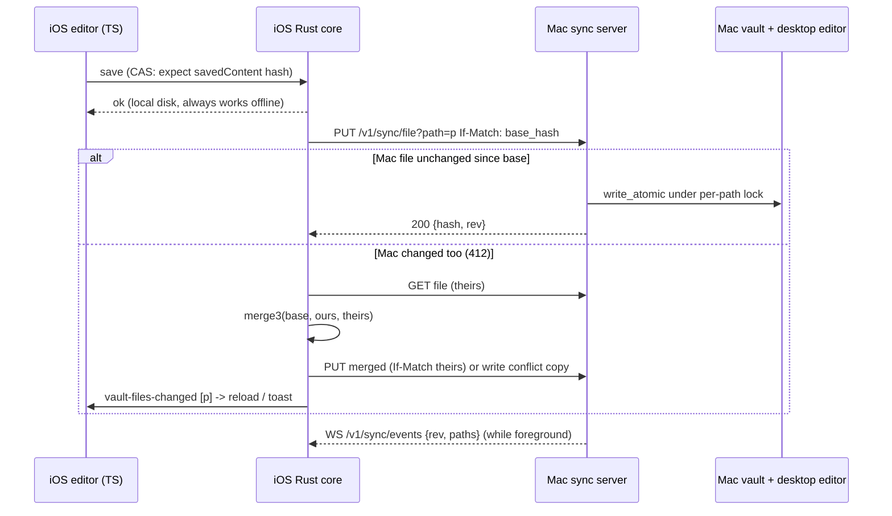

# Design B: LOCAL, Tauri 2 iOS app with the Rust core on the device

Status: design proposal (2026-11-02). Read-only study; nothing was compiled, run or tested. Code refs are `path:line` at `main` 2a937e57. External refs carry URLs. UNVERIFIED marks claims I could not check against code or a primary source.

Inputs: scouts 00-17 in this folder. I spot-checked the claims this design depends on; corrections are listed in section 13.

## 0. Verdict

- **B is feasible at moderate cost, and its compile and boot work is mostly cfg gating.** The core (`vault/`, `db/`, `search/`, `utils/`) is already Tauri-free and ratcheted (`src-tauri/tests/core_tauri_free_test.rs:9`, `:22-43`). The mobile entry point exists (`src-tauri/src/lib.rs:222`, `Cargo.toml:16`). The blockers are four desktop crates, the desktop-only shell code in `lib.rs`, and the folder picker.
- **How the notes get onto the device is the real design problem, not Tauri.** Recommendation: the vault lives in the app container (`Documents/Vault`). A Kokobrain-specific **file sync with the Mac as the sync server** runs over Tailscale. Every save goes to local disk first, so offline works from day one. Conflicts use a 3-way merge with a conflict-copy fallback. iCloud Drive, Syncthing and git are second-tier options (section 4).
- **Keep `.kokobrain/kokobrain.db` where it is on iOS.** With a container vault the DB is on a local filesystem, so the SQLite WAL contract holds (https://www.sqlite.org/wal.html), and ADR-0019 needs no change for B. The DB move (`DataDirs`) is a prerequisite only for the iCloud variant.
- **On iOS, do not use `notify`.** The app is the only writer to its container, so the sync engine injects the paths it changed into the existing watcher pipeline. The frontend change path stays the same (`fs.watcher.ts:198` leads to `applyNoteChange`).
- **Drop on iOS:** semantic/hybrid ONNX search, quick capture, the global shortcut, the updater, relaunch, the native menu, the composer window, reveal in Finder, open log folder, and zoom shortcuts (iPhone).
- **B converges with A.** The Mac-side sync server needs the same pairing, auth, Tailscale route and path containment as A's host. Build that host once; B uses it for sync and A uses it for live RPC.

## 1. Architecture

```
 iPhone / iPad (Tauri 2 iOS app, one process + WKWebView content process)
 +--------------------------------------------------------------------------+
 | WKWebView: SvelteKit SPA (same bundle, built with KOKO_TARGET=ios)       |
 |   editor / rail / panels --call()/on()--> Tauri IPC (ipc://localhost)    |
 |   plugin-fs (container paths only)        asset:// for images            |
 +--------------------------------------------------------------------------+
 | Rust (staticlib)                                                         |
 |  commands/*  (Tauri glue; desktop-only cmds cfg'd out)                   |
 |  core: vault/ db/ search/ utils/  (unchanged)                            |
 |  vault/watcher.rs  -> InjectedSource on iOS (no notify)                  |
 |  sync/  (NEW, Tauri-free): manifest, plan, merge3, state store           |
 |  sync_client/ (NEW): reqwest (rustls) -> https://<mac>.ts.net/v1/sync    |
 |  Disk: <container>/Documents/Vault/**         (notes, attachments)        |
 |        <container>/Documents/Vault/.kokobrain/ (settings, db, trash; local)|
 |        <container>/Library/Application Support/<id>/sync/ (state, bases) |
 +--------------------------------------------------------------------------+
            | HTTPS + WS over the tailnet (Tailscale Serve cert)
            v
 MacBook (desktop Tauri app, or a later headless `kokobrain serve`)
 +--------------------------------------------------------------------------+
 | sync_server/ (NEW, cfg(desktop)): axum on 127.0.0.1, fronted by           |
 |   `tailscale serve`; pairing token -> device session (t3code pattern)    |
 | uses sync/ core + vault/ index + the same per-path write lock as editor  |
 | Vault on Mac disk (source of truth for the Mac), notify watcher as today |
 +--------------------------------------------------------------------------+
```



## 2. What is dropped on iOS, and why

| Feature | Where | Why dropped | iOS replacement |
|---|---|---|---|
| Semantic + hybrid search (BGE-M3, reranker) | `semantic/*`, `commands/semantic.rs` | 542 MB + 571 MB models (ADR-0019; `semantic/model.rs:38-56`), about 1.6 GB peak RSS on macOS (`semantic/mod.rs:27-31`, per scout 02), ORT iOS build untested. The owner allows the drop. | FTS5 (`search_fts`) stays. `search_hybrid` returns FTS-only results. |
| Quick capture (hotkeys, clipboard capture, composer popover) | `lib.rs:37-151`, `quick_capture/*`, `routes/composer` | No global hotkeys on iOS. arboard has no iOS backend. A second window is untested. | Later, optionally: a Share extension or App Intent (not designed here) |
| Global shortcut plugin | `lib.rs:15-17`, `:229-252`, `:271`, `:285` | The crate is cfg'd out on iOS (`global-shortcut src/lib.rs:15`, https://github.com/tauri-apps/plugins-workspace/blob/global-shortcut-v2.4.1/plugins/global-shortcut/src/lib.rs) | none |
| Updater + update channel UI | `lib.rs:286`, `commands/update_channel.rs`, `UpdateSection.svelte` | Not supported on iOS (updater README, per scout 04). Updates come from TestFlight or the App Store. | Hide the section |
| `relaunch` (process plugin) | `lib.rs:287`, `UpdateSection.svelte:209` | iOS unsupported (README, per scout 04) | none |
| Native menu, `menu:settings` | `lib.rs:153-220`, `:256-257`, `:274-278` | `tauri::menu` is `cfg(desktop)` (scout 03, tauri-v2.12.5 `lib.rs:111-113`) | Settings button in the rail (check it exists) |
| Reveal in Finder, open log folder | `fs.service.ts:291`, `note-action-bar.service.ts:41`, `log.service.ts:186` | opener on mobile opens URLs only (https://v2.tauri.app/plugin/opener/) | Hide. Log export goes through the share sheet later. |
| Zoom shortcuts | `zoom.service.ts:29`, `global-keybindings.ts:178-181` | Keyboard only. Keep them on iPad with a hardware keyboard. | Pinch zoom is off by default in the webview (UNVERIFIED) |
| Todoist push | `features/tasks/todoist*` | Not in the owner's first four. Token sits in plaintext `settings.json` (`settings.types.ts:220-221`). | Later, with a Keychain token |
| Vault switching / recent vaults | `vault.service.ts`, `vault.store.svelte.ts:43-56` | The owner uses one vault (scout 00) | Fixed vault `Documents/Vault` |
| Font list | `commands/fonts.rs:71-74` returns `[]` off macOS | Harmless | Optional: extend the CoreText block to iOS (UNVERIFIED) |

## 3. cfg gating (compile and boot)

Mechanism checks:
- tauri-build 2.7.4 emits the `desktop` and `mobile` cfg aliases for the app crate (`crates/tauri-build/src/lib.rs:659-660`, tag `tauri-build-v2.7.4`, read via gh api). So `#[cfg(desktop)]` is usable in `lib.rs`.
- `generate_handler!` honours per-entry `#[cfg]` attributes (scout 02, `tauri-macros/src/command/handler.rs:155-177`, default branch).
- Capability files accept a `platforms` key (scout 13, `tauri-utils/src/acl/capability.rs:196-204`).

### 3.1 `src-tauri/Cargo.toml`

| Line | Dep | Change |
|---|---|---|
| 28 | `tauri-plugin-global-shortcut` | move to `[target.'cfg(not(any(target_os = "ios", target_os = "android")))'.dependencies]` |
| 31 | `arboard` | same table |
| 41 | `notify` | same table (not used on iOS, see section 6) |
| 67, 68 | `tauri-plugin-updater`, `tauri-plugin-process` | same table |
| 59-62, 64 | `ort`, `half`, `ndarray`, `tokenizers`, `futures-util` | `[target.'cfg(not(target_os = "ios"))'.dependencies]`. The code is gated by a build.rs cfg `kb_semantic`, emitted when `CARGO_CFG_TARGET_OS != "ios"` and `KOKO_DISABLE_SEMANTIC` is unset (declare it with `cargo::rustc-check-cfg`). The env switch lets macOS CI test the stub path. |
| 63 | `reqwest` | keep unconditional: the sync client needs it. Default TLS is rustls with the platform verifier (scout 04, `reqwest/Cargo.toml:39-45` at v0.13.5). |
| 65 | `tokio` | add the `net` feature on desktop for axum (scout 16) |
| new | `axum` (+`ws`), `tower-http` | desktop target table only (sync server) |
| new | `diffy` | 3-way merge, `diffy::merge(original, a, b)` returns `Err(text with conflict markers)` on conflict (https://github.com/bmwill/diffy `src/lib.rs:220-278`, Apache-2.0, pushed 2026-10-08). Alternative: npm `node-diff3` on the TS side. |

Alternative to the build.rs cfg: a Cargo feature `semantic-onnx`, default on. That needs `tauri ios build` to forward `--no-default-features`, which I did not verify. The build.rs cfg avoids the question.

### 3.2 `src-tauri/src/lib.rs`

| Lines | What | Gate |
|---|---|---|
| 15-17 | global-shortcut imports | `#[cfg(desktop)]` |
| 20-27 | quick-capture imports (`SystemClipboard`, `show_composer`, `frontmost_bundle_id`) | `#[cfg(desktop)]` |
| 37-87 | `dispatch_shortcut` | `#[cfg(desktop)]` |
| 92-151 | `intercept_close_as_hide`, `apply_move_to_active_space`, `build_composer_window`. The builder chain uses `center`, `decorations`, `skip_taskbar`, `shadow`, which are `cfg(desktop)` in tauri 2.12.5 (scout 03). | `#[cfg(desktop)]` |
| 153-220 | `build_menu` | `#[cfg(desktop)]` |
| 229-252 | accelerator parsing and `ShortcutBuilder` inside `run()` | wrap in a `#[cfg(desktop)] fn desktop_plugins(builder) -> builder` |
| 256-257, 268, 271 | `set_menu`, `build_composer_window`, `register_multiple` in `setup` | split `setup` into a shared part (log sink `:258-267`) and `#[cfg(desktop)] desktop_setup(app)` |
| 274-278 | `on_menu_event` | `#[cfg(desktop)]` |
| 285-287 | shortcut, updater and process `.plugin()` calls | inside `desktop_plugins` |
| 292 | `.manage(PrevFrontmostPid)` | `#[cfg(desktop)]` (harmless either way) |
| 337-346 | semantic commands | keep them registered on iOS. Bodies take the `kb_semantic` stub branch (3.3). |
| 347-351 | `check_for_update_on_channel`, the 4 quick-capture commands | `#[cfg(desktop)]` on each entry. The TS side must not call them on iOS (3.5). |
| new | `commands::sync::*` (all targets), `commands::sync_host::*` (`#[cfg(desktop)]`) | section 5 |

`quick_capture/` itself: `#[cfg(desktop)] pub mod quick_capture;` at `lib.rs:5`. Its pure parts (`kind_detect`, payload builders) are not needed on iOS. `objc2` is already macOS-only (`Cargo.toml:72-74`).

### 3.3 Semantic split (detail in scout 02, section 3)

- Gate `semantic/{embedder,reranker,model}.rs` and `ort_environment`/`session_builder` (`semantic/mod.rs:11-48`) with `#[cfg(kb_semantic)]`. First move `deserialize_embedding` and `cosine_similarity` (`embedder.rs:342`, `:364`) into an ungated `semantic/vector.rs`.
- `commands/semantic.rs`: stubs under `#[cfg(not(kb_semantic))]` with the same signatures. `is_*_model_available` returns `false`, `init_semantic_search` returns `Ok(false)`, and `build_semantic_index`, `search_semantic` and the downloads return `Err("semantic search is not available on this platform")`. Keep `remove_semantic_file` and the DB-only branches of `update_semantic_file` working, because they run on every delete and save (`note-change.service.ts:217`, `:252`).
- `search_hybrid` (`commands/semantic.rs:930-1130`): when the embedder is absent, return the FTS results it already computed at `:946`. Today `ensure_embedder_loaded()?` at `:952` drops them (scout 02 finding 5, a defect on desktop too).
- Frontend: `semanticSearchEnabled` already gates init (`app-lifecycle.service.ts:443`). On iOS, force it to false and hide the Settings section.

### 3.4 Capabilities and config

- Split `src-tauri/capabilities/default.json` into:
  - `desktop.json` with `"platforms": ["macOS","windows","linux"]`. It takes today's `default.json`: global-shortcut `:20-22`, `opener:allow-open-path` on `$APPLOG` `:24-34`, the `kokobrain-vaults` fs roots `:37-222`, window, zoom and `create-webview-window` `:10-16`.
  - `mobile.json` with `"platforms": ["iOS"]`: `core:default`, `dialog:default`, `deep-link:default`, `clipboard-manager:allow-read-text`, `opener:default`. fs grants are scoped to `$DOCUMENT/Vault`, `$DOCUMENT/Vault/**` and `$DOCUMENT/Vault/**/.kokobrain/**`, plus `$APPLOG/**`. Add `fs:allow-read-file`, which the desktop is missing too (scout 07 G2: canvas images).
  - `composer.json` gets `"platforms"` for desktop.
- `tauri.conf.json`:
  - `assetProtocol.scope` (`:30-43`) gets `$DOCUMENT/Vault/**`. `$DOCUMENT` resolves through `dirs::document_dir()` (tauri-v2.12.5 `crates/tauri/src/path/desktop.rs:108-110`). On iOS that is `<container>/Documents` (derived from dirs-rs, UNVERIFIED on device).
  - Add `bundle.iOS` (`developmentTeam`; the minimum iOS defaults to 15.0 per scout 13, `tauri-utils/src/config.rs:3621`).
  - `plugins.deep-link.mobile: [{"scheme":["kokobrain"],"appLink":false}]` (scout 03, deep-linking docs). Optional for v1.
  - CSP `connect-src` (`:29`): the sync client is Rust, so the webview needs no tailnet origin. Leave it as is.
- `src-tauri/gen/apple/` is an empty skeleton: 0 files (`find src-tauri/gen/apple -type f | wc -l` = 0). `git status --ignored` shows `!! src-tauri/gen/`, but only because `/gen/schemas` is ignored (`src-tauri/.gitignore:7`) and `apple/` holds no files: `git check-ignore -v src-tauri/gen/apple/x` matches no rule. Run `pnpm tauri ios init` fresh. Then commit `gen/apple`, minus build products, so CI and other checkouts can build (open question 7).
- `gen/apple/PrivacyInfo.xcprivacy`: `NSPrivacyAccessedAPICategoryFileTimestamp` with reason `C617.1` (fs plugin docs, https://v2.tauri.app/plugin/file-system/). Rust reads mtimes (`commands/vault.rs:127`).
- Info.plist (via `bundle.iOS.infoPlist` merge, scout 13): `UIFileSharingEnabled` + `LSSupportsOpeningDocumentsInPlace` in **debug builds only**, so a vault can be dropped in through Finder during M1. Apple's `LSSupportsOpeningDocumentsInPlace` page does not document Files or Finder visibility (https://developer.apple.com/tutorials/data/documentation/bundleresources/information-property-list/lssupportsopeningdocumentsinplace.json), so this pairing is UNVERIFIED (common practice).

### 3.5 Frontend platform flag

There is no runtime platform branch today (scout 08 section 4: no `isTauri` or `__TAURI__` check). `IS_MAC` uses `navigator.platform` (`src/lib/utils/platform.ts:17-23`), and iPadOS may report "MacIntel" (UNVERIFIED).

- Add `src/lib/utils/target.ts`: `export const TARGET: 'desktop' | 'ios' = import.meta.env.VITE_KOKO_TARGET ?? 'desktop'`. Set it in `vite.config.js` `define` from `TAURI_ENV_PLATFORM`, which Tauri sets for `beforeBuildCommand`/`beforeDevCommand` (https://github.com/tauri-apps/tauri/blob/dev/crates/tauri-cli/ENVIRONMENT_VARIABLES.md lines 52-59). The iOS value of that variable is UNVERIFIED (expected `ios`).
- **Concrete trap:** `scripts/tauri-before-build.sh` skips `pnpm build` when the fingerprint of `src/`, `static/` and the configs is unchanged (`:9-22`, `INPUT_PATHS` `:51-58`). It does not include the target, so an iOS build after a desktop build would ship the desktop bundle. Add `TAURI_ENV_PLATFORM` to the fingerprint.
- Gate on `TARGET === 'ios'`: Update section, quick-capture listener (`(app)/+layout.svelte:52-54`), menu listener, zoom keys on iPhone, reveal items (`fs.service.ts:291`, `note-action-bar.service.ts:41`, `NoteRowMenu`), the "open log folder" button, the semantic settings, the vault picker (3.6), and the dock badge (works per Tauri, `window/mod.rs:2282` per scout 06, so keep or drop at will).

### 3.6 Vault selection on iOS

`open({directory:true})` returns `FolderPickerNotImplemented` on mobile (`plugins/dialog/src/commands.rs:185-186` at dialog-v2.8.4, verified via gh api). With the container design no picker is needed. `+page.svelte` on iOS shows "Set up sync with your Mac" or, when `Documents/Vault` exists, opens it at once (`vaultStore.open(<container>/Documents/Vault)`). The root comes from `documentDir()` (`@tauri-apps/api/path`) at every launch and is never persisted as an absolute path, because the container path can differ across installs (tauri#12276 shows the UUID in the path, https://github.com/tauri-apps/tauri/issues/12276; stability across app updates is UNVERIFIED).

## 4. Where the vault lives and how notes get there

The vault lives on the MacBook (scout 00). Options for B:

| # | Option | Mac asleep or offline | Same note edited on both | Owner setup | Effort | Risk |
|---|---|---|---|---|---|---|
| **S1** | **Container vault + Kokobrain sync, Mac as server** (recommended) | iOS works fully offline (local disk). Changes queue until the Mac is reachable. | Detected per file by a base hash. Clean 3-way merge applies silently. Overlapping hunks produce a conflict copy plus a toast. Nothing is lost. | Tailscale on both devices (already in use for t3code). `tailscale serve` with HTTPS certs (publishes machine names to CT logs, scout 16). One pairing code. Mac app running. | L (sync engine + server) | Med |
| S2 | Vault in iCloud Drive, picked through a custom folder picker + bookmark. The Mac opens the same iCloud folder. | Works without the Mac. iCloud syncs when the app is in the foreground ("pulled when the app that owns the files comes to the foreground", Apple iCloud design guide, per scout 15). | iCloud keeps both and renames one, silently (scout 15, stephanmiller.com). Kokobrain would need `NSFileVersion` conflict handling. | Move the Mac vault into iCloud Drive. | L+ | High: no `NSFileCoordinator` in plugin-fs (`fs/src/ios.rs`, scout 12), `.icloud` placeholders, a custom Swift picker, and `.kokobrain` must move out of the vault **on both platforms** (WAL over sync, ADR-0019:20, :59). `.nosync` naming is community folklore with conflicting reports (https://eclecticlight.co/2026/01/06/exclude-or-include-items-in-backup-search-icloud-drive-and-quicklook-preview/, https://forum.xojo.com/t/nosync/79558). |
| S3 | Git repo via Working Copy (File Provider) + picker + bookmark | Offline; the user commits and pushes by hand | Git merge in Working Copy; the user resolves | Git remote, Working Copy app (paid) | M + picker | Med-high: manual flow, same picker and coordination work as S2 |
| S4 | Syncthing via Möbius Sync into a shared folder | Possible "24 hours to start to sync", then "1-2h of sync activity per day" (https://mobiussync.com/faq/) | Syncthing `.sync-conflict` files | Möbius install, folder share | M + picker | High: background limits, unsupported per Obsidian (scout 15) |
| S5 | Manual import (Finder file sharing or zip) | n/a | none (one-way) | Copy by hand | S | Low, but not a product. Use it only for M1 development. |

**Recommendation: S1.** Reasons:
1. It answers the owner's central question with the one transport they already run (Tailscale). With the Mac asleep, iOS keeps working, so offline comes for free and is required anyway (scout 00 "Offline").
2. No iOS File Provider, security-scope or `NSFileCoordinator` work. The app owns its container, and every write is `std::fs` on a local path.
3. The SQLite WAL stays local on both sides, so ADR-0019 is untouched.
4. The Mac-side server is the same artifact that model A needs (pairing, TLS route, path containment). Nothing is wasted if A or a hybrid wins later.
5. Note identity (vault-relative NFC path + sha256 of the bytes) and the write path (local first, then a CAS push) are what a later CRDT or event-log store can sit on, without a rewrite of the editor contract.

## 5. Sync design (S1)

### 5.1 Model

- **Identity:** vault-relative path, `/` separators, Unicode NFC (APFS preserves normalization, so two spellings can coexist; normalize the keys). The DB already stores vault-relative keys (`notes_content.path`, `snapshots.file_path`, `chunks.source_path`; scout 02 §4a). Content id is the SHA-256 of the bytes (`sha2` is already a dep, `Cargo.toml:53`).
- **Per-file base:** the client stores `{path, base_hash, base_size, server_rev}` for the last state both sides agreed on, plus the base bytes for text files (content-addressed `bases/<sha256>`), so a 3-way merge is possible offline.
- **Server rev:** the Mac keeps a monotonic `rev` and an `epoch` (random id per server start). The WS change feed sends `{epoch, rev, paths}`. On an epoch change or a rev gap, the client runs a full manifest diff. This applies scout 17's lesson (`tauri-listeners.service.ts:271` never checks version gaps) to the new channel.
- **Scope:** every file under the vault, except dot-directories (mirrors the Rust hidden-dir filter, `vault/watcher.rs` `is_inside_hidden_dir`). Allowlist: `.kokobrain/folder-order.json` (rail order, owner priority 4). Not synced: `settings.json` (iOS layout differs), trash, DB, caches. Attachments sync with a size cap (default 50 MB/file, open question 4).

### 5.2 Algorithm (one cycle)

```
local  = scan(vault)                 // path -> (hash, size, mtime); hash cached by (mtime,size)
remote = GET /v1/sync/manifest       // or ?since=rev delta when epoch matches
for p in union(local, remote, base):
  L = local[p], R = remote[p], B = base[p]
  L==R                      -> base[p]=L (converged)
  L==B, R!=B                -> pull R (write_atomic, CAS on L)
  R==B, L!=B                -> push L  (PUT If-Match: B, or If-None-Match:* when B absent)
  L!=B, R!=B, text          -> merge3(B, L, R): clean -> write locally + push (If-Match R)
                                                conflict -> keep L at p, write R as
                                                "p (Mac conflict YYYY-MM-DD HHmm).md", push both
  L!=B, R!=B, binary        -> keep both (conflict copy), never overwrite
  deleted on one side, unchanged on other -> delete (iOS: move to sync/deleted/ for 30 d)
  deleted on one side, changed on other   -> keep the changed one (resurrect)
emit vault-files-changed(changed_local_paths)   // existing TS pipeline indexes them
```

A rename shows up as delete + create in v1. A desktop `rename_note` also rewrites links in other files (`link-updater.service.ts:35-39`), and those arrive as ordinary edits.

### 5.3 Editor safety (the "never silently drop an edit" rule)

Today the editor ignores an external change while a tab is dirty, and the next autosave overwrites the disk (`editor.service.ts:368-373`, `:378-380`). With sync, that silently drops the other device's edit, **on both iOS and the Mac** (the Mac editor would overwrite a phone edit the sync server wrote). Required change, shared by both platforms:

- New Rust command `write_note_cas(path, content, expectedHash) -> CasResult { written: bool, diskHash, diskContent? }`. It reads, compares and writes under an in-process per-path mutex (`utils/fs.rs` `write_atomic` underneath). On the Mac the sync server runs in the same process and takes the same mutex, so server writes and editor saves serialize.
- `saveFileByPath` (`editor.service.ts:161-178`) and the frontmatter writer (`frontmatter-write.service.ts:149`) call it with the hash of `tab.savedContent`. On a mismatch they run `merge3(savedContent, buffer, disk)`. A clean merge updates the editor and saves. A conflict keeps the buffer, saves it as a conflict copy, and shows a toast. The behavior change on desktop needs owner approval (open question 2).
- iOS lifecycle: on `document.visibilitychange` to `hidden`, run `saveAllDirtyTabs()` + `flushSettingsPersistence()` (the desktop close handler does this at `tauri-listeners.service.ts:50-82`), then `sync_push_now()`. Autosave debounces 2000 ms (CLAUDE.md, Indexing §7), so without the flush a suspend could lose the last two seconds. Whether `onCloseRequested` fires on iOS is UNVERIFIED (likely never).
- Push failure is visible: a `sync-status` event drives a status-bar badge ("3 notes not on Mac yet"). The text is always on local disk, so nothing is held only in the editor.

### 5.4 Wire API (Mac host, vault-relative paths, JSON unless noted)

| Method | Path | Notes |
|---|---|---|
| POST | `/v1/pair` | `{code}` -> `{deviceId, token}`. One-time code, 5-minute TTL, atomic consume (t3code `PairingGrantStore`, scout 14/16). Store a hash of the token, not the plaintext (t3code's weak spot, scout 14). |
| GET | `/v1/sync/manifest[?since=rev]` | `{epoch, rev, files:[{path,hash,size,mtime}]}` |
| GET | `/v1/sync/file?path=` | raw bytes, `ETag: <sha256>` |
| PUT | `/v1/sync/file?path=` | `If-Match: <hash>` or `If-None-Match: *`. Returns 200 `{hash,rev}`, 412 `{hash}` on mismatch, 409 when a parent is not a directory. Body is raw bytes. |
| DELETE | `/v1/sync/file?path=` | `If-Match` required |
| GET (WS) | `/v1/sync/events` | `{epoch, rev, paths}` pushes from the Mac watcher. Client heartbeat; reconnect on foreground (iOS kills background sockets, scout 14/16). |

Server rules: canonicalize and `starts_with(vault_root)` on every path, the `read_files_batch` pattern (`commands/files.rs:31-49`). Deny dot-paths except the allowlist. Bind to `127.0.0.1` behind `tailscale serve` (scout 16). Bearer token on every request. Every write goes through `write_note_cas` and then through the desktop's normal index path. The Mac's `notify` watcher sees the write and emits `vault-files-changed`, so the desktop UI and index update as for any external edit (`app-lifecycle.service.ts:476-499`).

ATS: Tailscale Serve gives a valid `*.ts.net` certificate, so no ATS exception should be needed. ATS likely does not apply to reqwest's own sockets at all (ATS governs the URL Loading System, UNVERIFIED).

### 5.5 Rust API shapes

```rust
// src-tauri/src/sync/mod.rs  (Tauri-free; add "sync" to CORE_DIRS in core_tauri_free_test.rs:9)
pub struct FileMeta { pub path: RelPath, pub hash: [u8; 32], pub size: u64, pub mtime: i64 }
pub struct Manifest { pub epoch: String, pub rev: u64, pub files: Vec<FileMeta> }
pub enum Action { Pull(RelPath), Push(RelPath), Merge(RelPath), ConflictCopy(RelPath),
                  DeleteLocal(RelPath), DeleteRemote(RelPath), Converged(RelPath) }
pub fn plan(local: &[FileMeta], remote: &Manifest, base: &BaseStore) -> Vec<Action>; // pure
pub fn merge3(base: &str, ours: &str, theirs: &str) -> Result<String, String>;       // diffy
pub trait Remote {                       // reqwest impl on iOS; in-memory impl in tests
    fn manifest(&self, since: Option<u64>) -> Result<Manifest, SyncError>;
    fn get(&self, p: &RelPath) -> Result<Vec<u8>, SyncError>;
    fn put(&self, p: &RelPath, bytes: &[u8], cond: Precondition) -> Result<PutResult, SyncError>;
    fn delete(&self, p: &RelPath, if_match: [u8; 32]) -> Result<(), SyncError>;
}
pub fn run_cycle(vault: &Path, state: &mut SyncState, remote: &dyn Remote,
                 on_local_change: &dyn Fn(Vec<String>)) -> Result<CycleReport, SyncError>;

// src-tauri/src/sync/state.rs: rusqlite file <app_support>/sync/state.db
//   files(path TEXT PK, base_hash BLOB, base_size INT, server_rev INT)
//   bases/<hex sha256> as plain files (text only)

// src-tauri/src/commands/sync.rs (all targets)
#[tauri::command] fn sync_configure(host_url: String, pairing_code: String) -> Result<(), String>;
#[tauri::command] async fn sync_now(app: AppHandle) -> Result<CycleReport, String>;
#[tauri::command] fn sync_status() -> Result<SyncStatus, String>;           // ts-rs export
#[tauri::command] fn write_note_cas(path: String, content: String, expected_hash: String)
    -> Result<CasResult, String>;                                            // also desktop

// src-tauri/src/commands/sync_host.rs (#[cfg(desktop)])
#[tauri::command] fn sync_host_start(app: AppHandle) -> Result<HostInfo, String>;
#[tauri::command] fn sync_host_stop() -> Result<(), String>;
#[tauri::command] fn sync_host_new_pairing_code() -> Result<String, String>;
```

New events (add them to `events.rs` and `src/lib/contracts/events.ts`. The parity test `events-parity.test.ts` has `MIN_EVENTS = 7` and must move): `sync-status` `{state: 'idle'|'syncing'|'offline'|'error', pending: u32, conflicts: u32, lastSyncAt}` and `sync-conflict` `{path, copyPath}`.

Token storage: iOS Keychain. Two routes: the `security-framework` crate (already in the tree through native-tls, scout 04; whether it is in the iOS dep graph is UNVERIFIED) or a 30-line Swift plugin. Do not use `settings.json`.

## 6. Watcher on iOS

| Option | Verdict |
|---|---|
| `notify` (kqueue on iOS) | Builds: `RecommendedWatcher = KqueueWatcher` for `target_os = "ios"` (notify-8.2.1 `notify/src/lib.rs:421-424`, verified). But kqueue holds one fd per watched file, with recursive watches emulated (scout 04, notify docs). The macOS default fd limit is 256 per community sources (https://www.npmjs.com/package/osx-ulimit); the iOS figure is UNVERIFIED. A large vault would exhaust it. **Reject.** |
| `NSFilePresenter` / `NSMetadataQuery` | Needed only for S2 (iCloud). Swift plugin work. Not needed for S1. |
| Rescan on foreground | `scan_vault_v2_cached` re-reads only files whose mtime changed (scout 01, `vault.rs:1287-1335`). Needed only if something other than the app writes the container (Finder file sharing in debug builds). Cheap. |
| **Injected source (recommended)** | In S1 the app is the only writer. The sync engine knows which paths it wrote, so it calls the same `on_change` callback the notify bridge uses (`vault/watcher.rs:241-283`). The TS side keeps its one path: `fs.watcher.ts:198` leads to `watcher-handler`, then `applyNoteChange`, which owns indexing. |

Shape: `vault/watcher.rs` gains a `PathEventSource` enum. `Notify(VaultWatcher)` stays as the desktop variant (`#[cfg(not(target_os = "ios"))]`). `Injected { on_change: Arc<dyn Fn(Vec<String>) + Send + Sync> }` is the variant on iOS, plus `pub fn inject(state: &VaultWatcherState, paths: Vec<String>)`. `start_vault_watcher` (`commands/watcher.rs:11-23`) keeps its signature, so the TS side needs no change. Foreground hook: JS `visibilitychange` to `visible`, then `sync_now()` and, in debug builds, a rescan. Tauri's `RunEvent::Resumed` ("Sent if the event loop is being resumed", tauri-v2.12.5 `crates/tauri/src/app.rs:251-252`) may serve as a Rust-side signal. Whether it fires on iOS foregrounding is UNVERIFIED.

## 7. Storage layout on the device

```
<container>/Documents/Vault/                     plugin-fs + std::fs, local APFS
  **/*.md, attachments                           synced (S1)
  .kokobrain/settings.json                       per-device (not synced)
  .kokobrain/folder-order.json                   synced (allowlist)
  .kokobrain/kokobrain.db (+ -wal, -shm)         FTS5, history; local, WAL-safe
  .kokobrain/vault-index.msgpack                 index cache; keyed by canonical path hash
  .kokobrain/trash/                              local trash (trash.service.ts)
<container>/Library/Application Support/com.diegorv.kokobrain/
  sync/state.db, sync/bases/, sync/deleted/      sync engine (never inside the vault)
  logs/                                          appLogDir() on iOS (derived, scout 12)
```

- The index cache is keyed by `sha256(canonicalize(vault_path))` (`vault/index_cache.rs:24-25`). If the container path changes, the cache misses and a full scan runs once. That costs time, not data.
- `localStorage` keys hold absolute paths (recent files, `quick-switcher.store.svelte.ts`). After a container move they go stale. That is cosmetic; filter missing entries.
- Backups: Documents and Application Support are backed up by default (from memory, UNVERIFIED). Optionally set `NSURLIsExcludedFromBackupKey` on the DB and `bases/`. Not needed for v1.
- For S2 only: a `DataDirs { vault_root, data_root }` seam moves the Rust-owned artifacts out of the vault. That is 3 sites: `db/mod.rs:37`, `vault/index_cache.rs:46-50`, `semantic/model.rs:67-75` + `commands/semantic.rs:1467-1477`. The TS-owned `.kokobrain/*.json` files (about 20 files build paths by string concat, scout 05 §5.2) can stay. Size M. Not part of the S1 plan.

## 8. plugin-fs scope and file picker on iOS

- With S1 every path is inside `<container>/Documents/Vault`, so all 27 plugin-fs importers (scout 05) work unchanged through `mobile.json` scope grants. No security-scoped URLs. The plugin's iOS module only matters for `file://` URLs (`plugins/fs/src/ios.rs:12`, `:33-58` at fs-v2.7.1, verified).
- plugins-workspace#1976 ("WriteTextFile does not work with iOS", open) concerns paths returned by the save dialog. The comments point at plugin-dialog URLs (https://github.com/tauri-apps/plugins-workspace/issues/1976). It should not affect container paths (UNVERIFIED on device; test it in B0).
- File picker use on iOS: "Insert image/attachment" through `open({multiple:true})` with the default copy mode (`DialogPlugin.swift:119-121`, scout 12). Copy the picked file into `Vault/attachments/`. That is a later milestone.
- A folder picker (S2/S3/S4 only) needs a custom Swift plugin with `UIDocumentPickerViewController(forOpeningContentTypes: [.folder])` plus bookmark persistence (https://developer.apple.com/documentation/uikit/providing-access-to-directories). The community `tauri-plugin-ios-bookmark` is file-oriented, beta, with 0 stars (README read via gh api, https://github.com/alasdairpan/tauri-plugin-ios-bookmark), so it does not fit a folder vault.

## 9. Signing, TestFlight, CI

- Paid Apple Developer account ($99/yr). `bundle.iOS.developmentTeam` or `APPLE_DEVELOPMENT_TEAM`. Run `tauri ios build --export-method app-store-connect`, then upload (scout 13, tauri-docs `distribute/app-store.mdx`). TestFlight internal testing for the owner's devices. The free-account 7-day provisioning and the 90-day TestFlight build expiry are from memory (UNVERIFIED).
- Known Tauri iOS pain points to budget for (scout 13): Xcode-version breakage (tauri#16121), Node under nvm not found by the Xcode build phase (tauri#15931; the repo uses a pnpm shell wrapper, see memory "pnpm shell wrapper"), and signing on clean CI runners (tauri#15740).
- License: the crate is `AGPL-3.0-or-later` (`Cargo.toml:6`). The owner holds the copyright, so personal TestFlight distribution is fine. Public App Store distribution of copyleft code is debated (not legal advice, UNVERIFIED).
- CI: a nightly `macos-latest` job running `rustup target add aarch64-apple-ios && cargo check --target aarch64-apple-ios` catches cfg regressions. The exact runner setup is UNVERIFIED. Not a PR gate: the Mac is throttled (memory "cargo builds throttled"), and the nightly macOS job already takes ~45 min (`nightly.yml:81-86`, scout 17).
- E2E: add a Playwright `webkit` project with `devices['iPhone 15']` (default browser WebKit, scout 17) for layout and touch. It runs the existing Tauri mocks, so it does not exercise Rust.

## 10. Binary size and memory

- Frontend bundle: `build/` is 35 MB uncompressed: `_app` 25 MB, `fonts` 10 MB (measured `du -sh`, build dated 2026-11-01). Icon packs (`file-icons.icon-data.ts:74-186`, scout 07) are a likely large share. Lazy-loading them is a later optimization.
- Rust: no iOS build exists, so the size is unknown. Dropping ORT removes the ONNX Runtime static library (the `aarch64-apple-ios coreml` prebuilt, scout 04). Its size is UNVERIFIED, but it is the single largest native dependency. `profile.release` already uses thin LTO, `strip` and 1 CGU (`Cargo.toml:82-88`).
- Memory: without ONNX, the main Rust consumers are `VaultIndex`, plus a **full clone of all entries per `get_all_vault_entries_v2` call** (`commands/vault.rs:515-517`). The memo in `vault-entries.service.ts` limits the frequency (CLAUDE.md, Indexing §12). JS heap and DOM live in the WebKit content process, which has its own jetsam limit (per-device, UNVERIFIED). Real numbers: run `os_proc_available_memory()` (libSystem, `<os/proc.h>`) from a debug command. `get_process_memory` returns 0 on iOS, because the sysinfo app_store stub has `memory() == 0` (scout 01 §7). The `com.apple.developer.kernel.increased-memory-limit` entitlement exists for iOS 15+, only on some devices (https://developer.apple.com/tutorials/data/documentation/bundleresources/entitlements/com.apple.developer.kernel.increased-memory-limit.json). Not needed without ONNX.
- Lock hot spots matter more on a phone: `get_tasks_in_section_v2` holds the read lock across N file reads on the IPC thread (`vault.rs:615-657`), and `toggle_task_status` holds the write lock across disk I/O (`vault.rs:715-720`). Fix both with the three-phase pattern of `get_unlinked_mentions_v2` (scout 01 §4).

## 11. Concrete module and file layout (new or changed)

```
src-tauri/
  Cargo.toml                         target tables (3.1), axum/tower-http desktop-only, diffy
  build.rs                           + emit cfg kb_semantic (not ios, no KOKO_DISABLE_SEMANTIC)
  capabilities/desktop.json          (renamed default.json, platforms desktop)
  capabilities/mobile.json           NEW, platforms ["iOS"], $DOCUMENT/Vault scope
  gen/apple/                         regenerated by `tauri ios init`; + PrivacyInfo.xcprivacy
  src/lib.rs                         desktop_setup / desktop_plugins split (3.2)
  src/semantic/vector.rs             NEW (moved cosine/deserialize)
  src/commands/semantic.rs           cfg(kb_semantic) bodies + stubs; search_hybrid FTS fallback
  src/vault/watcher.rs               PathEventSource { Notify | Injected } + inject()
  src/sync/{mod,plan,merge,state,manifest,relpath}.rs     NEW core, Tauri-free, ratcheted
  src/sync_client/http.rs            NEW, reqwest Remote impl (all targets; tested on desktop)
  src/sync_server/{mod,routes,auth,pairing}.rs            NEW, cfg(desktop), axum
  src/commands/sync.rs               NEW sync_configure / sync_now / sync_status / write_note_cas
  src/commands/sync_host.rs          NEW cfg(desktop)
  tests/sync_plan_test.rs, tests/sync_merge_test.rs, tests/sync_roundtrip_test.rs
       (roundtrip: real axum server on 127.0.0.1 + real client, two temp vaults)
src/lib/
  utils/target.ts                    NEW TARGET flag
  contracts/commands.ts, events.ts   + sync commands/events (ipc-parity, events-parity tests)
  core/editor/editor.service.ts      saveFileByPath via write_note_cas + merge (5.3)
  core/frontmatter/frontmatter-write.service.ts   same CAS path
  app/lifecycle/mobile-lifecycle.service.ts       NEW visibilitychange flush + sync_now
  features/sync/                     NEW SyncStatus badge, pairing sheet, conflict toast
  core/settings/sections/*           hide desktop-only sections when TARGET==='ios'
scripts/tauri-before-build.sh        fingerprint includes TAURI_ENV_PLATFORM
e2e/mocks/tauri-core.ts              HANDLERS entries for new commands (exhaustive map)
e2e/playwright.config.ts             + webkit-iphone project
```

Test seams: `Remote` is a trait, so `run_cycle` is tested with an in-memory remote. The roundtrip test runs the real server and client. Merge cases (clean, overlap, delete-vs-edit, binary) are table-driven. On the TS side, the CAS save path is tested with real stores and a fake `call` that returns a mismatched `diskHash` (TESTING.md rules: no store mocks).

## 12. Milestones (B track), effort, owner priorities

Sizes: S = up to 2 days, M = 3-7 days, L = 1-3 weeks, focused work, my estimate, not measured.

| Milestone | Delivers (owner priority) | Pieces | Size |
|---|---|---|---|
| **B0 Boot** | App launches on the simulator and the device and opens `Documents/Vault` copied in through Finder file sharing | cfg gating 3.1-3.3 (M), capabilities split + conf + `ios init` + privacy manifest (S), `TARGET` flag + before-build fingerprint (S), semantic stubs + hybrid FTS fallback (S), injected watcher source (S) | M overall |
| **B1 View** | P1: browse and read with live preview | Touch-safe reading (shared UI track: single-pane shell on iPhone, scouts 09/10), asset images (`asset://localhost`, scout 07 §5, device test), fix relative image G1 | M (shared with A) |
| **B2 Pull sync** | The real Mac vault appears on the phone, read-only | `sync/` core plan + state (M), `sync_server` minimal (manifest/get, pairing, containment) (M), `sync_client` (S), status badge (S) | L |
| **B3 Edit + push** | P2/P3: edit, toggle tasks, properties; saves reach the Mac; offline queue is implicit | `write_note_cas` + editor/frontmatter CAS (M), PUT/DELETE + merge3 + conflict copies (M), visibilitychange flush (S), WS change feed (S), lock fixes `vault.rs:615-720` (S) | L |
| **B4 Rail shell** | P4: rail, navigators, lenses on touch | Shared UI track (scout 09: bottom bar or sheet, long-press menu, "Move to...", 44 pt targets). Rust needs nothing new (backlinks/outgoing commands exist). | L (iPhone) / M (iPad) |
| B5 | Search (FTS), tags, tasks view, templates, periodic notes, calendar | Mostly UI. Templates need `ensureTemplatesFolder` checked on a fresh container. | M |
| B6 | Attachments import, kanban, canvas (iPad), graph (iPad), file history | canvas `readFile` grant (G2) | M |
| Later | Share extension capture, Keychain Todoist, CoreText fonts, BGAppRefresh sync | Swift plugins | M each |

The owner's offline requirement is met at **B3**: from then on every edit lives on local disk and syncs later. B0-B1 can run before any sync exists (Finder copy), so the touch/UI work is not blocked on the server.

## 13. Risks (ranked) and mitigations

| # | Risk | Likelihood / impact | Mitigation |
|---|---|---|---|
| 1 | A sync bug loses or corrupts notes (two writers, merge errors) | Med / High | Never overwrite without a matching base (CAS on both sides). Conflict copies instead of guesses. `sync/deleted/` retention. Mac-side file history still snapshots. Property tests on `plan()`. A B2 read-only phase to observe the planner before B3 writes. |
| 2 | The desktop editor overwrites sync-written content (`editor.service.ts:368-373` "editor always wins") | High if unaddressed / High | CAS save + merge (5.3) on desktop **before** B3 ships. Needs owner approval. |
| 3 | Rust iOS link failures (sentry transport, tokenizers/onig if not gated, rusqlite bundled, objc in deps) | Med / Med | Run `cargo check --target aarch64-apple-ios` first in B0. Gate semantic fully. Sentry can be cfg'd off on iOS if it fails. |
| 4 | Mac asleep or app closed, so no sync for hours | High / Low (offline works) | Visible pending badge. Later a headless `kokobrain serve` under launchd (overlaps A). |
| 5 | Tauri iOS tooling churn (Xcode updates, signing) | Med / Med | Pin the Xcode version in docs. Nightly iOS compile job. Commit `gen/apple`. |
| 6 | Suspend kills edits in the 2 s autosave window | Med / Med | visibilitychange flush. Test on device (UNVERIFIED that WKWebView fires it before suspension). |
| 7 | WebKit memory on large vaults (entries clone, many widgets) | Low-Med / Med | Measure with `os_proc_available_memory`. Paginate `get_all_vault_entries_v2` if needed. |
| 8 | Touch/editor UX gaps (reveal guard on touch, hover controls, Cmd-click links) | High / Med | Shared UI track, scout 10 R1 fix (`mouse-selecting.ts:40-56` arms on touchstart). |
| 9 | Pairing token or server exposed beyond the tailnet | Low / High | Bind 127.0.0.1, Tailscale Serve only, hashed tokens, short pairing TTL, path containment on every route. |
| 10 | Container path change invalidates absolute paths | Low / Low | Resolve the root at launch. The cache miss is self-healing. |

## 14. Corrections to scout claims (spot checks)

- Scout 02 says a missing `update_semantic_file` makes every save report to Sentry. In fact that call logs with `debug()`, not `error()` (`note-change.service.ts:252-254`). `remove_semantic_file` does use `error()` (`:217-219`). Conclusion unchanged: keep the stubs registered.
- Scouts 06/13/17 describe `src-tauri/gen/apple` as a generated Xcode project with an archive. It holds directories only, with 0 files (verified). Scout 03 is right: re-run `tauri ios init`. Scouts 03/13 also call `gen/apple` git-ignored. Only `/gen/schemas` is ignored (`git check-ignore` matches nothing for `gen/apple`).
- Scout 15 mentions the iCloud `.nosync` trick only in passing. Community sources conflict on whether a folder suffix works, so do not rely on it.

## 15. Open questions for the owner

1. **Sync choice:** is S1 (Kokobrain sync with the Mac as server, Mac app must be running) acceptable, or is the vault already in iCloud Drive, which would favour S2?
2. **Desktop editor rule change:** may the desktop editor switch from "editor always wins" (`editor.service.ts:368-373`) to CAS + 3-way merge + conflict copy? This applies to every external edit, not just sync.
3. **Conflict UX:** conflict copy file plus toast (proposed), or inline conflict markers in the note?
4. **Attachments:** sync all of them (cap per file?) or notes only at first? What is the vault size (notes count, total MB)?
5. **What crosses devices in `.kokobrain/`:** only `folder-order.json` (proposed), or also settings such as theme?
6. **Always-on host:** run the sync server only inside the desktop app (v1), or plan a headless launchd `kokobrain serve` (shared with model A)?
7. **Commit `src-tauri/gen/apple`?** No ignore rule covers it today (only `/gen/schemas`, `src-tauri/.gitignore:7`), so after `tauri ios init` its files show up as untracked. Committing it makes CI and fresh checkouts reproducible. The cost is Xcode-project churn in diffs.
8. **Sentry on iOS:** keep (privacy policy, extra dependency) or cfg off?
9. **Distribution:** TestFlight only for personal use, or a public App Store build (license and review implications)?

## 16. Not verified

- No iOS compile, simulator or device run. All iOS runtime claims are UNVERIFIED: asset protocol on device, `visibilitychange` timing in WKWebView, `RunEvent::Resumed` on iOS, `$DOCUMENT` resolution, ATS vs reqwest, kqueue fd limits, WebKit memory limits, ORT and Rust binary size.
- Tailscale Serve passing WebSocket upgrades (scout 16 [U]).
- `diffy` merge quality on real notes (API read from source docs only).
- The iOS value of `TAURI_ENV_PLATFORM`, and whether `tauri ios build` forwards cargo feature flags.
- Effort sizes are estimates, not measured.
