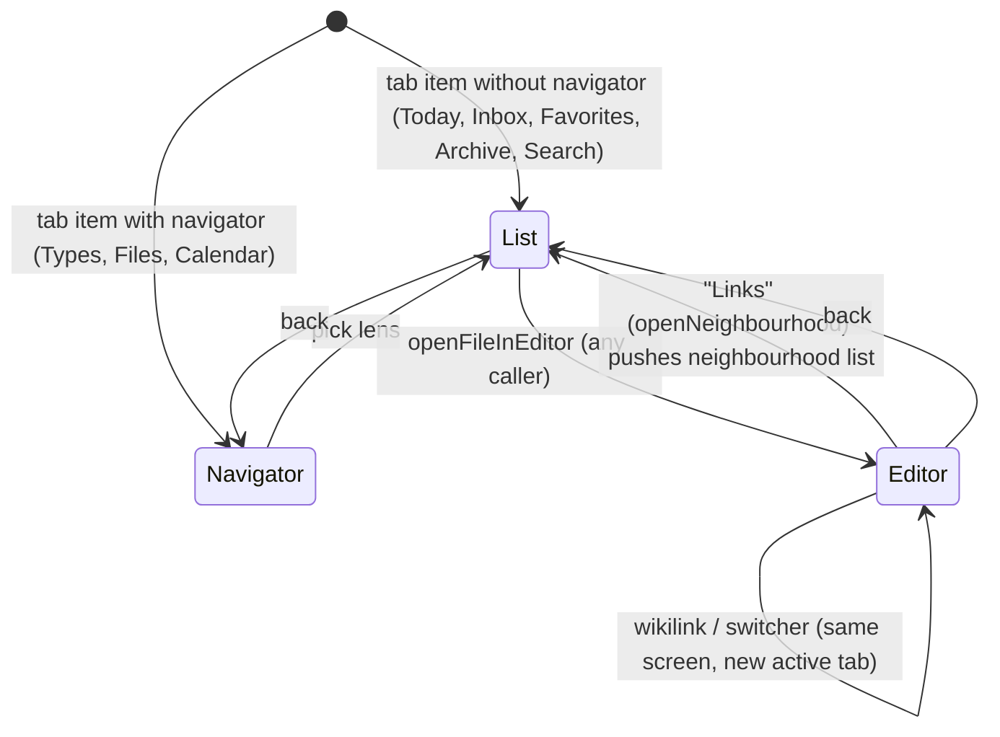

# Design C: mobile UI adaptation (shared by Model A remote and Model B local)

Status: design proposal, 2026-11-02. Read-only study. Nothing was built, run or tested; no device was used.
Scope: the Svelte UI only. Transport, vault access, the vault picker / pairing screen and storage belong to designs A/B. This design assumes they deliver: (1) the same `call()` / `on()` / plugin-fs surface the UI uses today, (2) an `assetUrl()` for images, (3) one open vault.
Owner priority order (`scout-00-owner-scope.md`): view notes, edit notes, interact with notes, rail shell. Everything else later.

Effort scale used below: **S** <= 1 day, **M** 2-4 days, **L** 1-2 weeks (estimates, not measured).

## 0. Assumptions (stated, not confirmed)

1. One SvelteKit bundle per build target (`desktop`, `ios`, optionally `web` for Model A). Same source tree, no fork.
2. The desktop UI must not change at any window size. The desktop window can be 800 px wide (`src-tauri/tauri.conf.json:22` `minWidth: 800`), so width alone must never switch the desktop to a touch layout.
3. iPad gets the existing desktop shell with touch fixes; iPhone (and iPad Slide Over / narrow split) gets a new stack shell. Both shells compose the same feature components.
4. Semantic search is a host capability: dropped in Model B, possibly available in Model A (the Mac runs ONNX). The UI reads a flag, it does not assume either.

## 1. Verified baseline (spot-checked against code)

| Fact | Evidence |
|---|---|
| No responsive or touch layer exists: no `matchMedia`, `innerWidth`, `pointer: coarse`, `hover: none`, `safe-area` anywhere in `src/` | `grep` over `src/` returned nothing |
| Desktop shell is one nested PaneForge group: Rail, navigator (8-30 %), note list (8-40 %), editor, right sidebar (5-30 %) | `src/lib/app/AppShell.svelte:174-273` |
| Defaults 14 / 20 / 20 % | `src/lib/core/settings/settings.store.svelte.ts:66-68` |
| Rail-shell components are prop-driven, so a second shell can reuse them unchanged: `Rail(activeItem, onSelect)`, `TypesNavigator(rows, picked, onPick)`, `FilesNavigator(picked, expanded, onPick, onToggle)`, `RailNoteList(lens)` | `src/lib/features/rail-shell/Rail.svelte:17-24`; `AppShell.svelte:177-223`; `RailNoteList.svelte:71-76` |
| Rail item list is hard-coded inside `Rail.svelte` (search, inbox, today, favorites / types, plugin navigators, files / archive) | `Rail.svelte:40-53` |
| Rail state (item, Types pick, folder, expanded folders) and the stale-pick fix are derived in `AppShell.svelte`, not in a reusable module | `AppShell.svelte:101-156` |
| Layout state lives in the vault's `settings.json`; one write site, one load merge | `src/lib/core/settings/settings.service.ts:10-17`, `:79` (`mergeLayout`), `:185-197` (`writeSettingsFile`) |
| `settingsStore.updateLayout` is called from 11 files (shell, commands, calendar navigator, TOC, type-definitions, files-navigator, neighbourhood, open-search, settings section) | `grep -l "updateLayout("` |
| `editorStore.editorView` exposes the active CodeMirror view | `src/lib/core/editor/editor.store.svelte.ts:16, :43, :107-109` |
| Palette and quick switcher are store-driven (`isOpen`/`open`/`toggle`), opened only by Cmd+P / Cmd+O | `command-palette.store.svelte.ts:4-39`; `quick-switcher.store.svelte.ts:4-30`; `src/lib/app/global-keybindings.ts:62-73` |
| Both dialogs are centered (`top-[50%] translate-y-[-50%]`) and the command input is `text-sm` (14 px) | `src/lib/components/ui/dialog/dialog-content.svelte:29-31`; `src/lib/components/ui/command/command-input.svelte:19` |
| No markdown formatting commands exist (no bold/italic/heading/list toggles, no `Mod-b`) | `grep` over `src/lib/core/markdown-editor`, `src/lib/app/commands.ts` (32 command ids, none for formatting) |
| CM exposes `EditorView.scrollMargins` (keyboard-safe caret scrolling) and `startCompletion` | `node_modules/@codemirror/view/dist/index.js:1605, :9031` (6.43.15); `@codemirror/autocomplete/dist/index.js:2125` |
| CM theme objects accept `@media` keys (style-mod) | `node_modules/.pnpm/style-mod@4.1.4/.../style-mod.js:176` |
| Tailwind 4.3.3 ships `pointer-coarse` / `any-pointer-coarse` variants | `node_modules/tailwindcss/package.json:3`; strings in `dist/lib.js` |
| PaneForge 1.0.2 already handles touch drags on resize handles | `node_modules/paneforge/dist/paneforge.svelte.js:449, :520-557` |
| A Vite `define` pattern already exists for build-time constants | `vite.config.js:83-86` (`__BUILD_INFO__`, `__APP_CHANNEL__`) |
| Hover-only editor controls, small targets | `extensions/live-preview/styles.ts:169-172` (checkbox 18 px), `:276-290` (copy 11 px, `opacity: 0` until `:hover`), `:340-372` (table `+` `opacity: 0`, 20 px) |
| Touch drag guard arms only on `mousedown` | `extensions/live-preview/core/mouse-selecting.ts:40-56` |
| External links need Cmd/Ctrl | `extensions/live-preview/click-handler.ts:16-17`; `src/lib/utils/platform.ts:30-32` |
| queryjs Prev/Next have `onclick` but no `mousedown` guard | `src/lib/plugins/queryjs/kb-ui.ts:499-533` |
| `SaveStatus` exists (needed in the phone header, since the phone has no status bar) | `AppShell.svelte:49, :281` |

### Corrections to the scouts

- **bits-ui ContextMenu already opens on touch long-press** (700 ms timer on non-mouse `pointerdown`, cancelled on `pointermove`/`pointerup`/`pointercancel`): `node_modules/bits-ui/dist/bits/menu/menu.svelte.js:1552-1557` (bits-ui 2.20.2). Scouts 09 and 10 said the menus are unreachable on touch. That is wrong for every `ContextMenu.Trigger` in the app. Whether WKWebView's own long-press callout or text selection cancels the timer first is UNVERIFIED on device.
- **New bug found, from that same path:** the long-press path calls `#handleOpen(e)` directly and never dispatches `contextmenu` (`menu.svelte.js:1540-1543, :1556`). The app sets the menu target only in `oncontextmenu` handlers: `NoteRow.svelte:64` (`menu.setContextTarget(note)`), `FilesNavigator.svelte:286-291, :393`, `TypesNavigator.svelte:182-189, :215, :244`, and `MarkdownEditor.svelte:84-89, :412` (moves the cursor to the press point). On a long press the menu opens with a **stale or null target**: the note-row menu renders nothing (`NoteRowMenu.svelte:177` `{#if contextTarget}`) or acts on the last right-clicked note, and copy-block-link acts on the old cursor line. Inferred from source, not run.
- Rename is reachable from the row menu (`NoteRowMenu.svelte:228-232`), not F2-only as scout 09 says. It only needs the long-press fix above.
- Autocorrect / autocapitalize / spellcheck are off twice: CodeMirror's defaults and the `<body>` attributes in `src/app.html:10`. Scout 10 named only CodeMirror.
- PaneForge resize handles do support touch (above). The 12 px hit area (`resizable-handle.svelte`, `after:w-3`) is still too small.

## 2. Architecture

```
                         one Svelte codebase
 ┌──────────────────────────────────────────────────────────────────────┐
 │ build-time   __APP_TARGET__  ('desktop' | 'ios' | 'web' | 'e2e')      │
 │      │                                                               │
 │      ▼                                                               │
 │ core/platform/capabilities.ts  CAPS (static flags, pure table)       │
 │ core/platform/host-caps.store  semanticSearch, ... (runtime, set by  │
 │                                transport A or probe B)               │
 │ core/layout/form-factor.*      'desktop' | 'tablet' | 'phone'        │
 │                                + keyboardInset (visualViewport)      │
 │      │                                                               │
 │      ▼                                                               │
 │ routes/(app)/+layout.svelte                                          │
 │   formFactor === 'phone' ? <PhoneShell> : <AppShell touch={...}>     │
 │                                                                      │
 │  AppShell (desktop, iPad)          PhoneShell (iPhone, iPad narrow)  │
 │  PaneGroup columns                 stack: navigator → list → editor  │
 │        \                              /                              │
 │         └── rail-shell-state.svelte.ts (shared derivations) ──┘      │
 │         └── Rail items / TypesNavigator / FilesNavigator /           │
 │             RailNoteList / EditorView / MarkdownEditor /             │
 │             PropertiesView / Backlinks / Outgoing / TOC (unchanged)  │
 │                                                                      │
 │ Overlays: CommandPalette, QuickSwitcher → sheet variant on touch     │
 │ Editor:   KeyboardToolbar (touch only), touch fixes in live preview  │
 └──────────────────────────────────────────────────────────────────────┘
        │ call()/on()/plugin-fs/assetUrl (unchanged surface)
        ▼
   Model A: WS/HTTP to Mac host      Model B: Tauri iOS, Rust on device
```



### 2.1 Rules that keep one codebase

1. **No `if (ios)` in features.** Features read capability flags (`CAPS.revealInFileManager`), never the target string. The target string is read in one file.
2. **Shells differ, components do not.** `PhoneShell` composes the same components `AppShell` composes. Shell-level derivations move to one shared module, so the two shells cannot drift on lens logic.
3. **Touch styling is CSS, not branches.** Hit targets, hover-free affordances and 16 px inputs use `@media (pointer: coarse)` / `(hover: none)`, through Tailwind `pointer-coarse:` in Svelte and `@media` keys in CM themes. The same rules then fix an iPad with a finger and leave an iPad with a trackpad alone.
4. **Desktop is pinned.** `formFactorFor` returns `'desktop'` whenever `CAPS.touchShell` is false. Desktop DOM is unchanged, and the existing chromium E2E suite is the regression proof.

## 3. Module shapes

### 3.1 Capabilities (static)

```ts
// src/lib/core/platform/capabilities.ts
/** Build target, injected by Vite `define` as __APP_TARGET__ (vite.config.js define block). */
export type AppTarget = 'desktop' | 'ios' | 'web';

/** What the runtime can do. Pure table, one row per target. */
export interface PlatformCapabilities {
	target: AppTarget;
	/** Phone/tablet shells may be chosen; false pins the desktop shell at any width. */
	touchShell: boolean;
	folderPicker: boolean;          // dialog open({directory:true}); false on iOS
	revealInFileManager: boolean;   // opener revealItemInDir; false on iOS
	openLogFolder: boolean;         // opener openPath(logDir)
	appUpdater: boolean;            // UpdateSection, relaunch
	globalShortcuts: boolean;       // quick-capture
	multiWindow: boolean;           // composer window
	webviewZoom: boolean;           // Cmd +/- zoom
	nativeMenu: boolean;            // menu:settings
	dockBadge: boolean;
}
export function capabilitiesFor(target: AppTarget): PlatformCapabilities; // pure, unit-tested
export const CAPS: PlatformCapabilities; // = capabilitiesFor(resolveTarget())
```

- `resolveTarget()` reads `__APP_TARGET__`. Under `PLAYWRIGHT` the define is `'e2e'`, and `resolveTarget` reads `localStorage['kokobrain:e2e-target']` (set by a fixture `addInitScript`). One dev server can then serve the desktop and the touch projects. This needs a new `vite.config.js` define entry.
- Gated call sites (all from scout 06/08 inventories): `vault.service.ts:26` (picker; design A/B supplies the alternative), `fs.service.ts:291` and `note-action-bar.service.ts:41` (reveal), `log.service.ts:186` (open log dir), `UpdateSection.svelte` (whole section), `zoom.service.ts:29` + `global-keybindings.ts:178-181`, `tauri-listeners.service.ts:30` (menu), `(app)/+layout.svelte:52-54` (quick-capture listener), `NoteRowMenu.svelte:222-226` (Reveal item).
- `IS_MAC` (`platform.ts:23`) stays for keyboard semantics. On iPhone `navigator.platform` is not "Mac", so palette shortcut labels show Ctrl. Add `IS_APPLE = IS_MAC || CAPS.target === 'ios'` for labels (S). The iPad "MacIntel" platform report is UNVERIFIED in WKWebView.

### 3.2 Host capabilities (runtime)

```ts
// src/lib/core/platform/host-caps.store.svelte.ts
/** Capabilities that depend on the vault host, not the device. Set once per vault open. */
export const hostCapsStore = {
	get semanticSearch(): boolean,   // false until the host says otherwise
	get fileHistory(): boolean,
	set(caps: Partial<HostCaps>): void,
};
```

The writer belongs to design A (host descriptor) or design B (a build flag). The UI hides `SemanticIndexStatus` (`AppShell.svelte:278`), the semantic/hybrid modes in search, and `SearchSection` model download when the flag is false.

### 3.3 Form factor and keyboard inset

```ts
// src/lib/core/layout/layout.logic.ts (existing file, pure additions)
export type FormFactor = 'desktop' | 'tablet' | 'phone';
/** Phone below 640 CSS px: iPhone portrait/landscape, iPad Slide Over and 1/3 split. */
export const PHONE_MAX_WIDTH = 639;
export function formFactorFor(touchShell: boolean, width: number): FormFactor;
/** Keyboard height from window.innerHeight and visualViewport; 0 when no on-screen keyboard. */
export function keyboardInsetFor(innerHeight: number, vvHeight: number, vvOffsetTop: number): number;

// src/lib/core/layout/form-factor.store.svelte.ts (state only)
export const formFactorStore = { get formFactor(), get width(), get keyboardInset(), set...(...) };

// src/lib/core/layout/form-factor.service.ts
/** Subscribes window resize + visualViewport resize/scroll; returns the unsubscribe. */
export function startFormFactorTracking(): () => void;
```

- The breakpoint uses width only. iPad split view and Stage Manager resize the webview at runtime, so the shell must be able to switch live without losing editor state. The shells share stores (tabs, scroll positions in `tab-view-state.ts`), so a switch remounts the components and keeps the data.
- The VisualViewport API has `resize`/`scroll` events and `height`/`offsetTop` (https://developer.mozilla.org/en-US/docs/Web/API/VisualViewport). Safari iOS support since 13 is from memory: the MDN compat table did not render. Whether a Tauri WKWebView shrinks the visual viewport, the layout viewport or the whole frame when the keyboard opens is **UNVERIFIED** and is the first device spike (risk 1).

### 3.4 Device-local layout

Problem: `layout` (rail item, picks, panel sizes, sidebar toggles) sits in `<vault>/.kokobrain/settings.json` (`settings.service.ts:10-17`). A phone that writes it either overwrites the Mac's layout (Model A, shared file) or makes a synced copy conflict (Model B). Ten other files write it through `updateLayout`, so changing each caller is the wrong seam.

Seam: persistence only, in `settings.service.ts`.

```ts
// settings.logic.ts (pure)
/** Layout to use after load: the device copy when the shell keeps layout per device, else the vault's. */
export function chooseLayout(vaultLayout: LayoutSettings, deviceLayout: unknown, deviceLocal: boolean, defaults: LayoutSettings): LayoutSettings;
/** Settings to write to the vault: the in-memory settings with `layout` replaced by the vault's last-loaded layout when device-local. */
export function settingsForVaultWrite(settings: AppSettings, vaultLayoutAtLoad: LayoutSettings, deviceLocal: boolean): AppSettings;
```

- `deviceLocal = CAPS.touchShell`. Load (`:79`) applies `chooseLayout` with `localStorage['kokobrain:layout']`. Write (`:204-207`) writes `settingsForVaultWrite(...)` and stores the layout in localStorage. Every `updateLayout` caller stays as it is.
- Phone defaults on first run: `rightSidebarVisible: false`, `railPanelsVisible: true`.
- Remaining race, not solved here: a phone write of any *other* key still replaces the whole `settings.json`. That is design A's concurrency problem (whole-file last-writer-wins) and is flagged to it.
- Open question Q3: should `editor.fontSize` / `contentWidth` also be per device? The Mac default of 18 px (`settings.store.svelte.ts:75`) is fine on a phone, but `contentWidth` is not.

### 3.5 Shared rail-shell state

```ts
// src/lib/features/rail-shell/rail-shell-state.svelte.ts
/** The derivations AppShell.svelte:101-156 does today, as one reusable unit. */
export function createRailShellState(): {
	readonly railItem: { item: string; lens: Lens };
	readonly showsTypesNavigator: boolean;
	readonly showsFilesNavigator: boolean;
	readonly registeredNavigator: RailNavigator | null;
	readonly typeRows: TypeNavigatorRow[];
	readonly railLens: Lens;
};
// rail-items.logic.ts (pure): the list now inside Rail.svelte:40-53
export function railItems(navigators: { id: string; label: string; icon: Component }[]): { top: RailItem[]; navigators: RailItem[]; bottom: RailItem[] };
```

The stale-pick `$effect` (`AppShell.svelte:138-156`) moves with it. Module-level `$derived` behind getters is allowed (ADR-0034, CLAUDE.md rule 3). Each getter gets a test.

### 3.6 Phone navigation

```ts
// src/lib/app/phone/phone-nav.logic.ts (pure)
export type PhoneScreen = 'navigator' | 'list' | 'editor';
export interface PhoneNavState { stack: PhoneScreen[] }
export type PhoneNavEvent =
	| { type: 'selectItem'; hasNavigator: boolean }   // tab bar
	| { type: 'pickLens' }                            // navigator row
	| { type: 'openNote' }                            // any openFileInEditor
	| { type: 'showNeighbourhood' }                   // NoteActionBar → openNeighbourhood
	| { type: 'back' };
export function stepPhoneNav(state: PhoneNavState, event: PhoneNavEvent): PhoneNavState;
// phone-nav.store.svelte.ts: state only, device-local (not persisted to the vault)
```

- **Open-note signal.** `openFileInEditor` has an early return for an already-open tab (`editor.service.ts:114-120`). Watching `activeTabPath` would therefore miss "tap the note already shown". Add a registry port, `registerFileOpenListener(fn)` in `editor.service.ts`, fired on every successful open (cached, race-cached and fresh branches). PhoneShell registers it and AppShell does not. This follows the repo's "consumers register" pattern (CLAUDE.md, Indexing 6). **S**, with a service test using the real store.
- `showNeighbourhood`: PhoneShell watches `railItem.item === NEIGHBOURHOOD_RAIL_ITEM` (`lens.logic.ts:131`), set by `openNeighbourhood` (`neighbourhood.service.ts:10`). No change to the feature.
- Tabs on phone: keep the multi-tab model in `editorStore`, hide `EditorTabs`, and offer an "Open notes" sheet later. Back does not close the tab. See Q1.

## 4. Shells

### 4.1 PhoneShell (iPhone; iPad below 640 px)

| Region | Content | Reuses |
|---|---|---|
| Top bar (44 pt + `env(safe-area-inset-top)`) | Back, title (lens name or note title), `SaveStatus`, action buttons: Search (opens quick switcher sheet), "..." (palette sheet) | `SaveStatus.svelte` |
| Screen: navigator | `TypesNavigator` / `FilesNavigator` / registered navigator (Calendar), full width | as `AppShell.svelte:190-207` |
| Screen: list | `RailNoteList lens={railLens}` or `SearchPanel` | `AppShell.svelte:220-224` |
| Screen: editor | `EditorView` minus `EditorTabs`, `NoteActionBar` in the top bar overflow, "Info" button opens the note-info sheet | `EditorView.svelte:63-149` |
| Note-info sheet (bottom, 90 % height) | Properties, TOC, Backlinks, Outgoing, the same 4 panels and toggles as the right sidebar | `AppShell.svelte:250-266` |
| Bottom tab bar (49 pt + `env(safe-area-inset-bottom)`) | Today, Inbox, Types, Files, More (Search, Favorites, Calendar, Archive) | `railItems()` (3.5), inbox badge from `Rail.svelte:27-32` |
| Keyboard toolbar | Section 6 | new |

- Hidden on phone: the status bar (save state moves to the top bar; word count to the info sheet), resize handles, the right-sidebar toggle (`AppShell.svelte:165-173`), the `data-tauri-drag-region` spacers.
- Safe areas need `viewport-fit=cover` in `src/app.html:6`. Whether Tauri iOS already extends the WKWebView under the notch and home indicator is UNVERIFIED.
- Transitions: none in v1 (instant swap). An edge-swipe back gesture is a later item (**M**). Its conflict with CodeMirror horizontal selection needs a device test.

### 4.2 iPad (>= 640 px): AppShell in touch mode

- Keep `AppShell.svelte`. Pass `touch = CAPS.touchShell`, which only toggles CSS:
  - resize handle hit area 12 px to 28 px under `pointer-coarse:` (`resizable-handle.svelte`, `after:w-3` to `pointer-coarse:after:w-7`).
  - remove the traffic-light spacer and drag regions (`AppShell.svelte:229-233, :251`; `Rail.svelte:62`) when `!CAPS.nativeMenu`.
  - rail buttons `p-2` with `size-4` icons are about 32 px (`Rail.svelte:80-89`), so raise them to 44 px under `pointer-coarse:`.
- Under 1100 px (iPad portrait 834 px, iPad Pro 11 descriptor per scout 17) the right sidebar renders as the same note-info **sheet** (side `right`), not a pane. The editor keeps about 500 px in portrait (48 + 14 % + 20 % of 834). Arithmetic from defaults, not measured.
- Hardware keyboard: the existing `global-keybindings.ts` stays. Whether iPadOS delivers Cmd+P / Cmd+O to the page or keeps them for the system is UNVERIFIED.

## 5. Feature tiers for iOS v1

Tiers follow the owner order (scout 00) and override scout 11's tiering where they differ.

| UI milestone | Features (folder) | UI work in this design |
|---|---|---|
| **UI-M1 View** | vault gate (from design A/B), rail-shell list + `RailNoteList`, `EditorView` read, live preview, `periodic-notes` (Today lens), `file-icons` (read) | PhoneShell skeleton, form factor, capabilities, device-local layout, iPad touch CSS |
| **UI-M2 Edit** | markdown editor, autosave, `SaveStatus` visible | keyboard toolbar, keyboard inset + `scrollMargins`, touch drag guard (R1), 16 px inputs |
| **UI-M3 Interact** | wikilinks, tasks toggle, `properties` (PropertiesView + meta-bind), callouts, tables, embeds, images, `note-action-bar` (minus reveal), `copy-block-link` | tap-to-open links, hit targets, `hover: none` affordances, context-menu target fix, note-info sheet |
| **UI-M4 Rail shell** | `rail-shell` Types/Files/Calendar navigators, neighbourhood lenses (backlinks, outgoing, belongs-to, has-many, related-to), `note-list` row menu (rename, favorite, icon, trash), `quick-switcher`, `command-palette`, text `search` | tab bar, navigator screen, long-press menus, "Move to..." action, palette/switcher sheets |
| Later, by value | `tags`, `tasks` view, `templates`, `calendar` plugin, `event-calendar` (iPad first), `collection`, `kanban`, `file-history`, `table-of-contents` (already in the sheet), `word-count`, settings (full-screen, subset), `auto-move`, `type-definitions` editing, `graph-view` and `canvas` (iPad first, iPhone read-only or hidden), `queryjs` (needs the Prev/Next fix), `one-on-one`, Todoist | per-feature touch pass (DnD in canvas/kanban/event-calendar not reviewed, scout 09) |
| **Dropped on iOS** | `quick-capture` (global shortcut, composer window, macOS sources: `lib.rs:15-17`, `quick_capture/source.rs`); auto-updater + relaunch (`UpdateSection.svelte`); Reveal in Finder (`fs.service.ts:291`, `note-action-bar.service.ts:41`); open log folder (`log.service.ts:186`); native menu (`menu:settings`); webview zoom shortcuts on iPhone; drag-and-drop move in Files on iPhone (replaced by "Move to..."); hover tab-close (`EditorTabs.svelte:71`, tabs hidden on phone) | gated by `CAPS` |
| **Host-dependent** | semantic and hybrid search, model download UI | `hostCapsStore.semanticSearch` (true possible in Model A only) |
| Kept, low value | dock badge: `setBadgeCount` is supported on iOS per scout 06 (`window/mod.rs:2282`). May need notification permission (UNVERIFIED). Keep it behind `CAPS.dockBadge`, off by default. | none |

## 6. Keyboard toolbar (markdown actions above the virtual keyboard)

### 6.1 Approach

A web-rendered bar, fixed to the bottom of the visual viewport, shown only when the editor is focused, `CAPS.touchShell` is true and `keyboardInset > 0`. With an iPad hardware keyboard there is no inset, so the bar hides by itself.

A native `inputAccessoryView` was rejected for v1. WKWebView owns the accessory view of its internal content view, so replacing it needs private-class swizzling in a Swift plugin. That is from memory and UNVERIFIED, and costs **L** and App Review risk. Revisit only if the web bar flickers badly on device.

### 6.2 Shapes

```ts
// src/lib/core/markdown-editor/format/markdown-format.logic.ts (pure, @codemirror/state only)
export type InlineMark = 'bold' | 'italic' | 'strike' | 'code' | 'highlight';
/** Wraps or unwraps each selection range in the mark's delimiters (**, *, ~~, `, ==). */
export function toggleInlineMark(state: EditorState, mark: InlineMark): TransactionSpec;
/** Cycles the current line(s): paragraph → H1 → H2 → H3 → paragraph. */
export function cycleHeading(state: EditorState): TransactionSpec;
/** Toggles "- " / "- [ ] " / "1. " prefixes on the selected lines. */
export function toggleLinePrefix(state: EditorState, kind: 'bullet' | 'task' | 'ordered' | 'quote'): TransactionSpec;
/** Inserts [[]] with the cursor inside, or wraps the selection as [[selection]]. */
export function insertWikilink(state: EditorState): TransactionSpec;

// src/lib/core/markdown-editor/format/keyboard-toolbar.ts
export interface ToolbarAction { id: string; label: string; icon: Component; run(view: EditorView): boolean }
export const KEYBOARD_TOOLBAR_ACTIONS: readonly ToolbarAction[];
```

- Row (horizontally scrollable): `[[ ]]` (insert + `startCompletion(view)`), task, bullet, heading, bold, italic, code, indent / outdent (`indentMore`/`indentLess` from `@codemirror/commands`), undo / redo (`undo`/`redo`, history is already installed at `editor-extensions.ts:129`), `#` tag, dismiss keyboard (`view.contentDOM.blur()`).
- Buttons call `preventDefault()` on `pointerdown` so the contenteditable keeps focus and the keyboard stays up. Each is 44x44 pt.
- The same `ToolbarAction` list registers palette commands (`commands.ts`) and desktop keymaps (Mod-b, Mod-i, from the same `run`). That serves both platforms, and the logic is tested once.
- Caret visibility: add `EditorView.scrollMargins.of(() => ({ bottom: keyboardInset + toolbarHeight }))` through a compartment that is reconfigured when the inset changes.
- Position: `KeyboardToolbar.svelte` with `style="transform: translateY(-{inset}px)"` inside a `fixed bottom-0` container. The `visualViewport` `scroll` event also fires while iOS scrolls the page under the keyboard, so the bar follows it. Flicker during the keyboard animation is expected (UNVERIFIED).

## 7. Command palette and quick switcher as sheets

- No new component. Add a `variant` prop to `command-dialog.svelte`. In touch mode it passes classes to `Dialog.Content` that override the centering. The content becomes top-anchored, full width, `max-h-[calc(100dvh-var(--kb-inset))]`, rounded bottom only, with no zoom animation. A centered dialog would sit behind the keyboard once the input is focused.
- Input font: `pointer-coarse:text-base` (16 px) on `command-input.svelte:19`, to avoid the iOS zoom-on-focus rule (the 16 px figure is secondary-source, scout 10 T4).
- Triggers: top-bar Search opens `quickSwitcherStore.open()`, "..." opens `commandPaletteStore.open()`. On iPad add the same two buttons to the rail top. The stores already exist (section 1).
- Shortcut labels (`CommandPalette.svelte`, `formatShortcut`) are hidden on phone and kept on iPad.
- A full-height **Sheet** primitive is needed for the note-info sheet, settings and row actions anyway. Add shadcn-svelte `Sheet` via the CLI: it is built on bits-ui `Dialog`, so no new dependency (https://github.com/huntabyte/shadcn-svelte/blob/main/docs/src/lib/registry/ui/sheet/sheet-content.svelte). `Drawer` (drag-to-dismiss) depends on `vaul-svelte` (same repo, `ui/drawer/drawer.svelte`). That is a new dependency, so not in v1.

## 8. Editor and shell touch fixes

| # | Fix | Where | Effort | Milestone |
|---|---|---|---|---|
| E1 | Arm `mouseSelecting` on touch: `touchstart` sets it, `touchend`/`touchcancel` release it. Test with real `EditorState` that `checkUpdateAction` returns skip while armed | `core/mouse-selecting.ts:40-56` | S code + device check | UI-M2 |
| E2 | Gate the 150 ms scroll-debounce rebuild while a touch is active | `core/scroll-debounce-plugin.ts:32-41` | S | UI-M2 |
| E3 | Tap opens links on touch. Pure predicate `isOpenLinkGesture(e, mac, lastPointerType)`. A `pointerdown` handler records `pointerType`, and a primary-button mousedown within 500 ms of a touch pointer counts as "modifier held". Revealed-line wikilinks keep "tap = place cursor" (Q2) | `click-handler.ts:16-17`, `platform.ts:30` | S | UI-M3 |
| E4 | `@media (hover: none)`: copy button and table `+` at opacity 0.6 / 1. `@media (pointer: coarse)`: hit areas up to 44 px through padding or a transparent `::before`, artwork unchanged | `styles.ts:169-172, :276-290, :340-372, :404-425, :912-920` | S | UI-M3 |
| E5 | `@media (pointer: coarse)`: 16 px font for meta-bind input/select, code-block language select and the rename input | `styles.ts:617-625, :709-717`; `NoteRow.svelte:55` (`text-[13px]`) | S | UI-M3 |
| E6 | Context-menu target on long press. A shared attachment `longPressTarget(fn)` calls the same `setContextTarget` / cursor move on touch `pointerdown`, before bits-ui's 700 ms timer opens the menu. Add `-webkit-touch-callout: none` and `user-select: none` on rows, so the iOS callout does not win | `NoteRow.svelte:64`, `FilesNavigator.svelte:286-291, :393`, `TypesNavigator.svelte:182-189, :215, :244`, `MarkdownEditor.svelte:84-89, :412`, `EditorTabs.svelte:32-33` | S-M | UI-M3/M4 |
| E7 | Editor long press is native text selection, so a menu there competes with the iOS loupe. On touch, put "Copy link to block" and "Copy block embed" in the note-info sheet and the toolbar overflow, not the long-press menu | `MarkdownEditor.svelte:408-426` | S | UI-M3 |
| E8 | queryjs Prev/Next `mousedown` stop-propagation (also a desktop bug) | `plugins/queryjs/kb-ui.ts:499-533` | S | later (queryjs) |
| E9 | "Move to..." row action (folder picker sheet over `fsStore.fileTree`, calls the existing `moveItem`) replaces DnD on phone | `NoteRowMenu.svelte`, `fs.service.ts` | M | UI-M4 |
| E10 | Autocorrect / autocapitalize in the editor: opt-in through `EditorView.contentAttributes`. Default stays off (app.html:10 + CM) until device IME tests pass (Q4) | `editor-extensions.ts` | S | UI-M2 (decision) |
| E11 | `viewport-fit=cover` and safe-area padding for top bar, tab bar and sheets | `src/app.html:6`, shell CSS | S | UI-M1 |
| E12 | Do not autofocus the editor on note open on phone (read-first, no keyboard pop) | `MarkdownEditor.svelte` focus paths (scout 10: `:134`, `:246`) | S | UI-M1 |

## 9. E2E strategy

### 9.1 Layers

| Layer | What | Runs where | Proves | Does not prove |
|---|---|---|---|---|
| Vitest unit | `capabilitiesFor`, `formFactorFor`, `keyboardInsetFor`, `stepPhoneNav`, `chooseLayout`/`settingsForVaultWrite`, `markdown-format.logic` (real `EditorState`, no mocks), `isOpenLinkGesture`, `rail-shell-state` getters, `registerFileOpenListener` with the real editor store | node/jsdom, existing CI | logic | layout, touch |
| Playwright `webkit-iphone` | `devices['iPhone 15']` (webkit, isMobile, hasTouch, 393x659; scout 17 verified the registry). New `e2e/specs/mobile/*.spec.ts` only | existing e2e job + `playwright install --with-deps webkit` (`e2e.yml:37-43`) | phone shell, stack nav, sheets, tap targets, long-press menu target (E6), link tap (E3), safe layout | WKWebView quirks, real keyboard, native selection handles |
| Playwright `webkit-ipad` | `devices['iPad Pro 11']` (834x1194) plus a landscape variant. The mobile specs tagged `@tablet` plus a small existing subset (`editor`, `rail-shell`, `wikilink-navigation`, `sidebars`) | same job | AppShell touch mode, sidebar-as-sheet below 1100, breakpoint switch on `page.setViewportSize` (simulated split view) | hardware-keyboard routing on iPadOS |
| Chromium (existing 44 specs) | unchanged, desktop target | existing | desktop not regressed (rule 2.1.4) | none |
| Device smoke (manual, owner) | checklist below, on simulator or device through the T3 device tools (`device_list` / `device_open` / `device_screenshot`), never `simctl` for UI | manual, per UI milestone | the UNVERIFIED items | none |

### 9.2 Mechanics

- `e2e/playwright.config.ts:19`: add projects. `{ name: 'webkit-iphone', use: { ...devices['iPhone 15'] }, testMatch: /mobile\/.*\.spec\.ts/ }` and the same for `webkit-ipad`. Chromium gets `testIgnore: /mobile\//`. That keeps the extra cost to the mobile folder rather than doubling the 44-spec suite.
- Target selection in one dev server: a fixture `mobileTest = test.extend(...)` runs `page.addInitScript(() => localStorage.setItem('kokobrain:e2e-target', 'ios'))` before `page.goto('/')`. It reuses `e2e/fixtures/test-vault.ts` (scout 08: `:142`).
- Taps: `locator.tap()` (needs `hasTouch`, which the descriptors set). Long press has no Playwright helper: dispatch `pointerdown` with `pointerType: 'touch'`, wait 750 ms, dispatch `pointerup`, then assert the menu shows the **pressed** note's actions (rendered text, CLAUDE.md rule 8).
- Keyboard: Playwright WebKit shows no on-screen keyboard. `form-factor.service.ts` reads the inset through one function. Under `PLAYWRIGHT`, `window.__e2e.setKeyboardInset(px)` (following the existing `window.__e2e` hooks, scout 08 section 4) drives the store. Specs then assert the toolbar is visible and the caret line's bounding box ends above the toolbar.
- Spec list (UI-M1..M4): `mobile/phone-shell.spec.ts` (tab bar, stack, back, open note from list / switcher / wikilink), `mobile/phone-editor-toolbar.spec.ts` (each action edits the doc and the text is asserted), `mobile/touch-links.spec.ts`, `mobile/row-actions.spec.ts` (long-press target, rename, move-to), `mobile/sheets.spec.ts` (palette, switcher, note-info), `mobile/tablet-shell.spec.ts` (breakpoint switch keeps the open tab and content).
- Limit: Playwright WebKit on Linux is not WKWebView inside Tauri (scout 17 2.3). The device checklist below remains mandatory.

### 9.3 Device smoke checklist (per UI milestone)

1. Keyboard up while typing at the end of a long note: the caret stays visible, the toolbar sits on the keyboard, no jump (V1, CM #1663).
2. Selection-handle drag across a table and a code block: the widget is not destroyed mid-drag (E1).
3. Long press on a note row: the menu shows that row's note; the iOS callout does not appear (E6).
4. Tap on an external link, a rendered wikilink and a task checkbox.
5. Fling-scroll a long wrapped note: decorations arrive, no scroll jumps (CM #1460 / #1601).
6. iPad split view resize across 640 px: the shell switches, the open note and scroll stay.
7. iPad hardware keyboard: Cmd+P, Cmd+O, Cmd+B reach the page.
8. Focus on meta-bind input and the palette input: no zoom.

## 10. Component list with effort

| # | Component / change | New / changed file | Effort | Milestone |
|---|---|---|---|---|
| 1 | Capability table + `__APP_TARGET__` define + e2e override | `core/platform/capabilities.ts`, `vite.config.js` | S | M1 |
| 2 | Gate desktop-only call sites (about 10 sites, section 3.1) | listed files | S | M1 |
| 3 | `hostCapsStore` + hide semantic UI | `core/platform/host-caps.store.svelte.ts`, `AppShell.svelte:278`, search UI | S | M1 |
| 4 | Form factor logic, store, service | `core/layout/layout.logic.ts`, `form-factor.store.svelte.ts`, `form-factor.service.ts` | S | M1 |
| 5 | Device-local layout persistence | `settings.service.ts:79, :204`, `settings.logic.ts` | S-M | M1 |
| 6 | Extract `createRailShellState` + `railItems` from AppShell / Rail | `features/rail-shell/rail-shell-state.svelte.ts`, `rail-items.logic.ts` | M (touches a hot desktop file; regression risk, covered by `rail-shell.spec.ts`) | M1 |
| 7 | Shell switch in the layout route | `routes/(app)/+layout.svelte:175-177` | S | M1 |
| 8 | `PhoneShell.svelte` (top bar, screens, back) | `app/phone/PhoneShell.svelte` | M | M1 |
| 9 | `phone-nav.logic.ts` + store + `registerFileOpenListener` port | `app/phone/*`, `editor.service.ts` | S | M1 |
| 10 | `PhoneTabBar.svelte` (5 slots + More sheet, inbox badge) | `app/phone/PhoneTabBar.svelte` | S-M | M4 (M1: Today + Files only) |
| 11 | Safe areas, `viewport-fit`, read-first open (E11, E12) | `app.html`, shells, `MarkdownEditor.svelte` | S | M1 |
| 12 | iPad touch CSS in AppShell / Rail / resize handle | `AppShell.svelte`, `Rail.svelte`, `resizable-handle.svelte` | S | M1 |
| 13 | shadcn `Sheet` primitive | `components/ui/sheet/*` (CLI) | S | M1 |
| 14 | `NoteInfoSheet.svelte` (4 right-sidebar panels) phone + iPad < 1100 | `app/NoteInfoSheet.svelte` | S-M | M3 (M1 phone read-only) |
| 15 | `markdown-format.logic.ts` + desktop keymaps + palette commands | `core/markdown-editor/format/*`, `editor-extensions.ts`, `commands.ts` | M | M2 |
| 16 | `KeyboardToolbar.svelte` + inset-driven `scrollMargins` compartment | `core/markdown-editor/format/KeyboardToolbar.svelte`, `MarkdownEditor.svelte` | M | M2 |
| 17 | Touch drag guard + scroll debounce gate (E1, E2) | live-preview core | S | M2 |
| 18 | Touch CSS for editor widgets (E4, E5) | `styles.ts` | S | M3 |
| 19 | Tap-to-open links (E3) | `click-handler.ts`, `platform.ts` | S | M3 |
| 20 | Long-press target attachment (E6) + editor menu relocation (E7) | `utils/` attachment, 5 components | S-M | M3/M4 |
| 21 | Palette / switcher sheet variant + 16 px input | `command-dialog.svelte`, `command-input.svelte`, `dialog-content.svelte` | S | M4 |
| 22 | "Move to..." action sheet (E9) | `NoteRowMenu.svelte`, new `MoveToSheet.svelte` | M | M4 |
| 23 | Mobile E2E projects, fixture, `__e2e.setKeyboardInset`, 6 specs | `e2e/playwright.config.ts`, `e2e/specs/mobile/*`, `.github/workflows/e2e.yml` | M | grows per milestone |
| 24 | Settings full-screen on phone (subset) | `SettingsPanel.svelte:112-118` | M | later |
| 25 | Edge-swipe back gesture | `PhoneShell.svelte` | M | later |
| 26 | Per-feature touch passes: canvas, kanban, event-calendar, graph | feature folders | L (not scoped) | later |

Totals for UI-M1..M4 (items 1-23): about 10 S, 9 M-ish, so about **4-6 weeks** of UI work for one developer, excluding designs A/B. Estimate only.

## 11. Risks, ranked

| # | Risk | Likelihood / impact | Mitigation |
|---|---|---|---|
| 1 | Keyboard handling in the Tauri WKWebView: the caret goes under the keyboard, or the visual viewport does not report it, so the toolbar has nothing to anchor to (V1, UNVERIFIED) | high / high (blocks M2) | Device spike first in M2. The inset sits behind one function, with a fallback: if `visualViewport` does not shrink, a tiny Swift plugin posts `keyboardWillChangeFrame` heights to JS (M) |
| 2 | Reveal-on-tap reflow and widget rebuild under selection handles (E1, P2) make editing tables and code blocks painful on a phone | high / medium | E1 + E2, device check 2; on phone, consider tap-to-edit for block widgets through an explicit "Edit" affordance (later) |
| 3 | Long-press menus act on the wrong item (bug in section 1, found in code) | certain if shipped / high (wrong-note rename or trash) | E6 before any touch menu ships; E2E long-press spec asserts the target |
| 4 | Two shells drift (lens logic duplicated in PhoneShell) | medium / medium | Component 6 (shared state) lands **before** PhoneShell; PhoneShell may not import `settingsStore.layout` rail fields directly; review rule |
| 5 | Layout or settings clobber between the Mac and the phone through `settings.json` | high in Model A / medium | Section 3.4 for layout; whole-file settings concurrency flagged to design A |
| 6 | Playwright WebKit green while the device is broken | high / medium | Device checklist 9.3 is a milestone gate, not optional |
| 7 | WKWebView wrapped-line scroll bugs (CM #1460, #1601: no upstream workaround) | medium / medium | Measure on device; the scout notes a root-level scroller avoided #1460, so try `.cm-scroller` as the main scroll view in PhoneShell |
| 8 | Desktop regression from the AppShell extraction (component 6) | low / high | Existing chromium suite (`rail-shell.spec.ts`, `sidebars.spec.ts`) + getter tests before the move (CLAUDE.md pre-change checklist) |
| 9 | Desktop-only code still in the iOS bundle (updater, composer route) | medium / low | `CAPS` constants fold at build time; check bundle output once, use a dynamic import for `UpdateSection` if needed |
| 10 | iPadOS keeps Cmd shortcuts for itself | unknown / low | Visible palette and switcher buttons on iPad regardless |

## 12. Open questions for the owner

1. **Tabs on iPhone:** keep the hidden multi-tab model with an "Open notes" switcher, or one note at a time (opening a note closes the previous unpinned one)?
2. **Tap on a rendered link in the editor:** open it (Obsidian mobile behaviour) or place the cursor? This design opens external links and rendered wikilinks on tap, and a raw `[[...]]` on the cursor line places the cursor.
3. **Per-device settings:** layout is per device (section 3.4). Should editor font size, content width and theme also be per device?
4. **Autocorrect / autocapitalize** in the editor on iOS: off as on desktop, or on (with the CM iOS IME caveats in scout 10 T1)?
5. **Bottom tab bar:** Today, Inbox, Types, Files, More. Is that the right four? Search sits in the top bar.
6. **iPhone scope for canvas, graph, kanban, event-calendar:** hidden, read-only, or full later?
7. **Read-first:** opening a note on the phone does not raise the keyboard until you tap into the text. OK?

## 13. Not verified

- Nothing was run on a device, simulator or browser. No build or tests were run.
- WKWebView inside Tauri iOS: visual viewport behaviour with the keyboard, safe-area defaults, the bits-ui long-press timer surviving the iOS callout, `keyboardDisplayRequiresUserAction` (programmatic focus raising the keyboard), the iPad `navigator.platform` value, and hardware-keyboard Cmd routing.
- Safari iOS VisualViewport version (MDN compat table did not render; "since 13" is from memory).
- The native `inputAccessoryView` swizzling claim (from memory).
- The 44 pt HIG figure and the 16 px input-zoom rule (secondary sources, via scout 10).
- The long-press stale-target bug (section 1) is inferred from bits-ui and app source and has not been reproduced. Write the E2E long-press spec first to confirm it.
- Breakpoint values (640 / 1100 px) are design choices, not measured against real iPad split widths.
