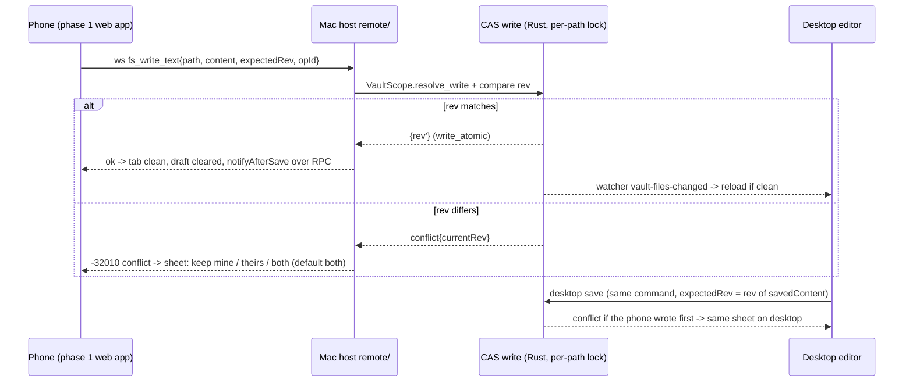

# Kokobrain iOS: architecture proposal (synthesis draft)

Status: draft for owner review, 2026-11-02, repo at `main` 2a937e57. Read-only study. Nothing was compiled, run, or tested on a device.
Inputs: `scout-00` (owner scope, authoritative), scouts 01-17, designs A (remote), B (local), C (mobile UI), D (core seams), all in this folder.
Citations: `path:line` for code (spot-checked in this pass where marked [V]; otherwise taken from the named design/scout). URLs for external claims. UNVERIFIED = not checked against code, a primary source, or a device.
Sizes: S <= 2 days, M 3-7 days, L 1-3 weeks of focused solo work. All sizes are estimates, not measurements.

## 1. Executive summary and recommendation

**Recommendation: a sequenced hybrid, A first, then B for offline. One Mac host serves both.**

- **Phase 1 (M0-M8), model A, option (a):** the Mac app runs a loopback-only HTTP+WebSocket server, published on the tailnet by `tailscale serve`. The iPhone/iPad runs the **same SvelteKit bundle** in Safari as a home-screen web app, with remote adapters behind the platform ports. It needs no Xcode, no Apple account, and no iOS Rust build. Semantic search works because BGE-M3 stays on the Mac.
- **Phase 2 (M9), model B, sync option S1:** a Tauri 2 iOS app with the Rust core on device and a local replica of the vault in the app container. Kokobrain's own file sync runs against the same Mac host over the same Tailscale route. This is the milestone where offline arrives.
- **Built once, used by both phases:**
  - a compare-and-swap (CAS) note write in Rust under a per-path lock;
  - `VaultScope` containment on every path command;
  - pairing and sessions;
  - the platform capability table;
  - the mobile UI (design C);
  - the device-local layout.

Why this order fits the owner:

| Owner fact (`scout-00`) | Consequence |
|---|---|
| Already reaches t3code from the phone through its remote URL over Tailscale | Model A copies a workflow the owner already runs: one host, a one-time pairing token, Tailscale Serve as the route (`scout-14` §1, §13). The only new setup is turning on Tailscale HTTPS for the Mac. |
| Priorities are view, edit, interact, rail shell; offline "required, but not in the first milestones" | A delivers priorities 1-4 without the riskiest piece of B, the sync engine (design B §12: B2 and B3 are both L). |
| Semantic search may be dropped on iOS | In A it is not dropped: the phone calls `search_hybrid` on the Mac. In B it is gated off (design B §3.3). |
| Solo developer | A defers Tauri iOS tooling churn: Xcode breakage, signing, Node under the Xcode build phase (tauri#16121, #15931, #15740, cited in design B §9). Each milestone is a few small commits. |
| Desktop must stay green | Every desktop behaviour change is isolated in its own milestone with an E2E proof (M2) or is off by default (the remote server toggle in M3). |
| "An edit must never be silently dropped", even before offline | The desktop CAS check lands **before** phone editing (M2). Design A put it later (A4). Section 4 explains why that ordering would lose phone edits. |
| Vault is on a **MacBook** | Model A is unavailable whenever the lid is closed. The owner scope accepts this for the early milestones, but for a notes app it is the main daily limit, which is why B follows A instead of being dropped. |

Why not B first: the first useful B milestone, the real vault on the phone (B2), needs the iOS compile gates, the Tauri iOS boot, the Mac sync server, and the pull half of the sync engine (design B §12: M + M + L). It also needs a paid Apple account before anything reaches the owner's phone. The touch UI work (design C) is the same in both models, and A lets it ship and be validated weeks earlier.

Why not A only: offline is a stated requirement (`scout-00`). Design A's own offline step (A6: a thin Tauri iOS app with a draft journal, op queue and read cache) only covers notes opened before going offline. It cannot browse, search, or show rail lenses (backlinks, belongs-to) offline, because those come from the Mac's `VaultIndex`. B's local replica runs the same index on device. A6 would be built and then replaced, so this plan skips it.

## 2. Comparison

| Criterion | A only (remote PWA, later A6) | B only (local Tauri iOS + S1 sync) | **Hybrid: A then B (recommended)** |
|---|---|---|---|
| Effort to owner priorities 1-4 | ~8-11 weeks (M0-M7 below) | ~10-14 weeks: B0-B4 plus the UI track (design B §12, design C §10). The sync engine sits on the critical path | Same as A: ~8-11 weeks |
| Effort to offline | +L for A6, which is partial offline | Included, met at B3 | +5-8 weeks (M9). Reuses the M2 CAS write, the M3 host, auth and the UI |
| Offline behaviour | Until A6: drafts kept in IndexedDB, a clear "Mac unreachable" state, no new reads. After A6: cached notes and a write queue | Full: the local disk is the source of truth on the phone, changes queue until the Mac is reachable | Like A until M9, like B after |
| Mac asleep or lid closed | Phone cannot open unopened notes. Edits stay as drafts | Full use, sync later | Like A until M9, like B after |
| Sync risk (two writers diverge) | Low: one copy of each file, writes rev-checked by the host | Medium: per-file base hash, 3-way merge, conflict copies (design B §5) | Low until M9. M9 adds B's risk, with conflict data from phase 1 to size it |
| Data-loss risk | Silent overwrite by a dirty desktop tab (`editor.service.ts:375-380` [V]) until the desktop CAS lands. PWA storage eviction of drafts (webkit.org/blog/14403) | Same desktop overwrite, plus sync merge bugs | Desktop overwrite closed in M2, before any phone write. Draft eviction is bounded by M9 |
| Feature coverage | Everything the host runs, including semantic and hybrid search and file history | No semantic search on iOS. FTS stays | Phase 1 has everything. Phase 2 local has no semantic search, and can call the host when it is reachable (M9 optional task) |
| App Store / TestFlight | None until A6 | Paid Apple Developer account from B0 ($99/yr per scout 13, UNVERIFIED) | None until M9 |
| iOS Rust build | Never (A6 is a separate small crate) | Required: gate global-shortcut, arboard, updater, process, notify, ONNX (scout 04) | Deferred to M9 |
| Maintenance | One bundle and one host. A protocol integer and caps (needed only once a separately shipped client exists) | Two runtimes (desktop, iOS Rust) plus a sync protocol | One bundle. Host RPC plus sync routes. The phase-1 remote mode can be retired after M9 (Q2) |
| Owner setup | Tailscale HTTPS on (machine FQDN goes to the public CT logs, tailscale.com/kb/1153), one QR pairing, Mac app running | The same plus TestFlight install | The same as A, plus TestFlight at M9 |

## 3. Target architecture

### 3.1 Topology (end state after M9)

```
 iPhone / iPad                                         MacBook (host; owns the vault)
 +---------------------------------------+             +-------------------------------------------------+
 | Phase 1: Safari home-screen web app    |  https/wss  | tailscaled: tailscale serve --bg --https=8443    |
 |   same SvelteKit bundle                |<--tailnet-->|   -> http://127.0.0.1:<port>                     |
 |   platform-select: !isTauri -> remote  |             |                                                 |
 |   app/remote/*: WS JSON-RPC, VaultFs,  |             | Kokobrain.app (Tauri, macOS)                     |
 |   Platform, assetUrl=/v1/asset/<rel>   |             |  webview: desktop UI (unchanged)                 |
 |   drafts in IndexedDB                  |             |  remote/ (axum, 127.0.0.1, off by default)       |
 +---------------------------------------+             |   /.well-known/kokobrain  /v1/auth/*             |
 +---------------------------------------+             |   /ws  JSON-RPC 2.0 + seq-numbered events        |
 | Phase 2 (M9): Tauri iOS app            |             |   /v1/asset/*  (Range, ETag)                     |
 |   same bundle, platform-select -> ios  |             |   /v1/sync/*   (M9: manifest, file, events)      |
 |   Rust core on device (vault/db/search)|             |   /*  static bundle via asset_resolver           |
 |   sync/ client (reqwest) ------------- | --tailnet-->|   policy (deny by default) + VaultScope          |
 |   Documents/Vault (+ .kokobrain local) |             |  commands/* -> core (Tauri-free) + EventSink     |
 +---------------------------------------+             |  CAS write (per-path lock): desktop editor save, |
                                                       |    phone RPC save, sync PUT all go through it    |
                                                       |  <vault>/ + .kokobrain/kokobrain.db (WAL, local) |
                                                       +-------------------------------------------------+
```



### 3.2 Decisions where the designs disagree

| # | Topic | Options in the designs | Decision and reason |
|---|---|---|---|
| D1 | How the phone bundle swaps Tauri modules | A: a second build with a Vite alias map (`KB_TARGET=remote`, `build-remote/`). D: runtime ports in `core/` plus boot selection | **Runtime ports, one bundle.** The host serves the desktop's own embedded bundle through `AppHandle::asset_resolver()` (`tauri-v2.12.5 crates/tauri/src/app.rs:879`, `AssetResolver::get` `:330` [V], https://github.com/tauri-apps/tauri/blob/tauri-v2.12.5/crates/tauri/src/app.rs). This removes version skew by construction, a second release build, a second `pnpm build` in the commit gate, and the `tauri-before-build.sh` fingerprint question for the remote mode. The ports cost about 3 days of import swaps more than A's shims (D §3 T3/T4) and are reused by the iOS app in M9. **Fallback** if the M0 spike shows that asset_resolver output does not boot in Safari (Tauri computes its own CSP for embedded HTML, UNVERIFIED): A's alias build. |
| D2 | Where remote code lives | A: new top-level `src/lib/platform/` | **`src/lib/app/remote/`** for the adapters and `src/lib/core/platform/` for the port and caps. `scripts/import-graph.mjs:155-174` [V] knows the layers `app`, `core`, `features`, `plugins`, `utils`, `types`, `components`, `contracts`. `app/` is the composition root and may import every layer (`:31-40` [V]). A new top-level folder would need an ADR-0003 amendment. |
| D3 | Telling desktop, web and iOS apart | C, B: a build-time `__APP_TARGET__` define. D: runtime (`isTauri()` plus plugin-os) | Phase 1: runtime `isTauri()` (sync, `@tauri-apps/api/core.js:491-493` per design D). Web means remote. **The iOS choice is deferred to M9**, and the recommendation there is a build-time define plus `TAURI_ENV_PLATFORM` in the fingerprint (`scripts/tauri-before-build.sh:51-58` [V] hashes files only). That adds no new dependency. iPhone vs iPad is decided by width (design C §3.3), so `navigator.platform` and plugin-os are never needed for that. |
| D4 | When the desktop gets the conflict check | A: A4, after phone editing ships. B: before B3 | **M2, before any phone write.** With A's order, a phone save followed by a save from a dirty desktop tab overwrites the phone's edit silently. The desktop ignores disk changes for dirty tabs (`editor.service.ts:375-380` [V]) and writes blindly (`:168` [V]). Design A §7.1 row 3 shows this case. It breaks the owner's "never silently dropped" rule. |
| D5 | Conflict resolution | A: a conflict sheet, default keep both. B: 3-way merge (diffy), conflict copy on overlap | **Phase 1: the sheet.** Live conflicts need both tabs dirty inside the 2 s autosave window (CLAUDE.md Indexing §7), so they should be rare. **M9 adds merge3** in front of the sheet, because offline makes conflicts common. One code path either way: CAS mismatch -> (merge3 if clean) -> sheet or conflict copy. |
| D6 | Revision token | A: first 16 hex chars of SHA-256. B: full SHA-256 | **Full SHA-256 hex** (`sha2` is already a dependency, design B §5.1). One function serves the CAS check and the sync base. |
| D7 | Detecting lost events | Scout 17: gaps in `UpdateResult.version`. D: a transport sequence number | **Transport `seq`** (design D T1 `onResync`). The index version is bumped on no-op updates, which emit nothing (`vault/index.rs:228`, `commands/vault.rs:317`, per design D §7), so version gaps are normal on desktop. |
| D8 | Path identity | A: absolute host paths on the wire. B: vault-relative NFC | **Both, each where it fits:** absolute host paths inside DTOs (CLAUDE.md "Absolute paths everywhere", unchanged), vault-relative paths for durable identity (drafts, sync state, conflict copies). This is design A §5.1 and B §5.1, and they agree. |
| D9 | Host dispatch | A: call `commands::*` with `app.state()`. D R3: move all 58 bodies to `api/` | **A's approach** while the host lives inside the Mac app. R3 (and the R5 crate split) only matter for a headless `kokobrain serve` (M10, optional). R1 `EventSink` is also optional for the in-app host, because `listen_any` (`tauri-v2.12.5 crates/tauri/src/lib.rs:938` [V]) taps the existing emits. It is kept in M1 because it is cheap, and M9 needs a Rust-side sink for the sync change feed. |
| D10 | Semantic gate on iOS | B: a build.rs cfg on the target. D: a Cargo feature | **Both combined (D R4):** `semantic-onnx` default feature; deps in the non-iOS target table; `build.rs` emits `cfg(semantic)` only when the feature is on and the target is not iOS, with `rustc-check-cfg` for clippy. ubuntu CI tests the stubs with `--no-default-features`, and `tauri ios build` never needs to forward flags. |

### 3.3 Module layout (new or changed)

```
src/lib/core/platform/
  capabilities.ts            capabilitiesFor(kind): pure table (C 3.1 + D T3 caps, merged)
  host-caps.store.svelte.ts  semanticSearch, fileHistory, metaWrites (set from host `welcome`)
  platform.ts                Platform port, default = Tauri desktop adapter; set/get
  dialog.ts opener.ts ...    named re-exports (import swap targets)
src/lib/core/filesystem/
  vault-fs.ts                VaultFs port (plugin-fs subset, narrowed options), default = plugin-fs
src/lib/core/conflict/       conflict store + ConflictSheet (keep mine / theirs / both)
src/lib/contracts/
  ipc.ts                     + setTransport / onTransportResync (default = Tauri)
  command-policy.ts          COMMAND_POLICY satisfies Record<keyof CommandMap, CommandClass>
src/lib/app/
  platform-select.logic.ts   (isTauri, kind) -> adapters; desktop installs nothing
  remote/                    transport.ts, connection.svelte.ts (supervisor), vault-fs.remote.ts,
                             platform.remote.ts, drafts.ts, save-state.svelte.ts, paths.ts
  phone/                     PhoneShell.svelte, PhoneTabBar.svelte, phone-nav.logic.ts (+store)
src/lib/features/rail-shell/ rail-shell-state.svelte.ts, rail-items.logic.ts (from AppShell/Rail)
src/lib/core/markdown-editor/format/  markdown-format.logic.ts, KeyboardToolbar.svelte
src-tauri/src/
  api/scope.rs               VaultScope (+ vault_session_open)
  api/sink.rs                EventSink + FanoutSink
  api/fs.rs                  fs_read_text / fs_write_text (CAS, per-path lock) / exists / list / ...
  remote/                    (cfg desktop) server, auth, ws, policy, hub, assets, static
  sync/  sync_client/        (M9) plan, merge3, state; reqwest Remote impl
e2e/specs/mobile/*           webkit-iphone / webkit-ipad projects
```

## 4. Incremental plan

Rules for every milestone:
- Each task is one `.scratch/ios-app/issues/NN-*.md` Issue and one commit, test-first (CLAUDE.md rules 6, 10, 11).
- Gate letters: **F** = frontend (`pnpm check` + `pnpm vitest run` + `pnpm build`), **R** = Rust (`cargo test`), **B** = both (also every IPC DTO or command change).
- "Desktop change" is stated explicitly. Where it says none, the existing tests stay unmodified and pass, and that is the proof.
- Desktop guard for every milestone: the chromium E2E suite stays green.

### M0: Route and runtime spike (throwaway worktree, not merged)

Goal: kill or confirm the four UNVERIFIED assumptions that would change the plan, before any seam work.

| Check | How | Passes when | If it fails |
|---|---|---|---|
| S1 `wss://` through `tailscale serve` to iPhone Safari, cookie auth | axum echo on `127.0.0.1`, `tailscale serve --bg --https=8443 http://127.0.0.1:<port>`; cookie set by a POST, WS upgrade with no query string (tailscale#18651 strips WS query params) | echo round-trips over 5 min with the phone locked and unlocked | Bind the tailnet IP with a `tailscale cert` certificate (scout 16 §5.2) and keep the same app protocol. Re-check the Host header and token rules |
| S2 Serve the embedded bundle | `app.asset_resolver().get("index.html")` plus `/_app/*`, with the host's own CSP header | the welcome page renders in Safari (the boot will then throw at `getCurrentWindow()`, scout 08 §3; expected) | Use D1's fallback: the alias build `build-remote/` |
| S3 Images | `/v1/asset/<rel>` with Range and the cookie, `` plus `<video>` | both render; a seek gets a 206 | Fall back to fetch + `URL.createObjectURL` (the `canvas-image.service.ts` pattern) |
| S4 Keyboard | plain CodeMirror page; `visualViewport` resize and `scrollMargins` while typing at the end of a long note | caret stays visible; the inset is reported | Plan a native keyboard plugin in M9 and a reduced toolbar in M5 (design C risk 1) |
| S5 Home-screen persistence | add to home screen; cookie + IndexedDB survive app kill and a 3-day idle | both survive | Re-pairing on expiry; warn while drafts exist |

Exit: a findings section appended to this file. Owner go/no-go on the route. Size S. Risk: it needs the owner's devices and Tailscale HTTPS turned on (Q4).

### M1: Platform seams (desktop change: none)

Goal: every later milestone plugs adapters in at boot instead of editing call sites.

| # | Task (one commit) | Files | Test that proves it | Gate |
|---|---|---|---|---|
| 1.1 | Capability table + host caps store | `core/platform/capabilities.ts`, `host-caps.store.svelte.ts` | table test per kind; getter tests (rule 3) | F |
| 1.2 | Platform port, default Tauri adapter; swap the plugin-dialog importers (9 files, scout 08 §5) | `core/platform/platform.ts`, `dialog.ts`, 9 call sites | the 9 files' existing tests pass unedited; `platform.test.ts` set/restore; adapter forwards `...args` verbatim | F |
| 1.3 | Swap opener (7), clipboard, process, http, deep-link | 11 files | as 1.2 | F |
| 1.4 | Hand-migrate window, zoom and badge (`tauri-listeners.service.ts:53,309`, `dock-badge.service.ts:17`, `zoom.service.ts:29`) | 3 files | existing tests unedited | F |
| 1.5 | Ratchet: only `core/platform/**` imports those 8 modules (allowlist `utils/log.service.ts`) | `src/tests/lib/architecture/platform-imports.test.ts` | the ratchet fails on a planted import | F |
| 1.6 | VaultFs port + conformance suite against an in-memory disk. Fix the E2E fake's ignored `create:false`, `recursive` and binary handling (`e2e/mocks/tauri-fs.ts:7-17, 35-38`, scout 05 §6) | `core/filesystem/vault-fs.ts`, `src/tests/lib/core/filesystem/vault-fs.conformance.ts`, e2e mock | conformance passes; chromium E2E green | F |
| 1.7 | Swap 26 plugin-fs importers (2 commits: core+app, features+plugins); ratchet `vault-fs-imports.test.ts` | 26 files | the 56 plugin-fs-mocking tests pass unedited; `raw-write-ratchet.test.ts:21` still counts `writeTextFile(` | F |
| 1.8 | Transport port in `contracts/ipc.ts` (`setTransport`, `onTransportResync`); keep the one-arg `invoke(cmd)` (`ipc.ts:21-26` [V]) | `contracts/ipc.ts` | `ipc.test.ts`: zero-arg call reaches `('cmd')`; restore returns to Tauri | F |
| 1.9 | `COMMAND_POLICY` (`vault-read`, `vault-write`, `host-lifecycle`, `device`, `desktop-only`), exhaustive by `satisfies` | `contracts/command-policy.ts` | keys equal `COMMAND_ARGS` keys (58 entries, `grep -c "args:" commands.ts` = 58 [V]) | F |
| 1.10 | Boot selection, installed at the top of `(app)/+layout.svelte` before `registerAppPorts()` (`:27`) | `app/platform-select.logic.ts`, `app/platform-select.ts` | table test; desktop installs nothing | F |
| 1.11 | Rust `EventSink` + `FanoutSink`; `TauriSink`; the emitting commands keep their wrapper signatures | `src-tauri/src/api/sink.rs`, `commands/vault.rs` emit sites | `api_sink_test.rs`: one event when changed, none when unchanged, always one for `create_note`; lock released before emit. `core_tauri_free_test.rs:9` [V] gains `api` | R |

Exit: all gates green, existing tests unedited apart from the E2E fake fix. Size M (design D: 6-8 days for wave 1). Risk: an adapter that adds a trailing `undefined` breaks `toHaveBeenCalledWith` assertions (design D risk 3); forward args verbatim.

### M2: Write safety and containment (desktop change: yes; needs Q1)

Goal: no write in the app overwrites a disk state it has not seen, and no path command reaches outside the vault. Valuable on the desktop alone: today an external editor, a git pull or a sync tool loses to a dirty tab.

| # | Task | Files | Test | Gate |
|---|---|---|---|---|
| 2.1 | Failing test first: `toggle_task_status` writes outside the vault (`vault.rs:664-683` [V] reads and writes any `path`). Then `VaultScope` + `vault_session_open`, called first in `initializeVault` (`app-lifecycle.service.ts:198`) | `api/scope.rs`, `commands/vault.rs`, `contracts/commands.ts`, e2e `HANDLERS` | `api_scope_test.rs`: outside path, `..`, symlink escape, new file in an existing folder, symlinked root (`/var` -> `/private/var`), DB deny-list; TS init-order test (update the exact-order assertions, do not loosen them) | B |
| 2.2 | Apply the scope to `create_note`/`create_folder` (`vault.rs:862-874` [V] only reject relative paths and `..`), `scan_vault*`, `save_vault_cache`, `start_vault_watcher`, `update_note_in_index`, `rename_note`; rewire `read_files_batch` (`files.rs:31-49`) | `commands/*.rs` | one rejection test per command | R |
| 2.3 | `fs_read_text -> {content, rev}` and `fs_write_text {path, content, mode, expectedRev?} -> {rev}` | `api/fs.rs` (`write_atomic`, `utils/fs.rs:16-32`), per-path `Mutex`, SHA-256 rev, opId ring (512 entries, for M5 retries) | `api_fs_test.rs`: matching rev writes; a stale rev returns `conflict{currentRev}` without writing; `mustExist`/`createOnly`; two threads serialize | B |
| 2.4 | Editor save via CAS: the tab carries `baseRev` from open/reload; `saveFileByPath` (`editor.service.ts:161-178` [V]) calls `fs_write_text`; frontmatter writer (`frontmatter-write.service.ts:149`) does the same | `editor.service.ts`, `editor.store.svelte.ts`, `frontmatter-write.service.ts` | service test with the real editor store and a fake `call` returning a conflict: the tab stays dirty and the conflict store is set | B |
| 2.5 | Conflict sheet: keep mine (rewrite with `expectedRev=currentRev`), keep theirs, keep both (default: `<name> (conflict <device> <yyyy-mm-dd HHmm>).md` `createOnly`); `save_snapshot` both versions (`commands/history.rs:56-78`) | `core/conflict/*`, a component | component test; E2E: dirty tab, `window.__e2e` external write, save, the sheet shows both texts, keep both gives two files | F |
| 2.6 | Rewrite the "editor always wins" doc comment (`editor.service.ts:368-374` [V]); write ADR-0035 "CAS note writes and vault scope" (an ADR-0020 amendment for scope) | docs, comment | none (docs) | none |

Exit: an E2E spec proves that an external change to a dirty tab is never overwritten. Desktop note saves now go through Rust CAS; other plugin-fs writes (META, trash) are unchanged. Size M. Risks: `VaultScope` rejects a legitimate desktop path (NFC vs NFD, trailing slash, symlinked root; design D risk 1); a failed save keeps the text and shows a toast. Option: a log-only release first (Q1). The `raw-write-ratchet` count for `editor.service.ts` drops; update its list in 2.4.

### M3: Mac host and read-only iPad (owner priority 1 on iPad; desktop change: new opt-in server, off by default)

Goal: on an iPad in Safari, the paired real vault browses and renders read-only in the existing desktop shell, while the Mac desktop session is unaffected.

| # | Task | Files | Test | Gate |
|---|---|---|---|---|
| 3.1 | `remote/` skeleton: axum (`ws`) and tower-http in the desktop target table, tokio `net`; bind `127.0.0.1` only; Host + Origin allowlist; `/.well-known/kokobrain`; config in the app config dir (`remote.json`, mode 0600, never in the vault) | `src-tauri/src/remote/{mod,server,config}.rs`, `Cargo.toml` | Rust test on `127.0.0.1:0`: a bad Host gets 403; the well-known body has no vault path | R |
| 3.2 | Pairing: a 12-char token stored as SHA-256, 5 min TTL, single use, atomic consume (t3code `PairingGrantStore.ts:549-561`, scout 14 §4, minus its plaintext column); `/v1/auth/pair` sets `kb_session` `HttpOnly; Secure; SameSite=Strict`; hashed sessions; device list and revoke; Settings > Remote access with QR (token in the URL fragment); `/v1/auth/pair` rate-limited | `remote/auth.rs`, settings section | single use, expiry, revoke, rate limit | B |
| 3.3 | Static bundle through `asset_resolver` (D1) with the host CSP: Tauri CSP minus `ipc:`/`asset:`, plus `connect-src 'self' wss://<host>` (CSP under 16 KiB, tauri#16442) | `remote/static.rs` | unknown path serves `index.html`; CSP header present | R |
| 3.4 | `/ws` JSON-RPC 2.0: hello/welcome `{proto, serverVersion, vaultRoot, indexVersion, seq, caps}`, ping/pong; dispatch to `commands::*` with `app.state()`; policy `match` with no `_` arm. Only the Read class is allowed now | `remote/{ws,dispatch,policy}.rs` | a Rust test parses `generate_handler!` in `lib.rs` and fails on an unclassified command; the TS mirror is `COMMAND_POLICY` | R |
| 3.5 | Event hub: `listen_any` per `EventMap` name -> broadcast `{seq, name, payload, origin}`, ring of ~2,000 for resume. Virtual class: `open_vault_db` (ok for the host vault), `close_vault_db`, `shutdown_semantic`, watcher start/stop, `save_vault_cache`, `cleanup_history` answered with no shared-state effect (design A §3.4) | `remote/hub.rs`, `policy.rs` | seq is monotonic; replay inside the ring; `close_vault_db` from a remote session leaves `db::is_open()` true | R |
| 3.6 | `fs_read_text`, exists and list over RPC; `GET /v1/asset/*rel` with Range 206/416, ETag (mtime+size), `nosniff`, SVG `sandbox` CSP, `Content-Disposition: inline` (wry#1889), `.kokobrain/**` denied, all through `VaultScope` | `remote/assets.rs` | Range, 304, deny-list and symlink-escape tests | R |
| 3.7 | TS remote transport + connection supervisor: id map, per-call timeout, reject pending calls on loss, never replay; equal-jitter backoff 1 s -> 5 min (t3code `supervisor.ts:42-43, 141-144`); probe on `visibilitychange`/`pageshow`; ping every 15 s; per-event-name promise chain (watcher handlers are not serialized, `fs.watcher.ts:121-172`); `onResync` on a seq gap or `resumed:false` | `app/remote/transport.ts`, `connection.svelte.ts` | vitest with an in-process fake WS host: reconnect fires resync once; a dropped frame triggers resync | F |
| 3.8 | Remote VaultFs (reads; writes reject `ReadOnly`) and remote Platform (dialog -> AlertDialog, opener -> `window.open`, sync window stub, `assetUrl(abs)` -> `/v1/asset/<rel>`); selected when `!isTauri()` | `app/remote/vault-fs.remote.ts`, `platform.remote.ts`, `platform-select.logic.ts` | the M1 conformance suite (read subset) against the fake host | F |
| 3.9 | Lifecycle guard: on remote, no `teardownVault()` on cold start (`(app)/+layout.svelte:65-79` [V]); auto-open `welcome.vaultRoot`; `initializeVault` skips `open_vault_db` (`app-lifecycle.service.ts:233`), the watcher start and `cleanup_history` (`:275`); `onTransportResync` -> `invalidateVaultEntries()` + `fullRefresh()` + tree refresh | `app-lifecycle.service.ts`, `+layout.svelte` | integration test with a recording transport: boot, open, read; no `host-lifecycle` command is sent | F |
| 3.10 | Settings on remote are read-only (`loadSettings` saves after every load, `settings.service.ts:162-163` [V]); device-local layout through `chooseLayout`/`settingsForVaultWrite` at the persistence seam (`settings.service.ts:79`, `:204`, design C §3.4), active when `caps.touchShell` | `settings.service.ts`, `settings.logic.ts` | logic tests; a desktop-caps test proves desktop still writes layout to the vault | F |
| 3.11 | Fix image gaps that also break desktop: G1 relative `` (`widgets.ts:143-150`), G3 binary `![[x.pdf]]` read as text, G4 raw `<video>` src (scout 07 §3). One `fix:` commit each | live-preview widgets | widget tests per gap (the failing test comes first) | F |
| 3.12 | Web app manifest + `apple-touch-icon`; **no service worker in phase 1** (no stale-bundle skew); reload once when `welcome.serverVersion` differs from the build | `static/`, `app.html` | none beyond `pnpm build`; manual install check | F |
| 3.13 | `docs/REMOTE-ACCESS.md` (Serve setup, CT-log warning, revoke) + ADR-0036 "in-app remote host" | docs | none | none |

Exit: on the owner's iPad, browse the real vault and read notes with live preview and images. A phone cold start does not close the desktop DB or replace its watcher (3.5, 3.9 tests). Size L (~8-12 days). Risks: remote attack surface (design A R2: mitigated by deny-by-default, `VaultScope`, loopback + Host/Origin, hashed tokens); iOS kills sockets silently (R4: ping watchdog, seq resync); the full `get_all_vault_entries_v2` clone over cellular (`vault.rs:515-517`: compression and the existing delta path).

### M4: Touch shells, read-only (owner priorities 1 and 4 read, on iPhone; desktop change: none)

| # | Task | Files | Test | Gate |
|---|---|---|---|---|
| 4.1 | Form factor logic/store/service; `formFactorFor` returns desktop whenever `!caps.touchShell` (the desktop window can be 800 px wide, `tauri.conf.json:22` [V]) | `core/layout/layout.logic.ts`, `form-factor.*` | pure tests | F |
| 4.2 | Getter tests first, then extract `createRailShellState` + `railItems` out of `AppShell.svelte:101-156` and `Rail.svelte:40-53` | `features/rail-shell/rail-shell-state.svelte.ts`, `rail-items.logic.ts` | new getter tests; chromium `rail-shell.spec.ts` unchanged | F |
| 4.3 | shadcn `Sheet` through the CLI (built on bits-ui Dialog; no new dependency) | `components/ui/sheet/*` | `pnpm check` | F |
| 4.4 | `phone-nav.logic.ts` + store; `registerFileOpenListener` port in `editor.service.ts` (fires on the cached branch too, `:114-120`) | `app/phone/*`, `editor.service.ts` | stack-step tests; listener test with the real editor store | F |
| 4.5 | `PhoneShell.svelte` (top bar with `SaveStatus`; navigator -> list -> editor; back) + shell switch in `(app)/+layout.svelte` | `app/phone/PhoneShell.svelte` | Playwright `webkit-iphone`: open a note from a list, assert rendered text (rule 8) | F |
| 4.6 | `PhoneTabBar` minimal (Today, Files) | `app/phone/PhoneTabBar.svelte` | same spec | F |
| 4.7 | `viewport-fit=cover` + safe-area padding (`app.html:6`); read-first: no editor autofocus on the phone | `app.html`, `MarkdownEditor.svelte` | spec asserts the editor is not focused after open | F |
| 4.8 | iPad: `pointer-coarse:` hit areas (rail 44 px, resize handle 28 px), drag regions hidden, right sidebar as a sheet below 1100 px, `NoteInfoSheet` read-only | `AppShell.svelte`, `Rail.svelte`, `resizable-handle.svelte` | `webkit-ipad` spec; chromium suite unchanged | F |
| 4.9 | Playwright `webkit-iphone` + `webkit-ipad` projects running only `e2e/specs/mobile/*`; `localStorage['kokobrain:e2e-target']` fixture; `playwright install webkit` in `e2e.yml` | `e2e/playwright.config.ts`, `.github/workflows/e2e.yml` | the projects run in CI | F |

Exit: on the owner's iPhone, Today/Files -> list -> read a note; the iPad uses the touch-tuned desktop shell. Device checklist items 5, 6, 8 (design C §9.3). Size M-L. Risk: the two shells drift; 4.2 lands before 4.5, and PhoneShell may not read rail layout fields directly (design C risk 4).

### M5: Edit from the phone (owner priority 2; desktop change: Mod-B / Mod-I keymaps added)

| # | Task | Files | Test | Gate |
|---|---|---|---|---|
| 5.1 | Allow `fs_write_text` and `update_note_in_index`/search/semantic updates in the Write class, checked by `VaultScope`; opId dedupe returns the stored result for a retried write | `remote/policy.rs`, `dispatch.rs` | Rust: a retry with the same opId does not write twice | R |
| 5.2 | Remote VaultFs writes + `saveFileByPath` remote path: on a network error the tab stays dirty (existing 5 s retry, `editor.service.ts:181-194` [V]) | `app/remote/vault-fs.remote.ts` | conformance (write subset) against the fake host | F |
| 5.3 | Draft journal: every edit debounce writes `{rel, baseRev, content, updatedAt}` to IndexedDB **before** the network save; boot reopens drafts as dirty tabs with a banner; drafts are never auto-discarded; `navigator.storage.persist()` | `app/remote/drafts.ts` (storage behind an interface, in-memory in tests) | vitest: kill between draft and save, boot restores the dirty tab with `baseRev` | F |
| 5.4 | Save pill: saved / saving / not saved (Mac unreachable) / conflict, driven by acks only | `app/remote/save-state.svelte.ts`, PhoneShell top bar | store tests | F |
| 5.5 | Lifecycle flush on `visibilitychange: hidden` and `pagehide`: `saveAllDirtyTabs` + `flushSettingsPersistence` (the desktop close handler does this at `tauri-listeners.service.ts:50-82`) | `platform.remote.ts` | test with a fake visibility event | F |
| 5.6 | `markdown-format.logic.ts` (inline marks, heading cycle, line prefixes, wikilink insert) + desktop Mod-B/Mod-I keymaps + palette commands (none exist today, design C §1) | `core/markdown-editor/format/*`, `editor-extensions.ts`, `commands.ts` | logic tests with a real `EditorState` | F |
| 5.7 | `KeyboardToolbar.svelte` + keyboard inset from `visualViewport` + a `scrollMargins` compartment; `window.__e2e.setKeyboardInset` | format/, `MarkdownEditor.svelte` | `webkit-iphone` spec: the caret line ends above the toolbar | F |
| 5.8 | Touch drag guard: arm `mouseSelecting` on `touchstart`, release on `touchend`/`touchcancel` (`mouse-selecting.ts:40-56` [V] arms on `mousedown` only); gate the scroll-debounce rebuild while a touch is active | live-preview core | test with a real `EditorState`: `checkUpdateAction` returns skip while armed | F |
| 5.9 | 16 px font under `pointer-coarse` for meta-bind inputs, selects and the rename input (iOS zooms inputs under 16 px, secondary source per scout 10 T4) | `styles.ts`, `NoteRow.svelte` | CSS only: `Test-Exempt` trailer | F |

Exit: type on the iPhone, kill Safari, reopen: the text is there (saved or as a draft) and reaches the Mac once it is reachable; a desktop-dirty conflict shows the sheet on whichever side saves second. Size M. Risk: the WebKit keyboard (M0 S4 decides the toolbar's shape).

### M6: Interact with notes (owner priority 3; desktop change: queryjs and long-press fixes only)

| # | Task | Files | Test | Gate |
|---|---|---|---|---|
| 6.1 | Write class for `toggle_task_status`, `create_note`, `create_folder`, `rename_note`, `propagate_type_rename`, `save_snapshot` | `remote/policy.rs` | policy test | R |
| 6.2 | Failing E2E first: a long press opens a menu with a stale or null target, because bits-ui opens on a 700 ms non-mouse `pointerdown` (`node_modules/bits-ui/dist/bits/menu/menu.svelte.js:1552-1557` [V]) while the app sets the target only in `oncontextmenu` (`NoteRow.svelte:64` [V]). Fix: a shared `longPressTarget` attachment on touch `pointerdown` + `-webkit-touch-callout: none` | `NoteRow.svelte`, `FilesNavigator.svelte`, `TypesNavigator.svelte`, `MarkdownEditor.svelte`, `EditorTabs.svelte` | `mobile/row-actions.spec.ts` asserts the pressed note's name in the menu | F |
| 6.3 | Tap opens links on touch: pure `isOpenLinkGesture` (`click-handler.ts:16-17` needs Cmd/Ctrl today) | `click-handler.ts`, `platform.ts` | logic test + `mobile/touch-links.spec.ts` | F |
| 6.4 | `@media (hover: none)` + 44 px hit areas for checkbox, copy, table `+`, callout chevron (`styles.ts:169-172, 276-290, 340-372`) | `styles.ts` | CSS only: `Test-Exempt` | F |
| 6.5 | Copy-block-link and block embed go into the note-info sheet on touch (the editor long press belongs to native selection) | `MarkdownEditor.svelte`, `NoteInfoSheet.svelte` | spec | F |
| 6.6 | `NoteInfoSheet` editable: properties (PropertiesView + meta-bind), backlinks, outgoing, TOC | `app/NoteInfoSheet.svelte` | spec edits a property and asserts the frontmatter on disk (fake) | F |
| 6.7 | Concurrent create of the same daily note: `openOrCreateNote` opens the existing note when `create_note` returns "exists" (`vault.rs:888-907`; current handling is UNVERIFIED, design A §7.1) | `note-creator.service.ts` | service test with a fake "exists" error | F |

Exit: on the iPhone, follow a wikilink, toggle a task, edit a property, view callouts, tables, embeds and images. Size M. Risk: the iOS callout cancels the bits-ui timer (UNVERIFIED; device checklist item 3).

### M7: Rail shell on touch (owner priority 4 complete; "success" checkpoint)

| # | Task | Test | Gate |
|---|---|---|---|
| 7.1 | `PhoneTabBar` full: Today, Inbox, Types, Files, More (Search, Favorites, Calendar, Archive) + inbox badge (`Rail.svelte:27-32`) | `mobile/phone-shell.spec.ts` | F |
| 7.2 | Navigator screens: Types, Files, registered navigators (Calendar); neighbourhood lenses (backlinks, outgoing, belongs-to, has-many, related-to) through `openNeighbourhood` | spec per lens: list contents rendered | F |
| 7.3 | Palette and quick switcher as top-anchored sheets (`command-dialog.svelte` variant; 16 px `command-input.svelte:19`) | `mobile/sheets.spec.ts` | F |
| 7.4 | Row actions without META writes: rename, favorite (a frontmatter write), "Move to..." sheet (`moveItem`) replacing DnD on the phone | `mobile/row-actions.spec.ts` | F |
| 7.5 | Text search panel on the phone (`search_fts`); semantic and hybrid shown when `hostCaps.semanticSearch` | spec with fake results | F |

Exit: owner priorities 1-4 on iPhone and iPad. Cumulative M0-M7: about 8-11 weeks (design A A0-A4 5-8 weeks plus design C's UI track, which overlaps M4-M7; estimate). Trash, icons and folder reorder stay hidden until M8 (META writes).

### M8: Remaining features over remote, by value (each its own Issue)

1. META writes, trash first: `.kokobrain/*.json` written with `expectedRev` (retry on conflict by re-reading) + a host `vault-meta-changed {file}` event that the desktop reloads on (today the desktop never reloads them, because the watcher drops dot-dirs, CLAUDE.md Indexing §5). Then folder order, recent icons, auto-move config.
2. Tags, tasks view, templates (`ensureTemplatesFolder`), periodic notes, calendar navigator: mostly free through proxied commands, plus a touch pass.
3. File history on the phone (`get_file_history`, `compute_diff`).
4. Settings on the phone: a full-screen subset; device-local keys (font size, content width, theme override) vs shared keys (Q in design C §12.3).
5. iPad-first: kanban, canvas (move to the asset URL, which also fixes the likely missing `fs:allow-read-file` grant, scout 07 G2), event calendar, graph.
6. queryjs: the Prev/Next `mousedown` guard (`kb-ui.ts:499-533`, also a desktop bug).
7. Optional: hold a "prevent idle sleep" power assertion while remote access is on and the Mac is on power (IOKit name from memory, UNVERIFIED). It does not help a closed lid on battery.

### M9: Offline through a local replica (model B, S1; needs Q2, Q3)

Goal: on the iPhone in airplane mode you can browse, read, search (FTS) and edit; on reconnect, edits reach the Mac; concurrent edits merge or produce a conflict copy and are never lost.

| # | Task | Files | Test | Gate |
|---|---|---|---|---|
| 9.1 | Cargo target tables for global-shortcut, arboard, updater, process, notify (`Cargo.toml:28,31,41,67,68`); `semantic-onnx` feature + `cfg(semantic)` in `build.rs` with check-cfg | `Cargo.toml`, `build.rs` | ubuntu `cargo test --no-default-features` job | R |
| 9.2 | Semantic stubs with the same signatures (keep every command registered: `update_semantic_file`/`remove_semantic_file` run on every save/delete, `note-change.service.ts:209-218, 247-252` [V]); `search_hybrid` returns the FTS hits when the embedder is absent (today `ensure_embedder_loaded()?` at `semantic.rs:952` [V] discards the FTS results from `:946`; a desktop bug too) | `commands/semantic.rs`, `semantic/vector.rs` | `fix:` test: hybrid without a model returns FTS hits | R |
| 9.3 | `lib.rs` `cfg(desktop)` split: menu, composer, shortcuts, updater/process plugins, the 5 desktop-only handler entries; `ipc-parity.test.ts` strips `#[cfg]` before `split('::')` | `lib.rs`, `ipc-parity.test.ts` | parity test; macOS nightly `cargo check --target aarch64-apple-ios` | B |
| 9.4 | Capabilities split `desktop.json` / `mobile.json` (`platforms`), `fs:allow-read-file`; `TAURI_ENV_PLATFORM` in the before-build fingerprint; `tauri ios init` (`gen/apple` holds folders only, 0 files, [V]); `PrivacyInfo.xcprivacy` `C617.1` | config, `scripts/tauri-before-build.sh`, `gen/apple` | an iOS build after a desktop build rebuilds the bundle | B |
| 9.5 | Injected watcher source on iOS (no `notify`/kqueue: one fd per watched file, scout 04) | `vault/watcher.rs` | Rust test: `inject()` reaches the same callback | R |
| 9.6 | iOS boot: `ios` kind in `capabilitiesFor` and `platform-select`; vault fixed at `Documents/Vault` (no folder picker on mobile, `dialog-v2.8.4 commands.rs:185-186`); TestFlight build | app/, config | platform-select table test; device smoke through the T3 device tools | F |
| 9.7 | `sync/` core (Tauri-free, added to `CORE_DIRS`): manifest, `plan()`, base store, `merge3` (diffy, a new dependency, ADR-0014 quarantine), `Remote` trait | `src-tauri/src/sync/*` | table-driven `plan()` and merge tests; property tests | R |
| 9.8 | Host `/v1/sync/{manifest,file,events}` on the M3 server: same pairing, `VaultScope`, and **the M2 CAS** for PUT (`If-Match` = base hash); bearer token in the iOS Keychain | `remote/sync.rs` | roundtrip test: real axum on `127.0.0.1` + a real client, two temp vaults | R |
| 9.9 | Pull-only release (read-only replica) to watch the planner before any write | `sync_client/http.rs`, `commands/sync.rs` | roundtrip pull test; `sync-status` event parity | B |
| 9.10 | Push + merge3 + conflict copies; the desktop CAS path also runs merge3 before the sheet (D5) | `sync/`, `core/conflict/*` | delete-vs-edit, overlap, binary, rename cases | B |
| 9.11 | Optional: semantic search through the host when it is reachable (`hostCaps.semanticSearch`) | `app/` | fake-host test | F |

Exit: the owner's offline requirement is met (`scout-00` "Offline"). Size: ~5-8 weeks (design B: B0 M, B2 L, B3 L, minus the UI and CAS work already done). `.kokobrain/kokobrain.db` stays in the container vault on local disk, so the WAL contract holds (https://www.sqlite.org/wal.html) and ADR-0019 needs no change for S1 (design B §0). Risks: a sync bug corrupts notes (mitigated by CAS on both sides, conflict copies, `sync/deleted/` retention, the 9.9 read-only phase); iOS compile surprises in C deps such as rusqlite and sentry (the 9.3 nightly job).
After M9: decide whether the phase-1 remote mode stays as a zero-install fallback (any tailnet browser, live semantic search) or is retired (Q2).

### M10 (optional): headless `kokobrain serve`

Only if the owner wants the host on an always-on machine (it then needs the vault on that machine). Requires design D R3 (`api/` for all commands) and R5 (crate split, with `default-members` set so the ts-rs exports still run). Size M-L.

### Effort roll-up (estimates)

| Milestone | Size | Cumulative |
|---|---|---|
| M0 spike | S (2-3 d) | ~0.5 wk |
| M1 seams | M (6-8 d) | ~2 wk |
| M2 CAS + scope | M (5-7 d) | ~3.5 wk |
| M3 host + iPad read | L (8-12 d) | ~6 wk |
| M4 touch shells | M-L (6-10 d) | ~8 wk |
| M5 edit | M (5-8 d) | ~9.5 wk |
| M6 interact | M (4-6 d) | ~10.5 wk |
| M7 rail shell | M (5-8 d) | ~12 wk ("success") |
| M8 features | per feature, S-M each | open |
| M9 offline | L x 2 (5-8 wk) | +5-8 wk |

The range runs higher than design A's 5-8 weeks for A0-A4 because M1 (ports) and M2 (desktop CAS before phone writes) are moved to the front.

## 5. Dropped or deferred on iOS

| Feature | Phase 1 (web app) | Phase 2 (Tauri iOS) | Why |
|---|---|---|---|
| Semantic / hybrid search, model download, index build | search works (host); maintenance UI hidden | dropped locally (FTS stays); optional through the host (9.11) | 542 MB + 571 MB models, ~1.6 GB peak RSS on macOS (`semantic/mod.rs:27-31`, scout 02 §6); the owner allows the drop |
| Quick capture (global hotkey, composer window, clipboard capture) | hidden | `cfg(desktop)` | no global hotkeys on iOS; global-shortcut crate excluded on iOS (`global-shortcut src/lib.rs:15`); arboard has no iOS backend. Later: a share extension (not designed) |
| Updater, relaunch | hidden | `cfg(desktop)` | host updates itself / App Store; updater and process plugins unsupported on iOS (plugin READMEs, scout 04) |
| Native menu, `menu:settings` | n/a | `cfg(desktop)` | `tauri::menu` is `cfg(desktop)` (tauri-v2.12.5 `lib.rs:111-113`, scout 03); Settings reached in-app |
| Reveal in Finder, open log folder | hidden ("Copy path" stays) | hidden | opener on mobile opens URLs only (https://v2.tauri.app/plugin/opener/) |
| Vault picker, recent vaults, vault switching | hidden; host vault auto-opened | fixed `Documents/Vault` | owner: one vault; no folder picker on mobile (`dialog-v2.8.4 commands.rs:185-186`) |
| Zoom shortcuts | browser zoom | kept on iPad with a keyboard | keyboard only |
| System font list | hidden | returns `[]` (`fonts.rs:71-74`) | fonts on the Mac are not on the phone |
| Debug log to file | off | `Application Support/<id>/logs` | device-local; host logs stay on the Mac |
| Deep links `kokobrain://` | hidden | optional `plugins.deep-link.mobile` | no custom scheme for a web app |
| Todoist push | hidden until CORS is checked (UNVERIFIED) | later, with a Keychain token | the token sits in plaintext `settings.json` (`settings.types.ts:220-221`) |
| Trash, folder reorder, icons, auto-move config | hidden until M8 | local, then synced (folder order allowlisted) | shared `.kokobrain/*.json` are whole-file read-modify-write (scout 12 §2) |
| Drag-and-drop move on iPhone | replaced by "Move to..." | same | no DnD on phone |
| Canvas, graph, kanban, event calendar on iPhone | iPad first (M8); iPhone hidden or read-only (design C Q6) | same | DnD and small screens not reviewed |

## 6. Risks and open questions

### 6.1 Risks that can change the plan (ranked)

| # | Risk | Milestone | Plan change if it fires |
|---|---|---|---|
| 1 | `wss://` through Tailscale Serve on iPhone Safari fails or drops (tailscale#18651 strips WS query params; iOS tunnel drops after backgrounding, tailscale#21387) | M0 | switch to a tailnet-IP bind with a `tailscale cert` certificate; if neither works, B moves ahead of M3 |
| 2 | Silent overwrite between desktop and phone (`editor.service.ts:375-380` [V]) | M2 | none (M2 exists for this); M5 must not ship before M2 |
| 3 | WebKit keyboard: no usable `visualViewport` inset (design C risk 1) | M0, M5 | a smaller toolbar in M5; a native keyboard plugin only in M9 |
| 4 | The embedded bundle served by `asset_resolver` does not boot in Safari (CSP and hashes computed by Tauri, UNVERIFIED) | M0 | D1 fallback: alias build `build-remote/` (+1-2 d of packaging) |
| 5 | Cross-client lifecycle side effects: cold-start `teardownVault`, watcher replacement, settings rewrite (`(app)/+layout.svelte:65-79` [V], `settings.service.ts:162-163` [V]) | M3 | none (3.5, 3.9, 3.10); a missed command fails the policy parity tests |
| 6 | Remote write/read outside the vault (`vault.rs:664-683`, `:862-874` [V]) | M2, M3 | none (`VaultScope` before the server exists) |
| 7 | Long press acts on the wrong note (stale `contextTarget`, inferred from source) | M6 | none; the E2E spec comes first |
| 8 | Web app storage eviction loses drafts (https://webkit.org/blog/14403/updates-to-storage-policy/) | M5 | warn while drafts exist; M9 removes the risk |
| 9 | Sync merge bug | M9 | the read-only pull phase (9.9) before push |
| 10 | iOS compile failures in unbuilt C deps | M9 | nightly job first (9.3); sentry `cfg`-off on iOS if needed |

### 6.2 Questions for the owner (only those that change the plan)

1. **Desktop write rule (M2).** May the desktop stop "editor always wins" (`editor.service.ts:368-374`)? With the change, a dirty tab never overwrites a change made elsewhere (the phone, git, another editor); you get a conflict sheet with "keep both" as the default. `VaultScope` also starts rejecting paths outside the vault. Enforce both at once, or ship one release in log-only mode first? If you decline the write rule, phone editing (M5) cannot ship safely.
2. **Availability until M9.** Is "MacBook awake, lid open, Kokobrain running" acceptable for M3-M8? If not, M9 (offline) moves ahead of M8, and the phase-1 remote mode may be retired after M9 instead of kept.
3. **Where the vault lives today.** Is it in iCloud Drive, Dropbox, or under git? If it is in iCloud, the offline route may be S2 (iCloud) instead of S1. S2 needs a custom Swift folder picker and a `DataDirs` move of `.kokobrain/kokobrain.db` out of the vault on both platforms (an ADR-0019 reversal; design B §4, §7). That changes M9.
4. **Tailscale HTTPS.** Turning it on writes the Mac's `machine.tailnet.ts.net` name to the public CT logs (https://tailscale.com/kb/1153/enabling-https). Is the current machine name fine, or rename it before M0?
5. **Apple Developer account for M9** (TestFlight on your own devices; $99/yr per scout 13, UNVERIFIED). Without it, offline has to stay inside the web app (IndexedDB plus design A's A6 shape) and accept the eviction risk.

## 7. Not verified

- No build, test, cargo, or device run. Every iOS and Safari runtime behaviour is UNVERIFIED and is what M0 (route, bundle, images, keyboard, persistence) and the per-milestone device checklists exist for.
- Verified in this pass ([V]): `editor.service.ts:161-194, 366-405`; `(app)/+layout.svelte:65-79`; `settings.service.ts:158-166`; `note-change.service.ts:244-256`; `vault.rs:660-686, 860-876`; `semantic.rs:944-954`; `core_tauri_free_test.rs:9`; `lib.rs:222`; `tauri.conf.json:22`; `mouse-selecting.ts:38-58`; `NoteRow.svelte:64`; the bits-ui long-press timer at `menu.svelte.js:1552-1557`; `AppShell.svelte:101`; `scripts/tauri-before-build.sh:1-70`; `vite.config.js:28-86`; `scripts/import-graph.mjs:25-60, 140-180`; `contracts/ipc.ts:1-38`; 58 `CommandMap` entries; `src-tauri/gen/apple` has 0 files; tauri-v2.12.5 `app.rs:313-345, 879` (`AssetResolver`) and `lib.rs:938` (`listen_any`).
- Everything else is taken from the scout and design files and was not re-read.
- Effort figures are estimates. Owner-device checks (S1-S5) gate M3 and M5.

## Sources

- Tauri v2.12.5 `AssetResolver` / `asset_resolver()`: https://github.com/tauri-apps/tauri/blob/tauri-v2.12.5/crates/tauri/src/app.rs
- Tauri v2.12.5 `Listener::listen_any`: https://github.com/tauri-apps/tauri/blob/tauri-v2.12.5/crates/tauri/src/lib.rs
- tauri-build v2.7.4 `desktop`/`mobile` cfg (design D R4): https://github.com/tauri-apps/tauri/blob/tauri-build-v2.7.4/crates/tauri-build/src/lib.rs
- Tailscale Serve strips WS query params: https://github.com/tailscale/tailscale/issues/18651
- Tailscale iOS tunnel drops: https://github.com/tailscale/tailscale/issues/21387
- Tailscale HTTPS and CT logs: https://tailscale.com/kb/1153/enabling-https
- Tailscale Serve: https://tailscale.com/kb/1312/serve
- t3code remote access and pairing (scout 14): https://github.com/pingdotgg/t3code/blob/main/docs/user/remote-access.md
- SQLite WAL single-host rule: https://www.sqlite.org/wal.html
- WebKit storage policy (eviction): https://webkit.org/blog/14403/updates-to-storage-policy/
- Tauri opener mobile limits: https://v2.tauri.app/plugin/opener/
- Tauri CSP header size on iOS: https://github.com/tauri-apps/tauri/issues/16442
- wry `Content-Disposition` on WebKit: https://github.com/tauri-apps/wry/issues/1889
- diffy 3-way merge (design B): https://github.com/bmwill/diffy
- Research inputs: `scout-00` through `scout-17` and `design-A` through `design-D` in this folder.
