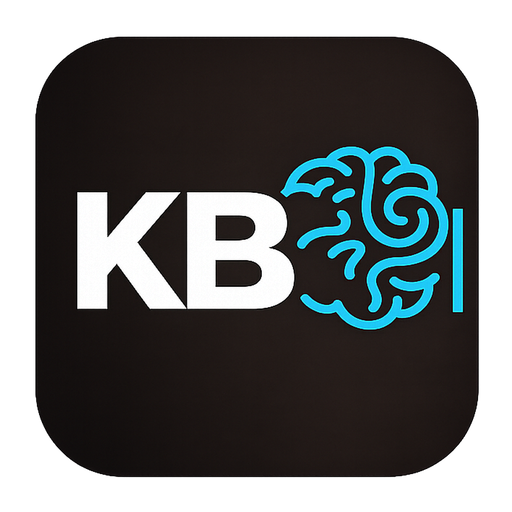

# Kokobrain

**A local-first second brain for macOS.**
 
Plain Markdown files on your disk, a fast editor, and search that never leaves your machine.

[![Latest release][version-badge]][version-url]
[![Platform][platform-badge]][platform-url]
[![License][license-badge]][license-url]
[![CI][ci-badge]][ci-url]
[![Built with Claude Code][claude-badge]][claude-url]

[**Download**](#-download) &nbsp;·&nbsp;
[**Features**](docs/FEATURES.md) &nbsp;·&nbsp;
[**User Guide**](help/documentation/README.md) &nbsp;·&nbsp;
[**Docs**](docs/README.md) &nbsp;·&nbsp;
[**Privacy**](PRIVACY.md)

---

## Why Kokobrain

<table>
<tr>
<td width="33%" valign="top">

### 📂 Your files, your disk

Every note is a plain `.md` file in a folder you choose. No cloud storage, no account, no proprietary format. Open your vault in any editor, back it up any way you like.

</td>
<td width="33%" valign="top">

### 🔒 Private by design

Full-text and semantic search run on your Mac. The models are downloaded once and run offline. No analytics, no tracking, no account; error reporting, Todoist sync and automatic update checks are opt-in. See [PRIVACY.md](PRIVACY.md).

</td>
<td width="33%" valign="top">

### ⚡ Native and fast

A Tauri 2 shell with a Rust core indexes the vault, keeps backlinks, tags and tasks up to date, and watches the folder for changes. The UI is Svelte 5 with a CodeMirror 6 live-preview editor.

</td>
</tr>
</table>

## ✨ Highlights

<table>
<tr>
<td width="33%" valign="top">
✏️ <a href="help/documentation/03-editor.md"><b>Live-preview editor</b></a> 
Markdown with wikilinks, embeds, block references and inline meta-bind inputs.
</td>
<td width="33%" valign="top">
🔍 <a href="help/documentation/06-search-and-navigation.md"><b>Hybrid search</b></a> 
SQLite FTS5 plus a local semantic embedder, fused into one ranking.
</td>
<td width="33%" valign="top">
🕸 <a href="help/documentation/14-graph-view.md"><b>Graph view</b></a> 
An interactive map of how your notes connect, with a local view and filters.
</td>
</tr>
<tr>
<td width="33%" valign="top">
🗂 <a href="help/documentation/25-types-and-relationships.md"><b>Types and relationships</b></a> 
Note types, semantic links and an inbox lifecycle with archive and favorites.
</td>
<td width="33%" valign="top">
📊 <a href="help/documentation/12-collection.md"><b>Views</b></a> 
Tables and calendars of notes, queried by frontmatter properties, saved as <code>.view</code> files.
</td>
<td width="33%" valign="top">
🧮 <a href="help/documentation/13-queryjs.md"><b>QueryJS</b></a> 
A JavaScript API for programmatic queries, rendered as tables, lists and charts.
</td>
</tr>
<tr>
<td width="33%" valign="top">
🎨 <a href="help/documentation/11-canvas.md"><b>Canvas</b></a> 
An infinite board of text, file, link, image and group nodes, saved as JSON Canvas files.
</td>
<td width="33%" valign="top">
📋 <a href="help/documentation/21-kanban.md"><b>Kanban</b></a> and <a href="help/documentation/10-tasks-and-todoist.md"><b>Tasks</b></a> 
Boards, saved task views with grouping and filters, and <a href="help/documentation/29-todoist-sync.md">two-way Todoist sync</a>.
</td>
<td width="33%" valign="top">
📅 <a href="help/documentation/27-calendar.md"><b>Calendar</b></a> 
Day, week and month views where every event is a Markdown note.
</td>
</tr>
<tr>
<td width="33%" valign="top">
🗃 <a href="help/documentation/22-auto-organize.md"><b>Auto Organize</b></a> 
Rules that move, rename or create notes, set properties and run mod actions when a note is saved.
</td>
<td width="33%" valign="top">
📥 <a href="help/documentation/09-quick-notes-and-templates.md"><b>Quick Capture and Templates</b></a> 
A global capture popover, a silent clipboard shortcut, 1:1 meeting notes and reusable templates.
</td>
<td width="33%" valign="top">
🧩 <a href="help/documentation/28-mods.md"><b>Vault mods</b></a> (Labs) 
Off by default: JavaScript in your vault that adds rail buttons, actions and hooks on note saves and moves.
</td>
</tr>
</table>

**[See every feature →](docs/FEATURES.md)**

## 📦 Download

Grab the `.dmg` of the [**latest stable release**](https://github.com/diegorv/koko.brain/releases/latest) (Apple Silicon, code-signed). Stable and Nightly builds update in place from Settings > Update > Check for updates.

| Channel | What you get |
|---|---|
| **Stable** | Tagged releases. |
| **Pre-release** | Alpha, beta and RC builds ahead of a major version, installed by hand. |
| **Nightly** | The latest `main`, rebuilt as code changes land. |

Details on each channel and how versions are numbered: [Release Channels](docs/RELEASE-CHANNELS.md).

> [!NOTE]
> **macOS only, built for one person.** Kokobrain is a personal project and does not accept external contributions. Bug reports are welcome as issues.

## 🚦 Quality gates

The workflows that guard `main` and the release builds. A release, Stable or pre-release, is built only after CI, E2E, Secret Scan, Security and Privacy pass again on the tagged commit. Nightly builds skip that gate.

| Workflow | Status | What it checks |
|---|---|---|
| **Main checks** | [![Main checks][ci-badge]][ci-url] | CI (type checking, Vitest and `cargo test`, run for the side of the app that changed) and the Playwright E2E suite against the frontend with Tauri mocked, on every push to `main` that changes app code |
| **Secret Scan** | [![Secret Scan][secrets-badge]][secrets-url] | gitleaks on every push to `main` and every PR, docs included |
| **Commit policy** | [![Commit policy][commit-policy-badge]][commit-policy-url] | Flags a `fix:` commit that changes app code without a test or a `Test-Exempt:` trailer |
| **Security** | [![Security][security-badge]][security-url] | `pnpm audit`, `cargo audit` and the 5-day supply-chain quarantine, plus OSV-Scanner (report only) and a daily full-history gitleaks scan |
| **CodeQL** | [![CodeQL][codeql-badge]][codeql-url] | GitHub code scanning of TypeScript, Rust, Python and the workflows |
| **Privacy** | [![Privacy][privacy-badge]][privacy-url] | Fails on any external network call that is not on its allowlist; [PRIVACY.md](PRIVACY.md) explains each one |
| **Dependabot** | [![Dependabot][dependabot-badge]][dependabot-url] | Dependency update PRs |
| **Release** | [![Release][release-badge]][release-url] | Signed Stable and pre-release builds |
| **Nightly** | [![Nightly][nightly-badge]][nightly-url] | Signed builds of `main` |

How each workflow works and when it runs: [GITHUB-WORKFLOW.md](GITHUB-WORKFLOW.md).

## 🛠 Built with

Kokobrain is written entirely with [Claude Code](https://docs.anthropic.com/en/docs/claude-code), with human review. Setup, commands and the full stack breakdown live in [CONTRIBUTING.md](CONTRIBUTING.md).

## 📚 Learn more

- 📖 **[User Guide](help/documentation/README.md)**: how to use every feature
- ✨ **[Features](docs/FEATURES.md)**: the complete feature list
- 🧭 **[Documentation index](docs/README.md)**: architecture, patterns, testing and release docs
- 💡 **[Inspirations](docs/INSPIRATIONS.md)**: the tools and plugins that shaped Kokobrain
- 🔒 **[Privacy](PRIVACY.md)** and 🛡 **[Security](SECURITY.md)**: what runs offline, and how the supply chain is guarded

## 📄 License

Licensed under the [GNU Affero General Public License v3.0 or later](LICENSE).

<!-- Badge reference definitions -->

[ci-badge]: https://img.shields.io/github/actions/workflow/status/diegorv/koko.brain/main-checks.yml?branch=main&label=CI&logo=github&logoColor=white
[ci-url]: https://github.com/diegorv/koko.brain/actions/workflows/main-checks.yml
[secrets-badge]: https://img.shields.io/github/actions/workflow/status/diegorv/koko.brain/secrets.yml?branch=main&label=Secret%20Scan&logo=github&logoColor=white
[secrets-url]: https://github.com/diegorv/koko.brain/actions/workflows/secrets.yml
[commit-policy-badge]: https://img.shields.io/github/actions/workflow/status/diegorv/koko.brain/commit-policy.yml?branch=main&label=Commit%20policy&logo=github&logoColor=white
[commit-policy-url]: https://github.com/diegorv/koko.brain/actions/workflows/commit-policy.yml
[security-badge]: https://img.shields.io/github/actions/workflow/status/diegorv/koko.brain/security.yml?label=Security&logo=github&logoColor=white
[security-url]: https://github.com/diegorv/koko.brain/actions/workflows/security.yml
[codeql-badge]: https://img.shields.io/badge/CodeQL-enabled-2ea44f?logo=github&logoColor=white
[codeql-url]: https://github.com/diegorv/koko.brain/security/code-scanning
[privacy-badge]: https://img.shields.io/github/actions/workflow/status/diegorv/koko.brain/privacy.yml?label=Privacy&logo=github&logoColor=white
[privacy-url]: https://github.com/diegorv/koko.brain/actions/workflows/privacy.yml
[release-badge]: https://img.shields.io/github/actions/workflow/status/diegorv/koko.brain/release.yml?event=push&label=Release&logo=github&logoColor=white
[release-url]: https://github.com/diegorv/koko.brain/actions/workflows/release.yml
[nightly-badge]: https://img.shields.io/github/actions/workflow/status/diegorv/koko.brain/nightly.yml?label=Nightly&logo=github&logoColor=white
[nightly-url]: https://github.com/diegorv/koko.brain/actions/workflows/nightly.yml
[dependabot-badge]: https://img.shields.io/github/actions/workflow/status/diegorv/koko.brain/dependabot/dependabot-updates?label=Dependabot&logo=dependabot&logoColor=white
[dependabot-url]: https://github.com/diegorv/koko.brain/actions/workflows/dependabot/dependabot-updates
[version-badge]: https://img.shields.io/github/v/release/diegorv/koko.brain?include_prereleases&sort=semver&label=release&color=blue
[version-url]: https://github.com/diegorv/koko.brain/releases
[license-badge]: https://img.shields.io/badge/license-AGPL--3.0-blue
[license-url]: ./LICENSE
[platform-badge]: https://img.shields.io/badge/platform-macOS-lightgrey?logo=apple&logoColor=white
[platform-url]: https://github.com/diegorv/koko.brain#kokobrain
[claude-badge]: https://img.shields.io/badge/built%20with-Claude%20Code-D97757?logo=anthropic&logoColor=white
[claude-url]: https://docs.anthropic.com/en/docs/claude-code
