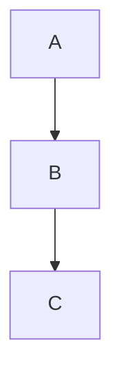

# Blocks reveal with the keyboard

Arrow into and out of each block from above and below. Expect: the block shows source while the cursor is inside it and renders again when you leave.

| col a | col b |
| ----- | ----- |
| 1     | 2     |
| 3     | 4     |

```js
const answer = 42;
console.log(answer);
```

$$
\int_0^1 x^2\,dx = \frac{1}{3}
$$



> [!note] A callout
> Body line one
> Body line two

![[01-arrows-bullet-heading]]

%%
A block comment that should be hidden
%%

Paragraph after all blocks.
