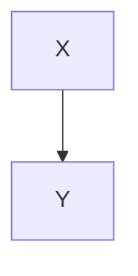

# Fenced code is respected

Expect: nothing inside the code fences below is rendered or executed.

```matlab
%% cell one
x = 1;
%% cell two
y = 2;
```

````md
```queryjs
dv.paragraph("THIS MUST NOT RUN")
```
````

````md

````

````md
```meta-bind-button
label: should not render
style: primary
action:
  type: command
  command: noop
```
````

```text
Inline comment %%inside code%% and [[wikilink inside code]] and https://example.com
```

Outside the fence: %%this comment is hidden%% and [[01-arrows-bullet-heading]] is a link.
