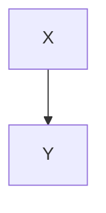

@@@ multi-line links and images (f7638b13, 121db924)
plain

[a](
/url)


[a
b](/url)

![a][r
s]

[r
s]: /url

after
@@@ nested callouts and a deep quote inside a callout (a404aebb)
plain

> [!note] Outer
> outer text
> > [!tip] Inner
> > inner text
> > > > deep quote
> back in outer
> > > three deep inside the callout

> [!warning]- Folded
> hidden body

after
@@@ comment markers inside a fenced block
plain

```matlab
%% cell one
x = 1;
%%
```

%% a real comment %%

text with %%inline%% comment
@@@ queryjs, mermaid and meta-bind-button fences inside an md fence
plain

````md
```queryjs
kb.paragraph("THIS MUST NOT RUN")
```
````

````md

````

````md
```meta-bind-button
label: should not render
style: primary
```
````

```text
[[wikilink inside code]] and  and `INPUT[toggle():done]`
```

after
@@@ hard breaks followed by a line
plain

line one  
line two\
line three

**bold**  
next line
@@@ bullet list right under frontmatter
---
title: Edge
tags: [a, b]
---
- one
- two
  - nested
- [ ] task

text
@@@ empty-label link next to a heading (df32aee9)
[](https://example.com)

# Heading

**bold** and *italic*

plain
@@@ an inline handler that throws on one construct (8d01b605)
plain

# Heading

==handler-fault== then **bold** and ==highlight==

[link](/url) and [[wikilink]]
